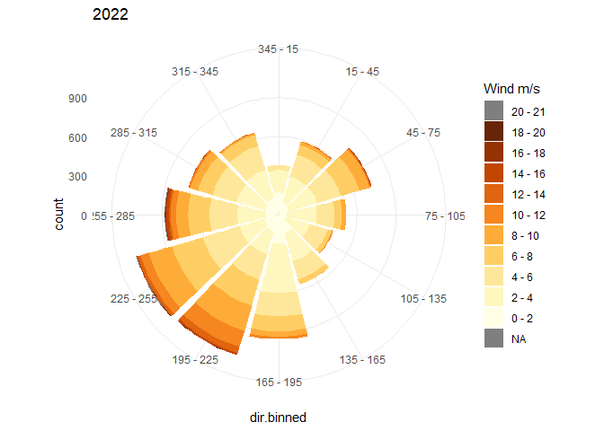
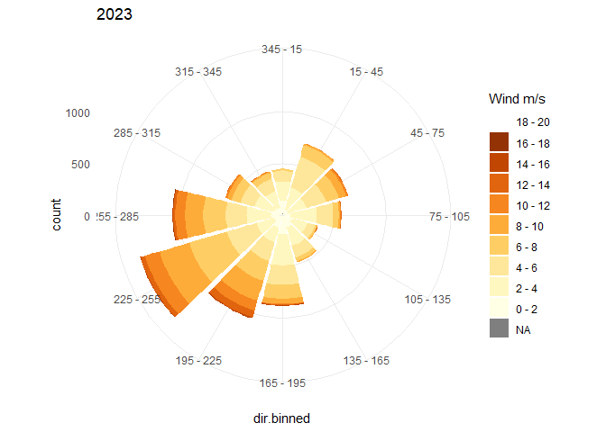
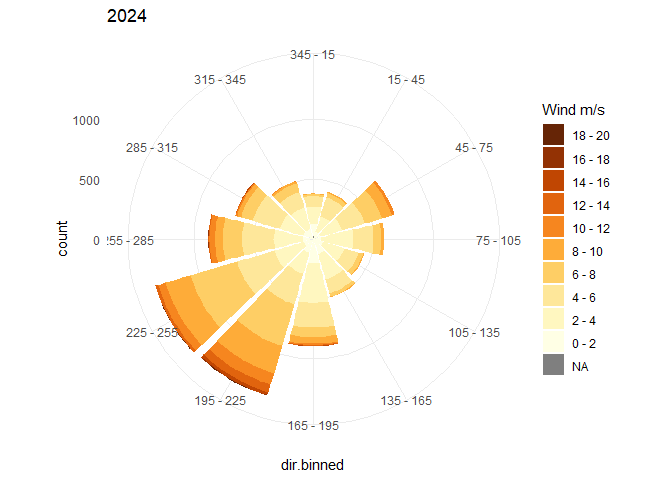
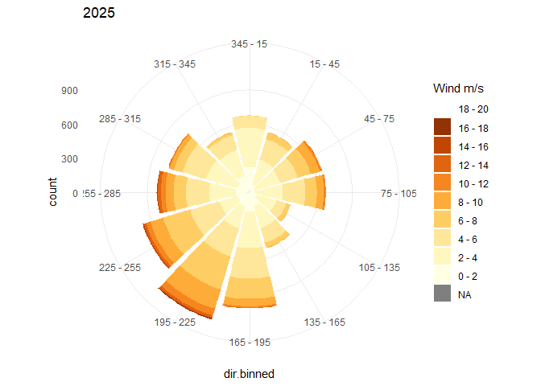
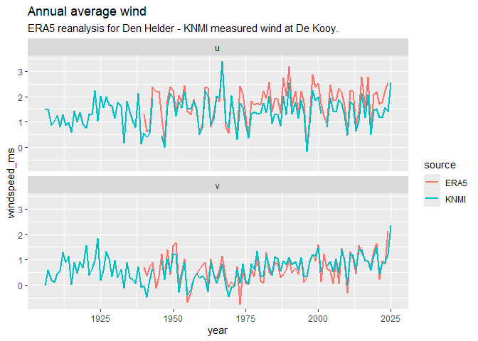
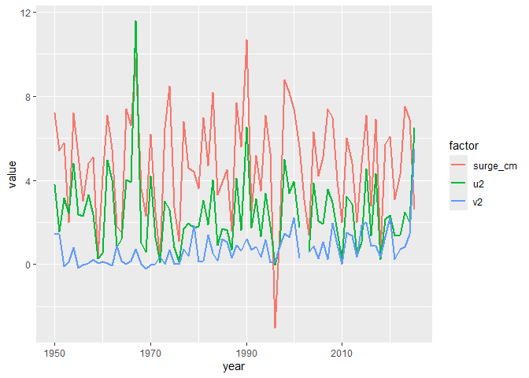
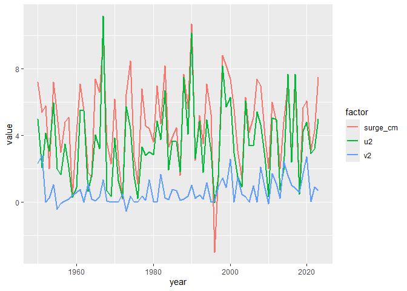

2024-09-12

# Compare GTSM with wind measurements and reanalyses

This notebook contains some basic checks of the GTSM surge data, and
comparisons with ERA5 reanalysis, and measured wind at Den Helder. It is
a “sanity check” for use of the GTSM surge data in the Sea Level
Monitor.

## Global Tide and Surge Model

The GTSM model results for wind surge were produced by Deltares (Muis et
al., 2016). Wind surge is extracted for the segement representative for
each one of the Dutch main tide gauge stations, and averaged per year.
This results in wind surge per year and station. Based on previous
comparisons with alternative corrections for wind, GTSM was chosen as
the preferential method (Deltares 2023).

A first glance at the GTSM wind surge results is shown below.

``` r
gtsm <- read_yearly_gtsm(filename = "../../data/deltares/gtsm/gtsm_surge_annual_mean_main_stations.csv") |>
  mutate(
    year = t,
    surge_mm = surge *1000
    ) %>% 
  dplyr::select(-t, -surge)

kableExtra::kable(align = "c",
    gtsm %>% arrange(-year),
    caption = "GTSM wind surge per station and year.",
    digits = 2
    ) %>%
  kableExtra::scroll_box(height = "500px") %>%
  kableExtra::kable_styling(full_width = T)
```

<div style="border: 1px solid #ddd; padding: 0px; overflow-y: scroll; height:500px; ">

<table class="table" style="color: black; margin-left: auto; margin-right: auto;">

<caption>

GTSM wind surge per station and year.
</caption>

<thead>

<tr>

<th style="text-align:center;position: sticky; top:0; background-color: #FFFFFF;">

name
</th>

<th style="text-align:center;position: sticky; top:0; background-color: #FFFFFF;">

ddl_id
</th>

<th style="text-align:center;position: sticky; top:0; background-color: #FFFFFF;">

year
</th>

<th style="text-align:center;position: sticky; top:0; background-color: #FFFFFF;">

surge_mm
</th>

</tr>

</thead>

<tbody>

<tr>

<td style="text-align:center;">

Delfzijl
</td>

<td style="text-align:center;">

DELFZL
</td>

<td style="text-align:center;">

2025
</td>

<td style="text-align:center;">

39
</td>

</tr>

<tr>

<td style="text-align:center;">

Den Helder
</td>

<td style="text-align:center;">

DENHDR
</td>

<td style="text-align:center;">

2025
</td>

<td style="text-align:center;">

26
</td>

</tr>

<tr>

<td style="text-align:center;">

Harlingen
</td>

<td style="text-align:center;">

HARLNGN
</td>

<td style="text-align:center;">

2025
</td>

<td style="text-align:center;">

41
</td>

</tr>

<tr>

<td style="text-align:center;">

Hoek van Holland
</td>

<td style="text-align:center;">

HOEKVHLD
</td>

<td style="text-align:center;">

2025
</td>

<td style="text-align:center;">

13
</td>

</tr>

<tr>

<td style="text-align:center;">

IJmuiden
</td>

<td style="text-align:center;">

IJMDBTHVN
</td>

<td style="text-align:center;">

2025
</td>

<td style="text-align:center;">

21
</td>

</tr>

<tr>

<td style="text-align:center;">

Vlissingen
</td>

<td style="text-align:center;">

VLISSGN
</td>

<td style="text-align:center;">

2025
</td>

<td style="text-align:center;">

7
</td>

</tr>

<tr>

<td style="text-align:center;">

Delfzijl
</td>

<td style="text-align:center;">

DELFZL
</td>

<td style="text-align:center;">

2024
</td>

<td style="text-align:center;">

73
</td>

</tr>

<tr>

<td style="text-align:center;">

Den Helder
</td>

<td style="text-align:center;">

DENHDR
</td>

<td style="text-align:center;">

2024
</td>

<td style="text-align:center;">

69
</td>

</tr>

<tr>

<td style="text-align:center;">

Harlingen
</td>

<td style="text-align:center;">

HARLNGN
</td>

<td style="text-align:center;">

2024
</td>

<td style="text-align:center;">

85
</td>

</tr>

<tr>

<td style="text-align:center;">

Hoek van Holland
</td>

<td style="text-align:center;">

HOEKVHLD
</td>

<td style="text-align:center;">

2024
</td>

<td style="text-align:center;">

57
</td>

</tr>

<tr>

<td style="text-align:center;">

IJmuiden
</td>

<td style="text-align:center;">

IJMDBTHVN
</td>

<td style="text-align:center;">

2024
</td>

<td style="text-align:center;">

67
</td>

</tr>

<tr>

<td style="text-align:center;">

Vlissingen
</td>

<td style="text-align:center;">

VLISSGN
</td>

<td style="text-align:center;">

2024
</td>

<td style="text-align:center;">

48
</td>

</tr>

<tr>

<td style="text-align:center;">

Delfzijl
</td>

<td style="text-align:center;">

DELFZL
</td>

<td style="text-align:center;">

2023
</td>

<td style="text-align:center;">

83
</td>

</tr>

<tr>

<td style="text-align:center;">

Den Helder
</td>

<td style="text-align:center;">

DENHDR
</td>

<td style="text-align:center;">

2023
</td>

<td style="text-align:center;">

75
</td>

</tr>

<tr>

<td style="text-align:center;">

Harlingen
</td>

<td style="text-align:center;">

HARLNGN
</td>

<td style="text-align:center;">

2023
</td>

<td style="text-align:center;">

95
</td>

</tr>

<tr>

<td style="text-align:center;">

Hoek van Holland
</td>

<td style="text-align:center;">

HOEKVHLD
</td>

<td style="text-align:center;">

2023
</td>

<td style="text-align:center;">

61
</td>

</tr>

<tr>

<td style="text-align:center;">

IJmuiden
</td>

<td style="text-align:center;">

IJMDBTHVN
</td>

<td style="text-align:center;">

2023
</td>

<td style="text-align:center;">

73
</td>

</tr>

<tr>

<td style="text-align:center;">

Vlissingen
</td>

<td style="text-align:center;">

VLISSGN
</td>

<td style="text-align:center;">

2023
</td>

<td style="text-align:center;">

51
</td>

</tr>

<tr>

<td style="text-align:center;">

Delfzijl
</td>

<td style="text-align:center;">

DELFZL
</td>

<td style="text-align:center;">

2022
</td>

<td style="text-align:center;">

61
</td>

</tr>

<tr>

<td style="text-align:center;">

Den Helder
</td>

<td style="text-align:center;">

DENHDR
</td>

<td style="text-align:center;">

2022
</td>

<td style="text-align:center;">

43
</td>

</tr>

<tr>

<td style="text-align:center;">

Harlingen
</td>

<td style="text-align:center;">

HARLNGN
</td>

<td style="text-align:center;">

2022
</td>

<td style="text-align:center;">

62
</td>

</tr>

<tr>

<td style="text-align:center;">

Hoek van Holland
</td>

<td style="text-align:center;">

HOEKVHLD
</td>

<td style="text-align:center;">

2022
</td>

<td style="text-align:center;">

27
</td>

</tr>

<tr>

<td style="text-align:center;">

IJmuiden
</td>

<td style="text-align:center;">

IJMDBTHVN
</td>

<td style="text-align:center;">

2022
</td>

<td style="text-align:center;">

38
</td>

</tr>

<tr>

<td style="text-align:center;">

Vlissingen
</td>

<td style="text-align:center;">

VLISSGN
</td>

<td style="text-align:center;">

2022
</td>

<td style="text-align:center;">

19
</td>

</tr>

<tr>

<td style="text-align:center;">

Delfzijl
</td>

<td style="text-align:center;">

DELFZL
</td>

<td style="text-align:center;">

2021
</td>

<td style="text-align:center;">

42
</td>

</tr>

<tr>

<td style="text-align:center;">

Den Helder
</td>

<td style="text-align:center;">

DENHDR
</td>

<td style="text-align:center;">

2021
</td>

<td style="text-align:center;">

31
</td>

</tr>

<tr>

<td style="text-align:center;">

Harlingen
</td>

<td style="text-align:center;">

HARLNGN
</td>

<td style="text-align:center;">

2021
</td>

<td style="text-align:center;">

46
</td>

</tr>

<tr>

<td style="text-align:center;">

Hoek van Holland
</td>

<td style="text-align:center;">

HOEKVHLD
</td>

<td style="text-align:center;">

2021
</td>

<td style="text-align:center;">

22
</td>

</tr>

<tr>

<td style="text-align:center;">

IJmuiden
</td>

<td style="text-align:center;">

IJMDBTHVN
</td>

<td style="text-align:center;">

2021
</td>

<td style="text-align:center;">

29
</td>

</tr>

<tr>

<td style="text-align:center;">

Vlissingen
</td>

<td style="text-align:center;">

VLISSGN
</td>

<td style="text-align:center;">

2021
</td>

<td style="text-align:center;">

15
</td>

</tr>

<tr>

<td style="text-align:center;">

Delfzijl
</td>

<td style="text-align:center;">

DELFZL
</td>

<td style="text-align:center;">

2020
</td>

<td style="text-align:center;">

72
</td>

</tr>

<tr>

<td style="text-align:center;">

Den Helder
</td>

<td style="text-align:center;">

DENHDR
</td>

<td style="text-align:center;">

2020
</td>

<td style="text-align:center;">

61
</td>

</tr>

<tr>

<td style="text-align:center;">

Harlingen
</td>

<td style="text-align:center;">

HARLNGN
</td>

<td style="text-align:center;">

2020
</td>

<td style="text-align:center;">

85
</td>

</tr>

<tr>

<td style="text-align:center;">

Hoek van Holland
</td>

<td style="text-align:center;">

HOEKVHLD
</td>

<td style="text-align:center;">

2020
</td>

<td style="text-align:center;">

41
</td>

</tr>

<tr>

<td style="text-align:center;">

IJmuiden
</td>

<td style="text-align:center;">

IJMDBTHVN
</td>

<td style="text-align:center;">

2020
</td>

<td style="text-align:center;">

55
</td>

</tr>

<tr>

<td style="text-align:center;">

Vlissingen
</td>

<td style="text-align:center;">

VLISSGN
</td>

<td style="text-align:center;">

2020
</td>

<td style="text-align:center;">

30
</td>

</tr>

<tr>

<td style="text-align:center;">

Delfzijl
</td>

<td style="text-align:center;">

DELFZL
</td>

<td style="text-align:center;">

2019
</td>

<td style="text-align:center;">

67
</td>

</tr>

<tr>

<td style="text-align:center;">

Den Helder
</td>

<td style="text-align:center;">

DENHDR
</td>

<td style="text-align:center;">

2019
</td>

<td style="text-align:center;">

57
</td>

</tr>

<tr>

<td style="text-align:center;">

Harlingen
</td>

<td style="text-align:center;">

HARLNGN
</td>

<td style="text-align:center;">

2019
</td>

<td style="text-align:center;">

76
</td>

</tr>

<tr>

<td style="text-align:center;">

Hoek van Holland
</td>

<td style="text-align:center;">

HOEKVHLD
</td>

<td style="text-align:center;">

2019
</td>

<td style="text-align:center;">

42
</td>

</tr>

<tr>

<td style="text-align:center;">

IJmuiden
</td>

<td style="text-align:center;">

IJMDBTHVN
</td>

<td style="text-align:center;">

2019
</td>

<td style="text-align:center;">

53
</td>

</tr>

<tr>

<td style="text-align:center;">

Vlissingen
</td>

<td style="text-align:center;">

VLISSGN
</td>

<td style="text-align:center;">

2019
</td>

<td style="text-align:center;">

34
</td>

</tr>

<tr>

<td style="text-align:center;">

Delfzijl
</td>

<td style="text-align:center;">

DELFZL
</td>

<td style="text-align:center;">

2018
</td>

<td style="text-align:center;">

16
</td>

</tr>

<tr>

<td style="text-align:center;">

Den Helder
</td>

<td style="text-align:center;">

DENHDR
</td>

<td style="text-align:center;">

2018
</td>

<td style="text-align:center;">

6
</td>

</tr>

<tr>

<td style="text-align:center;">

Harlingen
</td>

<td style="text-align:center;">

HARLNGN
</td>

<td style="text-align:center;">

2018
</td>

<td style="text-align:center;">

14
</td>

</tr>

<tr>

<td style="text-align:center;">

Hoek van Holland
</td>

<td style="text-align:center;">

HOEKVHLD
</td>

<td style="text-align:center;">

2018
</td>

<td style="text-align:center;">

1
</td>

</tr>

<tr>

<td style="text-align:center;">

IJmuiden
</td>

<td style="text-align:center;">

IJMDBTHVN
</td>

<td style="text-align:center;">

2018
</td>

<td style="text-align:center;">

4
</td>

</tr>

<tr>

<td style="text-align:center;">

Vlissingen
</td>

<td style="text-align:center;">

VLISSGN
</td>

<td style="text-align:center;">

2018
</td>

<td style="text-align:center;">

-2
</td>

</tr>

<tr>

<td style="text-align:center;">

Delfzijl
</td>

<td style="text-align:center;">

DELFZL
</td>

<td style="text-align:center;">

2017
</td>

<td style="text-align:center;">

88
</td>

</tr>

<tr>

<td style="text-align:center;">

Den Helder
</td>

<td style="text-align:center;">

DENHDR
</td>

<td style="text-align:center;">

2017
</td>

<td style="text-align:center;">

69
</td>

</tr>

<tr>

<td style="text-align:center;">

Harlingen
</td>

<td style="text-align:center;">

HARLNGN
</td>

<td style="text-align:center;">

2017
</td>

<td style="text-align:center;">

92
</td>

</tr>

<tr>

<td style="text-align:center;">

Hoek van Holland
</td>

<td style="text-align:center;">

HOEKVHLD
</td>

<td style="text-align:center;">

2017
</td>

<td style="text-align:center;">

52
</td>

</tr>

<tr>

<td style="text-align:center;">

IJmuiden
</td>

<td style="text-align:center;">

IJMDBTHVN
</td>

<td style="text-align:center;">

2017
</td>

<td style="text-align:center;">

64
</td>

</tr>

<tr>

<td style="text-align:center;">

Vlissingen
</td>

<td style="text-align:center;">

VLISSGN
</td>

<td style="text-align:center;">

2017
</td>

<td style="text-align:center;">

41
</td>

</tr>

<tr>

<td style="text-align:center;">

Delfzijl
</td>

<td style="text-align:center;">

DELFZL
</td>

<td style="text-align:center;">

2016
</td>

<td style="text-align:center;">

36
</td>

</tr>

<tr>

<td style="text-align:center;">

Den Helder
</td>

<td style="text-align:center;">

DENHDR
</td>

<td style="text-align:center;">

2016
</td>

<td style="text-align:center;">

28
</td>

</tr>

<tr>

<td style="text-align:center;">

Harlingen
</td>

<td style="text-align:center;">

HARLNGN
</td>

<td style="text-align:center;">

2016
</td>

<td style="text-align:center;">

43
</td>

</tr>

<tr>

<td style="text-align:center;">

Hoek van Holland
</td>

<td style="text-align:center;">

HOEKVHLD
</td>

<td style="text-align:center;">

2016
</td>

<td style="text-align:center;">

18
</td>

</tr>

<tr>

<td style="text-align:center;">

IJmuiden
</td>

<td style="text-align:center;">

IJMDBTHVN
</td>

<td style="text-align:center;">

2016
</td>

<td style="text-align:center;">

26
</td>

</tr>

<tr>

<td style="text-align:center;">

Vlissingen
</td>

<td style="text-align:center;">

VLISSGN
</td>

<td style="text-align:center;">

2016
</td>

<td style="text-align:center;">

13
</td>

</tr>

<tr>

<td style="text-align:center;">

Delfzijl
</td>

<td style="text-align:center;">

DELFZL
</td>

<td style="text-align:center;">

2015
</td>

<td style="text-align:center;">

95
</td>

</tr>

<tr>

<td style="text-align:center;">

Den Helder
</td>

<td style="text-align:center;">

DENHDR
</td>

<td style="text-align:center;">

2015
</td>

<td style="text-align:center;">

71
</td>

</tr>

<tr>

<td style="text-align:center;">

Harlingen
</td>

<td style="text-align:center;">

HARLNGN
</td>

<td style="text-align:center;">

2015
</td>

<td style="text-align:center;">

103
</td>

</tr>

<tr>

<td style="text-align:center;">

Hoek van Holland
</td>

<td style="text-align:center;">

HOEKVHLD
</td>

<td style="text-align:center;">

2015
</td>

<td style="text-align:center;">

46
</td>

</tr>

<tr>

<td style="text-align:center;">

IJmuiden
</td>

<td style="text-align:center;">

IJMDBTHVN
</td>

<td style="text-align:center;">

2015
</td>

<td style="text-align:center;">

63
</td>

</tr>

<tr>

<td style="text-align:center;">

Vlissingen
</td>

<td style="text-align:center;">

VLISSGN
</td>

<td style="text-align:center;">

2015
</td>

<td style="text-align:center;">

33
</td>

</tr>

<tr>

<td style="text-align:center;">

Delfzijl
</td>

<td style="text-align:center;">

DELFZL
</td>

<td style="text-align:center;">

2014
</td>

<td style="text-align:center;">

52
</td>

</tr>

<tr>

<td style="text-align:center;">

Den Helder
</td>

<td style="text-align:center;">

DENHDR
</td>

<td style="text-align:center;">

2014
</td>

<td style="text-align:center;">

48
</td>

</tr>

<tr>

<td style="text-align:center;">

Harlingen
</td>

<td style="text-align:center;">

HARLNGN
</td>

<td style="text-align:center;">

2014
</td>

<td style="text-align:center;">

64
</td>

</tr>

<tr>

<td style="text-align:center;">

Hoek van Holland
</td>

<td style="text-align:center;">

HOEKVHLD
</td>

<td style="text-align:center;">

2014
</td>

<td style="text-align:center;">

35
</td>

</tr>

<tr>

<td style="text-align:center;">

IJmuiden
</td>

<td style="text-align:center;">

IJMDBTHVN
</td>

<td style="text-align:center;">

2014
</td>

<td style="text-align:center;">

45
</td>

</tr>

<tr>

<td style="text-align:center;">

Vlissingen
</td>

<td style="text-align:center;">

VLISSGN
</td>

<td style="text-align:center;">

2014
</td>

<td style="text-align:center;">

27
</td>

</tr>

<tr>

<td style="text-align:center;">

Delfzijl
</td>

<td style="text-align:center;">

DELFZL
</td>

<td style="text-align:center;">

2013
</td>

<td style="text-align:center;">

30
</td>

</tr>

<tr>

<td style="text-align:center;">

Den Helder
</td>

<td style="text-align:center;">

DENHDR
</td>

<td style="text-align:center;">

2013
</td>

<td style="text-align:center;">

20
</td>

</tr>

<tr>

<td style="text-align:center;">

Harlingen
</td>

<td style="text-align:center;">

HARLNGN
</td>

<td style="text-align:center;">

2013
</td>

<td style="text-align:center;">

30
</td>

</tr>

<tr>

<td style="text-align:center;">

Hoek van Holland
</td>

<td style="text-align:center;">

HOEKVHLD
</td>

<td style="text-align:center;">

2013
</td>

<td style="text-align:center;">

14
</td>

</tr>

<tr>

<td style="text-align:center;">

IJmuiden
</td>

<td style="text-align:center;">

IJMDBTHVN
</td>

<td style="text-align:center;">

2013
</td>

<td style="text-align:center;">

19
</td>

</tr>

<tr>

<td style="text-align:center;">

Vlissingen
</td>

<td style="text-align:center;">

VLISSGN
</td>

<td style="text-align:center;">

2013
</td>

<td style="text-align:center;">

12
</td>

</tr>

<tr>

<td style="text-align:center;">

Delfzijl
</td>

<td style="text-align:center;">

DELFZL
</td>

<td style="text-align:center;">

2012
</td>

<td style="text-align:center;">

61
</td>

</tr>

<tr>

<td style="text-align:center;">

Den Helder
</td>

<td style="text-align:center;">

DENHDR
</td>

<td style="text-align:center;">

2012
</td>

<td style="text-align:center;">

48
</td>

</tr>

<tr>

<td style="text-align:center;">

Harlingen
</td>

<td style="text-align:center;">

HARLNGN
</td>

<td style="text-align:center;">

2012
</td>

<td style="text-align:center;">

68
</td>

</tr>

<tr>

<td style="text-align:center;">

Hoek van Holland
</td>

<td style="text-align:center;">

HOEKVHLD
</td>

<td style="text-align:center;">

2012
</td>

<td style="text-align:center;">

35
</td>

</tr>

<tr>

<td style="text-align:center;">

IJmuiden
</td>

<td style="text-align:center;">

IJMDBTHVN
</td>

<td style="text-align:center;">

2012
</td>

<td style="text-align:center;">

45
</td>

</tr>

<tr>

<td style="text-align:center;">

Vlissingen
</td>

<td style="text-align:center;">

VLISSGN
</td>

<td style="text-align:center;">

2012
</td>

<td style="text-align:center;">

27
</td>

</tr>

<tr>

<td style="text-align:center;">

Delfzijl
</td>

<td style="text-align:center;">

DELFZL
</td>

<td style="text-align:center;">

2011
</td>

<td style="text-align:center;">

76
</td>

</tr>

<tr>

<td style="text-align:center;">

Den Helder
</td>

<td style="text-align:center;">

DENHDR
</td>

<td style="text-align:center;">

2011
</td>

<td style="text-align:center;">

60
</td>

</tr>

<tr>

<td style="text-align:center;">

Harlingen
</td>

<td style="text-align:center;">

HARLNGN
</td>

<td style="text-align:center;">

2011
</td>

<td style="text-align:center;">

85
</td>

</tr>

<tr>

<td style="text-align:center;">

Hoek van Holland
</td>

<td style="text-align:center;">

HOEKVHLD
</td>

<td style="text-align:center;">

2011
</td>

<td style="text-align:center;">

41
</td>

</tr>

<tr>

<td style="text-align:center;">

IJmuiden
</td>

<td style="text-align:center;">

IJMDBTHVN
</td>

<td style="text-align:center;">

2011
</td>

<td style="text-align:center;">

54
</td>

</tr>

<tr>

<td style="text-align:center;">

Vlissingen
</td>

<td style="text-align:center;">

VLISSGN
</td>

<td style="text-align:center;">

2011
</td>

<td style="text-align:center;">

30
</td>

</tr>

<tr>

<td style="text-align:center;">

Delfzijl
</td>

<td style="text-align:center;">

DELFZL
</td>

<td style="text-align:center;">

2010
</td>

<td style="text-align:center;">

25
</td>

</tr>

<tr>

<td style="text-align:center;">

Den Helder
</td>

<td style="text-align:center;">

DENHDR
</td>

<td style="text-align:center;">

2010
</td>

<td style="text-align:center;">

20
</td>

</tr>

<tr>

<td style="text-align:center;">

Harlingen
</td>

<td style="text-align:center;">

HARLNGN
</td>

<td style="text-align:center;">

2010
</td>

<td style="text-align:center;">

23
</td>

</tr>

<tr>

<td style="text-align:center;">

Hoek van Holland
</td>

<td style="text-align:center;">

HOEKVHLD
</td>

<td style="text-align:center;">

2010
</td>

<td style="text-align:center;">

24
</td>

</tr>

<tr>

<td style="text-align:center;">

IJmuiden
</td>

<td style="text-align:center;">

IJMDBTHVN
</td>

<td style="text-align:center;">

2010
</td>

<td style="text-align:center;">

23
</td>

</tr>

<tr>

<td style="text-align:center;">

Vlissingen
</td>

<td style="text-align:center;">

VLISSGN
</td>

<td style="text-align:center;">

2010
</td>

<td style="text-align:center;">

24
</td>

</tr>

<tr>

<td style="text-align:center;">

Delfzijl
</td>

<td style="text-align:center;">

DELFZL
</td>

<td style="text-align:center;">

2009
</td>

<td style="text-align:center;">

47
</td>

</tr>

<tr>

<td style="text-align:center;">

Den Helder
</td>

<td style="text-align:center;">

DENHDR
</td>

<td style="text-align:center;">

2009
</td>

<td style="text-align:center;">

40
</td>

</tr>

<tr>

<td style="text-align:center;">

Harlingen
</td>

<td style="text-align:center;">

HARLNGN
</td>

<td style="text-align:center;">

2009
</td>

<td style="text-align:center;">

55
</td>

</tr>

<tr>

<td style="text-align:center;">

Hoek van Holland
</td>

<td style="text-align:center;">

HOEKVHLD
</td>

<td style="text-align:center;">

2009
</td>

<td style="text-align:center;">

31
</td>

</tr>

<tr>

<td style="text-align:center;">

IJmuiden
</td>

<td style="text-align:center;">

IJMDBTHVN
</td>

<td style="text-align:center;">

2009
</td>

<td style="text-align:center;">

39
</td>

</tr>

<tr>

<td style="text-align:center;">

Vlissingen
</td>

<td style="text-align:center;">

VLISSGN
</td>

<td style="text-align:center;">

2009
</td>

<td style="text-align:center;">

25
</td>

</tr>

<tr>

<td style="text-align:center;">

Delfzijl
</td>

<td style="text-align:center;">

DELFZL
</td>

<td style="text-align:center;">

2008
</td>

<td style="text-align:center;">

83
</td>

</tr>

<tr>

<td style="text-align:center;">

Den Helder
</td>

<td style="text-align:center;">

DENHDR
</td>

<td style="text-align:center;">

2008
</td>

<td style="text-align:center;">

70
</td>

</tr>

<tr>

<td style="text-align:center;">

Harlingen
</td>

<td style="text-align:center;">

HARLNGN
</td>

<td style="text-align:center;">

2008
</td>

<td style="text-align:center;">

93
</td>

</tr>

<tr>

<td style="text-align:center;">

Hoek van Holland
</td>

<td style="text-align:center;">

HOEKVHLD
</td>

<td style="text-align:center;">

2008
</td>

<td style="text-align:center;">

51
</td>

</tr>

<tr>

<td style="text-align:center;">

IJmuiden
</td>

<td style="text-align:center;">

IJMDBTHVN
</td>

<td style="text-align:center;">

2008
</td>

<td style="text-align:center;">

64
</td>

</tr>

<tr>

<td style="text-align:center;">

Vlissingen
</td>

<td style="text-align:center;">

VLISSGN
</td>

<td style="text-align:center;">

2008
</td>

<td style="text-align:center;">

40
</td>

</tr>

<tr>

<td style="text-align:center;">

Delfzijl
</td>

<td style="text-align:center;">

DELFZL
</td>

<td style="text-align:center;">

2007
</td>

<td style="text-align:center;">

95
</td>

</tr>

<tr>

<td style="text-align:center;">

Den Helder
</td>

<td style="text-align:center;">

DENHDR
</td>

<td style="text-align:center;">

2007
</td>

<td style="text-align:center;">

74
</td>

</tr>

<tr>

<td style="text-align:center;">

Harlingen
</td>

<td style="text-align:center;">

HARLNGN
</td>

<td style="text-align:center;">

2007
</td>

<td style="text-align:center;">

96
</td>

</tr>

<tr>

<td style="text-align:center;">

Hoek van Holland
</td>

<td style="text-align:center;">

HOEKVHLD
</td>

<td style="text-align:center;">

2007
</td>

<td style="text-align:center;">

61
</td>

</tr>

<tr>

<td style="text-align:center;">

IJmuiden
</td>

<td style="text-align:center;">

IJMDBTHVN
</td>

<td style="text-align:center;">

2007
</td>

<td style="text-align:center;">

71
</td>

</tr>

<tr>

<td style="text-align:center;">

Vlissingen
</td>

<td style="text-align:center;">

VLISSGN
</td>

<td style="text-align:center;">

2007
</td>

<td style="text-align:center;">

52
</td>

</tr>

<tr>

<td style="text-align:center;">

Delfzijl
</td>

<td style="text-align:center;">

DELFZL
</td>

<td style="text-align:center;">

2006
</td>

<td style="text-align:center;">

63
</td>

</tr>

<tr>

<td style="text-align:center;">

Den Helder
</td>

<td style="text-align:center;">

DENHDR
</td>

<td style="text-align:center;">

2006
</td>

<td style="text-align:center;">

51
</td>

</tr>

<tr>

<td style="text-align:center;">

Harlingen
</td>

<td style="text-align:center;">

HARLNGN
</td>

<td style="text-align:center;">

2006
</td>

<td style="text-align:center;">

70
</td>

</tr>

<tr>

<td style="text-align:center;">

Hoek van Holland
</td>

<td style="text-align:center;">

HOEKVHLD
</td>

<td style="text-align:center;">

2006
</td>

<td style="text-align:center;">

36
</td>

</tr>

<tr>

<td style="text-align:center;">

IJmuiden
</td>

<td style="text-align:center;">

IJMDBTHVN
</td>

<td style="text-align:center;">

2006
</td>

<td style="text-align:center;">

46
</td>

</tr>

<tr>

<td style="text-align:center;">

Vlissingen
</td>

<td style="text-align:center;">

VLISSGN
</td>

<td style="text-align:center;">

2006
</td>

<td style="text-align:center;">

27
</td>

</tr>

<tr>

<td style="text-align:center;">

Delfzijl
</td>

<td style="text-align:center;">

DELFZL
</td>

<td style="text-align:center;">

2005
</td>

<td style="text-align:center;">

56
</td>

</tr>

<tr>

<td style="text-align:center;">

Den Helder
</td>

<td style="text-align:center;">

DENHDR
</td>

<td style="text-align:center;">

2005
</td>

<td style="text-align:center;">

42
</td>

</tr>

<tr>

<td style="text-align:center;">

Harlingen
</td>

<td style="text-align:center;">

HARLNGN
</td>

<td style="text-align:center;">

2005
</td>

<td style="text-align:center;">

58
</td>

</tr>

<tr>

<td style="text-align:center;">

Hoek van Holland
</td>

<td style="text-align:center;">

HOEKVHLD
</td>

<td style="text-align:center;">

2005
</td>

<td style="text-align:center;">

34
</td>

</tr>

<tr>

<td style="text-align:center;">

IJmuiden
</td>

<td style="text-align:center;">

IJMDBTHVN
</td>

<td style="text-align:center;">

2005
</td>

<td style="text-align:center;">

41
</td>

</tr>

<tr>

<td style="text-align:center;">

Vlissingen
</td>

<td style="text-align:center;">

VLISSGN
</td>

<td style="text-align:center;">

2005
</td>

<td style="text-align:center;">

27
</td>

</tr>

<tr>

<td style="text-align:center;">

Delfzijl
</td>

<td style="text-align:center;">

DELFZL
</td>

<td style="text-align:center;">

2004
</td>

<td style="text-align:center;">

76
</td>

</tr>

<tr>

<td style="text-align:center;">

Den Helder
</td>

<td style="text-align:center;">

DENHDR
</td>

<td style="text-align:center;">

2004
</td>

<td style="text-align:center;">

63
</td>

</tr>

<tr>

<td style="text-align:center;">

Harlingen
</td>

<td style="text-align:center;">

HARLNGN
</td>

<td style="text-align:center;">

2004
</td>

<td style="text-align:center;">

85
</td>

</tr>

<tr>

<td style="text-align:center;">

Hoek van Holland
</td>

<td style="text-align:center;">

HOEKVHLD
</td>

<td style="text-align:center;">

2004
</td>

<td style="text-align:center;">

48
</td>

</tr>

<tr>

<td style="text-align:center;">

IJmuiden
</td>

<td style="text-align:center;">

IJMDBTHVN
</td>

<td style="text-align:center;">

2004
</td>

<td style="text-align:center;">

59
</td>

</tr>

<tr>

<td style="text-align:center;">

Vlissingen
</td>

<td style="text-align:center;">

VLISSGN
</td>

<td style="text-align:center;">

2004
</td>

<td style="text-align:center;">

37
</td>

</tr>

<tr>

<td style="text-align:center;">

Delfzijl
</td>

<td style="text-align:center;">

DELFZL
</td>

<td style="text-align:center;">

2003
</td>

<td style="text-align:center;">

32
</td>

</tr>

<tr>

<td style="text-align:center;">

Den Helder
</td>

<td style="text-align:center;">

DENHDR
</td>

<td style="text-align:center;">

2003
</td>

<td style="text-align:center;">

14
</td>

</tr>

<tr>

<td style="text-align:center;">

Harlingen
</td>

<td style="text-align:center;">

HARLNGN
</td>

<td style="text-align:center;">

2003
</td>

<td style="text-align:center;">

28
</td>

</tr>

<tr>

<td style="text-align:center;">

Hoek van Holland
</td>

<td style="text-align:center;">

HOEKVHLD
</td>

<td style="text-align:center;">

2003
</td>

<td style="text-align:center;">

6
</td>

</tr>

<tr>

<td style="text-align:center;">

IJmuiden
</td>

<td style="text-align:center;">

IJMDBTHVN
</td>

<td style="text-align:center;">

2003
</td>

<td style="text-align:center;">

11
</td>

</tr>

<tr>

<td style="text-align:center;">

Vlissingen
</td>

<td style="text-align:center;">

VLISSGN
</td>

<td style="text-align:center;">

2003
</td>

<td style="text-align:center;">

2
</td>

</tr>

<tr>

<td style="text-align:center;">

Delfzijl
</td>

<td style="text-align:center;">

DELFZL
</td>

<td style="text-align:center;">

2002
</td>

<td style="text-align:center;">

38
</td>

</tr>

<tr>

<td style="text-align:center;">

Den Helder
</td>

<td style="text-align:center;">

DENHDR
</td>

<td style="text-align:center;">

2002
</td>

<td style="text-align:center;">

31
</td>

</tr>

<tr>

<td style="text-align:center;">

Harlingen
</td>

<td style="text-align:center;">

HARLNGN
</td>

<td style="text-align:center;">

2002
</td>

<td style="text-align:center;">

46
</td>

</tr>

<tr>

<td style="text-align:center;">

Hoek van Holland
</td>

<td style="text-align:center;">

HOEKVHLD
</td>

<td style="text-align:center;">

2002
</td>

<td style="text-align:center;">

22
</td>

</tr>

<tr>

<td style="text-align:center;">

IJmuiden
</td>

<td style="text-align:center;">

IJMDBTHVN
</td>

<td style="text-align:center;">

2002
</td>

<td style="text-align:center;">

30
</td>

</tr>

<tr>

<td style="text-align:center;">

Vlissingen
</td>

<td style="text-align:center;">

VLISSGN
</td>

<td style="text-align:center;">

2002
</td>

<td style="text-align:center;">

17
</td>

</tr>

<tr>

<td style="text-align:center;">

Delfzijl
</td>

<td style="text-align:center;">

DELFZL
</td>

<td style="text-align:center;">

2001
</td>

<td style="text-align:center;">

63
</td>

</tr>

<tr>

<td style="text-align:center;">

Den Helder
</td>

<td style="text-align:center;">

DENHDR
</td>

<td style="text-align:center;">

2001
</td>

<td style="text-align:center;">

56
</td>

</tr>

<tr>

<td style="text-align:center;">

Harlingen
</td>

<td style="text-align:center;">

HARLNGN
</td>

<td style="text-align:center;">

2001
</td>

<td style="text-align:center;">

70
</td>

</tr>

<tr>

<td style="text-align:center;">

Hoek van Holland
</td>

<td style="text-align:center;">

HOEKVHLD
</td>

<td style="text-align:center;">

2001
</td>

<td style="text-align:center;">

49
</td>

</tr>

<tr>

<td style="text-align:center;">

IJmuiden
</td>

<td style="text-align:center;">

IJMDBTHVN
</td>

<td style="text-align:center;">

2001
</td>

<td style="text-align:center;">

56
</td>

</tr>

<tr>

<td style="text-align:center;">

Vlissingen
</td>

<td style="text-align:center;">

VLISSGN
</td>

<td style="text-align:center;">

2001
</td>

<td style="text-align:center;">

42
</td>

</tr>

<tr>

<td style="text-align:center;">

Delfzijl
</td>

<td style="text-align:center;">

DELFZL
</td>

<td style="text-align:center;">

2000
</td>

<td style="text-align:center;">

80
</td>

</tr>

<tr>

<td style="text-align:center;">

Den Helder
</td>

<td style="text-align:center;">

DENHDR
</td>

<td style="text-align:center;">

2000
</td>

<td style="text-align:center;">

74
</td>

</tr>

<tr>

<td style="text-align:center;">

Harlingen
</td>

<td style="text-align:center;">

HARLNGN
</td>

<td style="text-align:center;">

2000
</td>

<td style="text-align:center;">

97
</td>

</tr>

<tr>

<td style="text-align:center;">

Hoek van Holland
</td>

<td style="text-align:center;">

HOEKVHLD
</td>

<td style="text-align:center;">

2000
</td>

<td style="text-align:center;">

55
</td>

</tr>

<tr>

<td style="text-align:center;">

IJmuiden
</td>

<td style="text-align:center;">

IJMDBTHVN
</td>

<td style="text-align:center;">

2000
</td>

<td style="text-align:center;">

69
</td>

</tr>

<tr>

<td style="text-align:center;">

Vlissingen
</td>

<td style="text-align:center;">

VLISSGN
</td>

<td style="text-align:center;">

2000
</td>

<td style="text-align:center;">

43
</td>

</tr>

<tr>

<td style="text-align:center;">

Delfzijl
</td>

<td style="text-align:center;">

DELFZL
</td>

<td style="text-align:center;">

1999
</td>

<td style="text-align:center;">

92
</td>

</tr>

<tr>

<td style="text-align:center;">

Den Helder
</td>

<td style="text-align:center;">

DENHDR
</td>

<td style="text-align:center;">

1999
</td>

<td style="text-align:center;">

82
</td>

</tr>

<tr>

<td style="text-align:center;">

Harlingen
</td>

<td style="text-align:center;">

HARLNGN
</td>

<td style="text-align:center;">

1999
</td>

<td style="text-align:center;">

105
</td>

</tr>

<tr>

<td style="text-align:center;">

Hoek van Holland
</td>

<td style="text-align:center;">

HOEKVHLD
</td>

<td style="text-align:center;">

1999
</td>

<td style="text-align:center;">

65
</td>

</tr>

<tr>

<td style="text-align:center;">

IJmuiden
</td>

<td style="text-align:center;">

IJMDBTHVN
</td>

<td style="text-align:center;">

1999
</td>

<td style="text-align:center;">

78
</td>

</tr>

<tr>

<td style="text-align:center;">

Vlissingen
</td>

<td style="text-align:center;">

VLISSGN
</td>

<td style="text-align:center;">

1999
</td>

<td style="text-align:center;">

54
</td>

</tr>

<tr>

<td style="text-align:center;">

Delfzijl
</td>

<td style="text-align:center;">

DELFZL
</td>

<td style="text-align:center;">

1998
</td>

<td style="text-align:center;">

96
</td>

</tr>

<tr>

<td style="text-align:center;">

Den Helder
</td>

<td style="text-align:center;">

DENHDR
</td>

<td style="text-align:center;">

1998
</td>

<td style="text-align:center;">

88
</td>

</tr>

<tr>

<td style="text-align:center;">

Harlingen
</td>

<td style="text-align:center;">

HARLNGN
</td>

<td style="text-align:center;">

1998
</td>

<td style="text-align:center;">

113
</td>

</tr>

<tr>

<td style="text-align:center;">

Hoek van Holland
</td>

<td style="text-align:center;">

HOEKVHLD
</td>

<td style="text-align:center;">

1998
</td>

<td style="text-align:center;">

70
</td>

</tr>

<tr>

<td style="text-align:center;">

IJmuiden
</td>

<td style="text-align:center;">

IJMDBTHVN
</td>

<td style="text-align:center;">

1998
</td>

<td style="text-align:center;">

84
</td>

</tr>

<tr>

<td style="text-align:center;">

Vlissingen
</td>

<td style="text-align:center;">

VLISSGN
</td>

<td style="text-align:center;">

1998
</td>

<td style="text-align:center;">

57
</td>

</tr>

<tr>

<td style="text-align:center;">

Delfzijl
</td>

<td style="text-align:center;">

DELFZL
</td>

<td style="text-align:center;">

1997
</td>

<td style="text-align:center;">

33
</td>

</tr>

<tr>

<td style="text-align:center;">

Den Helder
</td>

<td style="text-align:center;">

DENHDR
</td>

<td style="text-align:center;">

1997
</td>

<td style="text-align:center;">

16
</td>

</tr>

<tr>

<td style="text-align:center;">

Harlingen
</td>

<td style="text-align:center;">

HARLNGN
</td>

<td style="text-align:center;">

1997
</td>

<td style="text-align:center;">

31
</td>

</tr>

<tr>

<td style="text-align:center;">

Hoek van Holland
</td>

<td style="text-align:center;">

HOEKVHLD
</td>

<td style="text-align:center;">

1997
</td>

<td style="text-align:center;">

5
</td>

</tr>

<tr>

<td style="text-align:center;">

IJmuiden
</td>

<td style="text-align:center;">

IJMDBTHVN
</td>

<td style="text-align:center;">

1997
</td>

<td style="text-align:center;">

12
</td>

</tr>

<tr>

<td style="text-align:center;">

Vlissingen
</td>

<td style="text-align:center;">

VLISSGN
</td>

<td style="text-align:center;">

1997
</td>

<td style="text-align:center;">

0
</td>

</tr>

<tr>

<td style="text-align:center;">

Delfzijl
</td>

<td style="text-align:center;">

DELFZL
</td>

<td style="text-align:center;">

1996
</td>

<td style="text-align:center;">

-22
</td>

</tr>

<tr>

<td style="text-align:center;">

Den Helder
</td>

<td style="text-align:center;">

DENHDR
</td>

<td style="text-align:center;">

1996
</td>

<td style="text-align:center;">

-30
</td>

</tr>

<tr>

<td style="text-align:center;">

Harlingen
</td>

<td style="text-align:center;">

HARLNGN
</td>

<td style="text-align:center;">

1996
</td>

<td style="text-align:center;">

-29
</td>

</tr>

<tr>

<td style="text-align:center;">

Hoek van Holland
</td>

<td style="text-align:center;">

HOEKVHLD
</td>

<td style="text-align:center;">

1996
</td>

<td style="text-align:center;">

-23
</td>

</tr>

<tr>

<td style="text-align:center;">

IJmuiden
</td>

<td style="text-align:center;">

IJMDBTHVN
</td>

<td style="text-align:center;">

1996
</td>

<td style="text-align:center;">

-26
</td>

</tr>

<tr>

<td style="text-align:center;">

Vlissingen
</td>

<td style="text-align:center;">

VLISSGN
</td>

<td style="text-align:center;">

1996
</td>

<td style="text-align:center;">

-19
</td>

</tr>

<tr>

<td style="text-align:center;">

Delfzijl
</td>

<td style="text-align:center;">

DELFZL
</td>

<td style="text-align:center;">

1995
</td>

<td style="text-align:center;">

70
</td>

</tr>

<tr>

<td style="text-align:center;">

Den Helder
</td>

<td style="text-align:center;">

DENHDR
</td>

<td style="text-align:center;">

1995
</td>

<td style="text-align:center;">

53
</td>

</tr>

<tr>

<td style="text-align:center;">

Harlingen
</td>

<td style="text-align:center;">

HARLNGN
</td>

<td style="text-align:center;">

1995
</td>

<td style="text-align:center;">

70
</td>

</tr>

<tr>

<td style="text-align:center;">

Hoek van Holland
</td>

<td style="text-align:center;">

HOEKVHLD
</td>

<td style="text-align:center;">

1995
</td>

<td style="text-align:center;">

43
</td>

</tr>

<tr>

<td style="text-align:center;">

IJmuiden
</td>

<td style="text-align:center;">

IJMDBTHVN
</td>

<td style="text-align:center;">

1995
</td>

<td style="text-align:center;">

51
</td>

</tr>

<tr>

<td style="text-align:center;">

Vlissingen
</td>

<td style="text-align:center;">

VLISSGN
</td>

<td style="text-align:center;">

1995
</td>

<td style="text-align:center;">

37
</td>

</tr>

<tr>

<td style="text-align:center;">

Delfzijl
</td>

<td style="text-align:center;">

DELFZL
</td>

<td style="text-align:center;">

1994
</td>

<td style="text-align:center;">

82
</td>

</tr>

<tr>

<td style="text-align:center;">

Den Helder
</td>

<td style="text-align:center;">

DENHDR
</td>

<td style="text-align:center;">

1994
</td>

<td style="text-align:center;">

71
</td>

</tr>

<tr>

<td style="text-align:center;">

Harlingen
</td>

<td style="text-align:center;">

HARLNGN
</td>

<td style="text-align:center;">

1994
</td>

<td style="text-align:center;">

94
</td>

</tr>

<tr>

<td style="text-align:center;">

Hoek van Holland
</td>

<td style="text-align:center;">

HOEKVHLD
</td>

<td style="text-align:center;">

1994
</td>

<td style="text-align:center;">

56
</td>

</tr>

<tr>

<td style="text-align:center;">

IJmuiden
</td>

<td style="text-align:center;">

IJMDBTHVN
</td>

<td style="text-align:center;">

1994
</td>

<td style="text-align:center;">

68
</td>

</tr>

<tr>

<td style="text-align:center;">

Vlissingen
</td>

<td style="text-align:center;">

VLISSGN
</td>

<td style="text-align:center;">

1994
</td>

<td style="text-align:center;">

46
</td>

</tr>

<tr>

<td style="text-align:center;">

Delfzijl
</td>

<td style="text-align:center;">

DELFZL
</td>

<td style="text-align:center;">

1993
</td>

<td style="text-align:center;">

51
</td>

</tr>

<tr>

<td style="text-align:center;">

Den Helder
</td>

<td style="text-align:center;">

DENHDR
</td>

<td style="text-align:center;">

1993
</td>

<td style="text-align:center;">

35
</td>

</tr>

<tr>

<td style="text-align:center;">

Harlingen
</td>

<td style="text-align:center;">

HARLNGN
</td>

<td style="text-align:center;">

1993
</td>

<td style="text-align:center;">

52
</td>

</tr>

<tr>

<td style="text-align:center;">

Hoek van Holland
</td>

<td style="text-align:center;">

HOEKVHLD
</td>

<td style="text-align:center;">

1993
</td>

<td style="text-align:center;">

27
</td>

</tr>

<tr>

<td style="text-align:center;">

IJmuiden
</td>

<td style="text-align:center;">

IJMDBTHVN
</td>

<td style="text-align:center;">

1993
</td>

<td style="text-align:center;">

34
</td>

</tr>

<tr>

<td style="text-align:center;">

Vlissingen
</td>

<td style="text-align:center;">

VLISSGN
</td>

<td style="text-align:center;">

1993
</td>

<td style="text-align:center;">

22
</td>

</tr>

<tr>

<td style="text-align:center;">

Delfzijl
</td>

<td style="text-align:center;">

DELFZL
</td>

<td style="text-align:center;">

1992
</td>

<td style="text-align:center;">

66
</td>

</tr>

<tr>

<td style="text-align:center;">

Den Helder
</td>

<td style="text-align:center;">

DENHDR
</td>

<td style="text-align:center;">

1992
</td>

<td style="text-align:center;">

52
</td>

</tr>

<tr>

<td style="text-align:center;">

Harlingen
</td>

<td style="text-align:center;">

HARLNGN
</td>

<td style="text-align:center;">

1992
</td>

<td style="text-align:center;">

73
</td>

</tr>

<tr>

<td style="text-align:center;">

Hoek van Holland
</td>

<td style="text-align:center;">

HOEKVHLD
</td>

<td style="text-align:center;">

1992
</td>

<td style="text-align:center;">

37
</td>

</tr>

<tr>

<td style="text-align:center;">

IJmuiden
</td>

<td style="text-align:center;">

IJMDBTHVN
</td>

<td style="text-align:center;">

1992
</td>

<td style="text-align:center;">

48
</td>

</tr>

<tr>

<td style="text-align:center;">

Vlissingen
</td>

<td style="text-align:center;">

VLISSGN
</td>

<td style="text-align:center;">

1992
</td>

<td style="text-align:center;">

27
</td>

</tr>

<tr>

<td style="text-align:center;">

Delfzijl
</td>

<td style="text-align:center;">

DELFZL
</td>

<td style="text-align:center;">

1991
</td>

<td style="text-align:center;">

48
</td>

</tr>

<tr>

<td style="text-align:center;">

Den Helder
</td>

<td style="text-align:center;">

DENHDR
</td>

<td style="text-align:center;">

1991
</td>

<td style="text-align:center;">

25
</td>

</tr>

<tr>

<td style="text-align:center;">

Harlingen
</td>

<td style="text-align:center;">

HARLNGN
</td>

<td style="text-align:center;">

1991
</td>

<td style="text-align:center;">

45
</td>

</tr>

<tr>

<td style="text-align:center;">

Hoek van Holland
</td>

<td style="text-align:center;">

HOEKVHLD
</td>

<td style="text-align:center;">

1991
</td>

<td style="text-align:center;">

13
</td>

</tr>

<tr>

<td style="text-align:center;">

IJmuiden
</td>

<td style="text-align:center;">

IJMDBTHVN
</td>

<td style="text-align:center;">

1991
</td>

<td style="text-align:center;">

22
</td>

</tr>

<tr>

<td style="text-align:center;">

Vlissingen
</td>

<td style="text-align:center;">

VLISSGN
</td>

<td style="text-align:center;">

1991
</td>

<td style="text-align:center;">

7
</td>

</tr>

<tr>

<td style="text-align:center;">

Delfzijl
</td>

<td style="text-align:center;">

DELFZL
</td>

<td style="text-align:center;">

1990
</td>

<td style="text-align:center;">

129
</td>

</tr>

<tr>

<td style="text-align:center;">

Den Helder
</td>

<td style="text-align:center;">

DENHDR
</td>

<td style="text-align:center;">

1990
</td>

<td style="text-align:center;">

107
</td>

</tr>

<tr>

<td style="text-align:center;">

Harlingen
</td>

<td style="text-align:center;">

HARLNGN
</td>

<td style="text-align:center;">

1990
</td>

<td style="text-align:center;">

141
</td>

</tr>

<tr>

<td style="text-align:center;">

Hoek van Holland
</td>

<td style="text-align:center;">

HOEKVHLD
</td>

<td style="text-align:center;">

1990
</td>

<td style="text-align:center;">

79
</td>

</tr>

<tr>

<td style="text-align:center;">

IJmuiden
</td>

<td style="text-align:center;">

IJMDBTHVN
</td>

<td style="text-align:center;">

1990
</td>

<td style="text-align:center;">

98
</td>

</tr>

<tr>

<td style="text-align:center;">

Vlissingen
</td>

<td style="text-align:center;">

VLISSGN
</td>

<td style="text-align:center;">

1990
</td>

<td style="text-align:center;">

64
</td>

</tr>

<tr>

<td style="text-align:center;">

Delfzijl
</td>

<td style="text-align:center;">

DELFZL
</td>

<td style="text-align:center;">

1989
</td>

<td style="text-align:center;">

75
</td>

</tr>

<tr>

<td style="text-align:center;">

Den Helder
</td>

<td style="text-align:center;">

DENHDR
</td>

<td style="text-align:center;">

1989
</td>

<td style="text-align:center;">

56
</td>

</tr>

<tr>

<td style="text-align:center;">

Harlingen
</td>

<td style="text-align:center;">

HARLNGN
</td>

<td style="text-align:center;">

1989
</td>

<td style="text-align:center;">

77
</td>

</tr>

<tr>

<td style="text-align:center;">

Hoek van Holland
</td>

<td style="text-align:center;">

HOEKVHLD
</td>

<td style="text-align:center;">

1989
</td>

<td style="text-align:center;">

40
</td>

</tr>

<tr>

<td style="text-align:center;">

IJmuiden
</td>

<td style="text-align:center;">

IJMDBTHVN
</td>

<td style="text-align:center;">

1989
</td>

<td style="text-align:center;">

51
</td>

</tr>

<tr>

<td style="text-align:center;">

Vlissingen
</td>

<td style="text-align:center;">

VLISSGN
</td>

<td style="text-align:center;">

1989
</td>

<td style="text-align:center;">

31
</td>

</tr>

<tr>

<td style="text-align:center;">

Delfzijl
</td>

<td style="text-align:center;">

DELFZL
</td>

<td style="text-align:center;">

1988
</td>

<td style="text-align:center;">

89
</td>

</tr>

<tr>

<td style="text-align:center;">

Den Helder
</td>

<td style="text-align:center;">

DENHDR
</td>

<td style="text-align:center;">

1988
</td>

<td style="text-align:center;">

77
</td>

</tr>

<tr>

<td style="text-align:center;">

Harlingen
</td>

<td style="text-align:center;">

HARLNGN
</td>

<td style="text-align:center;">

1988
</td>

<td style="text-align:center;">

101
</td>

</tr>

<tr>

<td style="text-align:center;">

Hoek van Holland
</td>

<td style="text-align:center;">

HOEKVHLD
</td>

<td style="text-align:center;">

1988
</td>

<td style="text-align:center;">

61
</td>

</tr>

<tr>

<td style="text-align:center;">

IJmuiden
</td>

<td style="text-align:center;">

IJMDBTHVN
</td>

<td style="text-align:center;">

1988
</td>

<td style="text-align:center;">

73
</td>

</tr>

<tr>

<td style="text-align:center;">

Vlissingen
</td>

<td style="text-align:center;">

VLISSGN
</td>

<td style="text-align:center;">

1988
</td>

<td style="text-align:center;">

51
</td>

</tr>

<tr>

<td style="text-align:center;">

Delfzijl
</td>

<td style="text-align:center;">

DELFZL
</td>

<td style="text-align:center;">

1987
</td>

<td style="text-align:center;">

25
</td>

</tr>

<tr>

<td style="text-align:center;">

Den Helder
</td>

<td style="text-align:center;">

DENHDR
</td>

<td style="text-align:center;">

1987
</td>

<td style="text-align:center;">

16
</td>

</tr>

<tr>

<td style="text-align:center;">

Harlingen
</td>

<td style="text-align:center;">

HARLNGN
</td>

<td style="text-align:center;">

1987
</td>

<td style="text-align:center;">

27
</td>

</tr>

<tr>

<td style="text-align:center;">

Hoek van Holland
</td>

<td style="text-align:center;">

HOEKVHLD
</td>

<td style="text-align:center;">

1987
</td>

<td style="text-align:center;">

11
</td>

</tr>

<tr>

<td style="text-align:center;">

IJmuiden
</td>

<td style="text-align:center;">

IJMDBTHVN
</td>

<td style="text-align:center;">

1987
</td>

<td style="text-align:center;">

16
</td>

</tr>

<tr>

<td style="text-align:center;">

Vlissingen
</td>

<td style="text-align:center;">

VLISSGN
</td>

<td style="text-align:center;">

1987
</td>

<td style="text-align:center;">

7
</td>

</tr>

<tr>

<td style="text-align:center;">

Delfzijl
</td>

<td style="text-align:center;">

DELFZL
</td>

<td style="text-align:center;">

1986
</td>

<td style="text-align:center;">

58
</td>

</tr>

<tr>

<td style="text-align:center;">

Den Helder
</td>

<td style="text-align:center;">

DENHDR
</td>

<td style="text-align:center;">

1986
</td>

<td style="text-align:center;">

45
</td>

</tr>

<tr>

<td style="text-align:center;">

Harlingen
</td>

<td style="text-align:center;">

HARLNGN
</td>

<td style="text-align:center;">

1986
</td>

<td style="text-align:center;">

65
</td>

</tr>

<tr>

<td style="text-align:center;">

Hoek van Holland
</td>

<td style="text-align:center;">

HOEKVHLD
</td>

<td style="text-align:center;">

1986
</td>

<td style="text-align:center;">

32
</td>

</tr>

<tr>

<td style="text-align:center;">

IJmuiden
</td>

<td style="text-align:center;">

IJMDBTHVN
</td>

<td style="text-align:center;">

1986
</td>

<td style="text-align:center;">

42
</td>

</tr>

<tr>

<td style="text-align:center;">

Vlissingen
</td>

<td style="text-align:center;">

VLISSGN
</td>

<td style="text-align:center;">

1986
</td>

<td style="text-align:center;">

24
</td>

</tr>

<tr>

<td style="text-align:center;">

Delfzijl
</td>

<td style="text-align:center;">

DELFZL
</td>

<td style="text-align:center;">

1985
</td>

<td style="text-align:center;">

54
</td>

</tr>

<tr>

<td style="text-align:center;">

Den Helder
</td>

<td style="text-align:center;">

DENHDR
</td>

<td style="text-align:center;">

1985
</td>

<td style="text-align:center;">

39
</td>

</tr>

<tr>

<td style="text-align:center;">

Harlingen
</td>

<td style="text-align:center;">

HARLNGN
</td>

<td style="text-align:center;">

1985
</td>

<td style="text-align:center;">

57
</td>

</tr>

<tr>

<td style="text-align:center;">

Hoek van Holland
</td>

<td style="text-align:center;">

HOEKVHLD
</td>

<td style="text-align:center;">

1985
</td>

<td style="text-align:center;">

27
</td>

</tr>

<tr>

<td style="text-align:center;">

IJmuiden
</td>

<td style="text-align:center;">

IJMDBTHVN
</td>

<td style="text-align:center;">

1985
</td>

<td style="text-align:center;">

36
</td>

</tr>

<tr>

<td style="text-align:center;">

Vlissingen
</td>

<td style="text-align:center;">

VLISSGN
</td>

<td style="text-align:center;">

1985
</td>

<td style="text-align:center;">

21
</td>

</tr>

<tr>

<td style="text-align:center;">

Delfzijl
</td>

<td style="text-align:center;">

DELFZL
</td>

<td style="text-align:center;">

1984
</td>

<td style="text-align:center;">

43
</td>

</tr>

<tr>

<td style="text-align:center;">

Den Helder
</td>

<td style="text-align:center;">

DENHDR
</td>

<td style="text-align:center;">

1984
</td>

<td style="text-align:center;">

33
</td>

</tr>

<tr>

<td style="text-align:center;">

Harlingen
</td>

<td style="text-align:center;">

HARLNGN
</td>

<td style="text-align:center;">

1984
</td>

<td style="text-align:center;">

50
</td>

</tr>

<tr>

<td style="text-align:center;">

Hoek van Holland
</td>

<td style="text-align:center;">

HOEKVHLD
</td>

<td style="text-align:center;">

1984
</td>

<td style="text-align:center;">

26
</td>

</tr>

<tr>

<td style="text-align:center;">

IJmuiden
</td>

<td style="text-align:center;">

IJMDBTHVN
</td>

<td style="text-align:center;">

1984
</td>

<td style="text-align:center;">

33
</td>

</tr>

<tr>

<td style="text-align:center;">

Vlissingen
</td>

<td style="text-align:center;">

VLISSGN
</td>

<td style="text-align:center;">

1984
</td>

<td style="text-align:center;">

21
</td>

</tr>

<tr>

<td style="text-align:center;">

Delfzijl
</td>

<td style="text-align:center;">

DELFZL
</td>

<td style="text-align:center;">

1983
</td>

<td style="text-align:center;">

104
</td>

</tr>

<tr>

<td style="text-align:center;">

Den Helder
</td>

<td style="text-align:center;">

DENHDR
</td>

<td style="text-align:center;">

1983
</td>

<td style="text-align:center;">

82
</td>

</tr>

<tr>

<td style="text-align:center;">

Harlingen
</td>

<td style="text-align:center;">

HARLNGN
</td>

<td style="text-align:center;">

1983
</td>

<td style="text-align:center;">

109
</td>

</tr>

<tr>

<td style="text-align:center;">

Hoek van Holland
</td>

<td style="text-align:center;">

HOEKVHLD
</td>

<td style="text-align:center;">

1983
</td>

<td style="text-align:center;">

63
</td>

</tr>

<tr>

<td style="text-align:center;">

IJmuiden
</td>

<td style="text-align:center;">

IJMDBTHVN
</td>

<td style="text-align:center;">

1983
</td>

<td style="text-align:center;">

76
</td>

</tr>

<tr>

<td style="text-align:center;">

Vlissingen
</td>

<td style="text-align:center;">

VLISSGN
</td>

<td style="text-align:center;">

1983
</td>

<td style="text-align:center;">

51
</td>

</tr>

<tr>

<td style="text-align:center;">

Delfzijl
</td>

<td style="text-align:center;">

DELFZL
</td>

<td style="text-align:center;">

1982
</td>

<td style="text-align:center;">

59
</td>

</tr>

<tr>

<td style="text-align:center;">

Den Helder
</td>

<td style="text-align:center;">

DENHDR
</td>

<td style="text-align:center;">

1982
</td>

<td style="text-align:center;">

47
</td>

</tr>

<tr>

<td style="text-align:center;">

Harlingen
</td>

<td style="text-align:center;">

HARLNGN
</td>

<td style="text-align:center;">

1982
</td>

<td style="text-align:center;">

70
</td>

</tr>

<tr>

<td style="text-align:center;">

Hoek van Holland
</td>

<td style="text-align:center;">

HOEKVHLD
</td>

<td style="text-align:center;">

1982
</td>

<td style="text-align:center;">

30
</td>

</tr>

<tr>

<td style="text-align:center;">

IJmuiden
</td>

<td style="text-align:center;">

IJMDBTHVN
</td>

<td style="text-align:center;">

1982
</td>

<td style="text-align:center;">

42
</td>

</tr>

<tr>

<td style="text-align:center;">

Vlissingen
</td>

<td style="text-align:center;">

VLISSGN
</td>

<td style="text-align:center;">

1982
</td>

<td style="text-align:center;">

20
</td>

</tr>

<tr>

<td style="text-align:center;">

Delfzijl
</td>

<td style="text-align:center;">

DELFZL
</td>

<td style="text-align:center;">

1981
</td>

<td style="text-align:center;">

87
</td>

</tr>

<tr>

<td style="text-align:center;">

Den Helder
</td>

<td style="text-align:center;">

DENHDR
</td>

<td style="text-align:center;">

1981
</td>

<td style="text-align:center;">

70
</td>

</tr>

<tr>

<td style="text-align:center;">

Harlingen
</td>

<td style="text-align:center;">

HARLNGN
</td>

<td style="text-align:center;">

1981
</td>

<td style="text-align:center;">

89
</td>

</tr>

<tr>

<td style="text-align:center;">

Hoek van Holland
</td>

<td style="text-align:center;">

HOEKVHLD
</td>

<td style="text-align:center;">

1981
</td>

<td style="text-align:center;">

59
</td>

</tr>

<tr>

<td style="text-align:center;">

IJmuiden
</td>

<td style="text-align:center;">

IJMDBTHVN
</td>

<td style="text-align:center;">

1981
</td>

<td style="text-align:center;">

68
</td>

</tr>

<tr>

<td style="text-align:center;">

Vlissingen
</td>

<td style="text-align:center;">

VLISSGN
</td>

<td style="text-align:center;">

1981
</td>

<td style="text-align:center;">

51
</td>

</tr>

<tr>

<td style="text-align:center;">

Delfzijl
</td>

<td style="text-align:center;">

DELFZL
</td>

<td style="text-align:center;">

1980
</td>

<td style="text-align:center;">

47
</td>

</tr>

<tr>

<td style="text-align:center;">

Den Helder
</td>

<td style="text-align:center;">

DENHDR
</td>

<td style="text-align:center;">

1980
</td>

<td style="text-align:center;">

36
</td>

</tr>

<tr>

<td style="text-align:center;">

Harlingen
</td>

<td style="text-align:center;">

HARLNGN
</td>

<td style="text-align:center;">

1980
</td>

<td style="text-align:center;">

51
</td>

</tr>

<tr>

<td style="text-align:center;">

Hoek van Holland
</td>

<td style="text-align:center;">

HOEKVHLD
</td>

<td style="text-align:center;">

1980
</td>

<td style="text-align:center;">

30
</td>

</tr>

<tr>

<td style="text-align:center;">

IJmuiden
</td>

<td style="text-align:center;">

IJMDBTHVN
</td>

<td style="text-align:center;">

1980
</td>

<td style="text-align:center;">

36
</td>

</tr>

<tr>

<td style="text-align:center;">

Vlissingen
</td>

<td style="text-align:center;">

VLISSGN
</td>

<td style="text-align:center;">

1980
</td>

<td style="text-align:center;">

25
</td>

</tr>

<tr>

<td style="text-align:center;">

Delfzijl
</td>

<td style="text-align:center;">

DELFZL
</td>

<td style="text-align:center;">

1979
</td>

<td style="text-align:center;">

42
</td>

</tr>

<tr>

<td style="text-align:center;">

Den Helder
</td>

<td style="text-align:center;">

DENHDR
</td>

<td style="text-align:center;">

1979
</td>

<td style="text-align:center;">

44
</td>

</tr>

<tr>

<td style="text-align:center;">

Harlingen
</td>

<td style="text-align:center;">

HARLNGN
</td>

<td style="text-align:center;">

1979
</td>

<td style="text-align:center;">

56
</td>

</tr>

<tr>

<td style="text-align:center;">

Hoek van Holland
</td>

<td style="text-align:center;">

HOEKVHLD
</td>

<td style="text-align:center;">

1979
</td>

<td style="text-align:center;">

36
</td>

</tr>

<tr>

<td style="text-align:center;">

IJmuiden
</td>

<td style="text-align:center;">

IJMDBTHVN
</td>

<td style="text-align:center;">

1979
</td>

<td style="text-align:center;">

43
</td>

</tr>

<tr>

<td style="text-align:center;">

Vlissingen
</td>

<td style="text-align:center;">

VLISSGN
</td>

<td style="text-align:center;">

1979
</td>

<td style="text-align:center;">

31
</td>

</tr>

<tr>

<td style="text-align:center;">

Delfzijl
</td>

<td style="text-align:center;">

DELFZL
</td>

<td style="text-align:center;">

1978
</td>

<td style="text-align:center;">

53
</td>

</tr>

<tr>

<td style="text-align:center;">

Den Helder
</td>

<td style="text-align:center;">

DENHDR
</td>

<td style="text-align:center;">

1978
</td>

<td style="text-align:center;">

46
</td>

</tr>

<tr>

<td style="text-align:center;">

Harlingen
</td>

<td style="text-align:center;">

HARLNGN
</td>

<td style="text-align:center;">

1978
</td>

<td style="text-align:center;">

58
</td>

</tr>

<tr>

<td style="text-align:center;">

Hoek van Holland
</td>

<td style="text-align:center;">

HOEKVHLD
</td>

<td style="text-align:center;">

1978
</td>

<td style="text-align:center;">

40
</td>

</tr>

<tr>

<td style="text-align:center;">

IJmuiden
</td>

<td style="text-align:center;">

IJMDBTHVN
</td>

<td style="text-align:center;">

1978
</td>

<td style="text-align:center;">

46
</td>

</tr>

<tr>

<td style="text-align:center;">

Vlissingen
</td>

<td style="text-align:center;">

VLISSGN
</td>

<td style="text-align:center;">

1978
</td>

<td style="text-align:center;">

35
</td>

</tr>

<tr>

<td style="text-align:center;">

Delfzijl
</td>

<td style="text-align:center;">

DELFZL
</td>

<td style="text-align:center;">

1977
</td>

<td style="text-align:center;">

73
</td>

</tr>

<tr>

<td style="text-align:center;">

Den Helder
</td>

<td style="text-align:center;">

DENHDR
</td>

<td style="text-align:center;">

1977
</td>

<td style="text-align:center;">

68
</td>

</tr>

<tr>

<td style="text-align:center;">

Harlingen
</td>

<td style="text-align:center;">

HARLNGN
</td>

<td style="text-align:center;">

1977
</td>

<td style="text-align:center;">

86
</td>

</tr>

<tr>

<td style="text-align:center;">

Hoek van Holland
</td>

<td style="text-align:center;">

HOEKVHLD
</td>

<td style="text-align:center;">

1977
</td>

<td style="text-align:center;">

58
</td>

</tr>

<tr>

<td style="text-align:center;">

IJmuiden
</td>

<td style="text-align:center;">

IJMDBTHVN
</td>

<td style="text-align:center;">

1977
</td>

<td style="text-align:center;">

67
</td>

</tr>

<tr>

<td style="text-align:center;">

Vlissingen
</td>

<td style="text-align:center;">

VLISSGN
</td>

<td style="text-align:center;">

1977
</td>

<td style="text-align:center;">

50
</td>

</tr>

<tr>

<td style="text-align:center;">

Delfzijl
</td>

<td style="text-align:center;">

DELFZL
</td>

<td style="text-align:center;">

1976
</td>

<td style="text-align:center;">

26
</td>

</tr>

<tr>

<td style="text-align:center;">

Den Helder
</td>

<td style="text-align:center;">

DENHDR
</td>

<td style="text-align:center;">

1976
</td>

<td style="text-align:center;">

11
</td>

</tr>

<tr>

<td style="text-align:center;">

Harlingen
</td>

<td style="text-align:center;">

HARLNGN
</td>

<td style="text-align:center;">

1976
</td>

<td style="text-align:center;">

20
</td>

</tr>

<tr>

<td style="text-align:center;">

Hoek van Holland
</td>

<td style="text-align:center;">

HOEKVHLD
</td>

<td style="text-align:center;">

1976
</td>

<td style="text-align:center;">

9
</td>

</tr>

<tr>

<td style="text-align:center;">

IJmuiden
</td>

<td style="text-align:center;">

IJMDBTHVN
</td>

<td style="text-align:center;">

1976
</td>

<td style="text-align:center;">

12
</td>

</tr>

<tr>

<td style="text-align:center;">

Vlissingen
</td>

<td style="text-align:center;">

VLISSGN
</td>

<td style="text-align:center;">

1976
</td>

<td style="text-align:center;">

7
</td>

</tr>

<tr>

<td style="text-align:center;">

Delfzijl
</td>

<td style="text-align:center;">

DELFZL
</td>

<td style="text-align:center;">

1975
</td>

<td style="text-align:center;">

41
</td>

</tr>

<tr>

<td style="text-align:center;">

Den Helder
</td>

<td style="text-align:center;">

DENHDR
</td>

<td style="text-align:center;">

1975
</td>

<td style="text-align:center;">

27
</td>

</tr>

<tr>

<td style="text-align:center;">

Harlingen
</td>

<td style="text-align:center;">

HARLNGN
</td>

<td style="text-align:center;">

1975
</td>

<td style="text-align:center;">

41
</td>

</tr>

<tr>

<td style="text-align:center;">

Hoek van Holland
</td>

<td style="text-align:center;">

HOEKVHLD
</td>

<td style="text-align:center;">

1975
</td>

<td style="text-align:center;">

19
</td>

</tr>

<tr>

<td style="text-align:center;">

IJmuiden
</td>

<td style="text-align:center;">

IJMDBTHVN
</td>

<td style="text-align:center;">

1975
</td>

<td style="text-align:center;">

24
</td>

</tr>

<tr>

<td style="text-align:center;">

Vlissingen
</td>

<td style="text-align:center;">

VLISSGN
</td>

<td style="text-align:center;">

1975
</td>

<td style="text-align:center;">

14
</td>

</tr>

<tr>

<td style="text-align:center;">

Delfzijl
</td>

<td style="text-align:center;">

DELFZL
</td>

<td style="text-align:center;">

1974
</td>

<td style="text-align:center;">

87
</td>

</tr>

<tr>

<td style="text-align:center;">

Den Helder
</td>

<td style="text-align:center;">

DENHDR
</td>

<td style="text-align:center;">

1974
</td>

<td style="text-align:center;">

85
</td>

</tr>

<tr>

<td style="text-align:center;">

Harlingen
</td>

<td style="text-align:center;">

HARLNGN
</td>

<td style="text-align:center;">

1974
</td>

<td style="text-align:center;">

104
</td>

</tr>

<tr>

<td style="text-align:center;">

Hoek van Holland
</td>

<td style="text-align:center;">

HOEKVHLD
</td>

<td style="text-align:center;">

1974
</td>

<td style="text-align:center;">

73
</td>

</tr>

<tr>

<td style="text-align:center;">

IJmuiden
</td>

<td style="text-align:center;">

IJMDBTHVN
</td>

<td style="text-align:center;">

1974
</td>

<td style="text-align:center;">

84
</td>

</tr>

<tr>

<td style="text-align:center;">

Vlissingen
</td>

<td style="text-align:center;">

VLISSGN
</td>

<td style="text-align:center;">

1974
</td>

<td style="text-align:center;">

65
</td>

</tr>

<tr>

<td style="text-align:center;">

Delfzijl
</td>

<td style="text-align:center;">

DELFZL
</td>

<td style="text-align:center;">

1973
</td>

<td style="text-align:center;">

90
</td>

</tr>

<tr>

<td style="text-align:center;">

Den Helder
</td>

<td style="text-align:center;">

DENHDR
</td>

<td style="text-align:center;">

1973
</td>

<td style="text-align:center;">

65
</td>

</tr>

<tr>

<td style="text-align:center;">

Harlingen
</td>

<td style="text-align:center;">

HARLNGN
</td>

<td style="text-align:center;">

1973
</td>

<td style="text-align:center;">

86
</td>

</tr>

<tr>

<td style="text-align:center;">

Hoek van Holland
</td>

<td style="text-align:center;">

HOEKVHLD
</td>

<td style="text-align:center;">

1973
</td>

<td style="text-align:center;">

52
</td>

</tr>

<tr>

<td style="text-align:center;">

IJmuiden
</td>

<td style="text-align:center;">

IJMDBTHVN
</td>

<td style="text-align:center;">

1973
</td>

<td style="text-align:center;">

62
</td>

</tr>

<tr>

<td style="text-align:center;">

Vlissingen
</td>

<td style="text-align:center;">

VLISSGN
</td>

<td style="text-align:center;">

1973
</td>

<td style="text-align:center;">

42
</td>

</tr>

<tr>

<td style="text-align:center;">

Delfzijl
</td>

<td style="text-align:center;">

DELFZL
</td>

<td style="text-align:center;">

1972
</td>

<td style="text-align:center;">

6
</td>

</tr>

<tr>

<td style="text-align:center;">

Den Helder
</td>

<td style="text-align:center;">

DENHDR
</td>

<td style="text-align:center;">

1972
</td>

<td style="text-align:center;">

2
</td>

</tr>

<tr>

<td style="text-align:center;">

Harlingen
</td>

<td style="text-align:center;">

HARLNGN
</td>

<td style="text-align:center;">

1972
</td>

<td style="text-align:center;">

11
</td>

</tr>

<tr>

<td style="text-align:center;">

Hoek van Holland
</td>

<td style="text-align:center;">

HOEKVHLD
</td>

<td style="text-align:center;">

1972
</td>

<td style="text-align:center;">

-1
</td>

</tr>

<tr>

<td style="text-align:center;">

IJmuiden
</td>

<td style="text-align:center;">

IJMDBTHVN
</td>

<td style="text-align:center;">

1972
</td>

<td style="text-align:center;">

3
</td>

</tr>

<tr>

<td style="text-align:center;">

Vlissingen
</td>

<td style="text-align:center;">

VLISSGN
</td>

<td style="text-align:center;">

1972
</td>

<td style="text-align:center;">

-2
</td>

</tr>

<tr>

<td style="text-align:center;">

Delfzijl
</td>

<td style="text-align:center;">

DELFZL
</td>

<td style="text-align:center;">

1971
</td>

<td style="text-align:center;">

41
</td>

</tr>

<tr>

<td style="text-align:center;">

Den Helder
</td>

<td style="text-align:center;">

DENHDR
</td>

<td style="text-align:center;">

1971
</td>

<td style="text-align:center;">

25
</td>

</tr>

<tr>

<td style="text-align:center;">

Harlingen
</td>

<td style="text-align:center;">

HARLNGN
</td>

<td style="text-align:center;">

1971
</td>

<td style="text-align:center;">

37
</td>

</tr>

<tr>

<td style="text-align:center;">

Hoek van Holland
</td>

<td style="text-align:center;">

HOEKVHLD
</td>

<td style="text-align:center;">

1971
</td>

<td style="text-align:center;">

18
</td>

</tr>

<tr>

<td style="text-align:center;">

IJmuiden
</td>

<td style="text-align:center;">

IJMDBTHVN
</td>

<td style="text-align:center;">

1971
</td>

<td style="text-align:center;">

23
</td>

</tr>

<tr>

<td style="text-align:center;">

Vlissingen
</td>

<td style="text-align:center;">

VLISSGN
</td>

<td style="text-align:center;">

1971
</td>

<td style="text-align:center;">

14
</td>

</tr>

<tr>

<td style="text-align:center;">

Delfzijl
</td>

<td style="text-align:center;">

DELFZL
</td>

<td style="text-align:center;">

1970
</td>

<td style="text-align:center;">

70
</td>

</tr>

<tr>

<td style="text-align:center;">

Den Helder
</td>

<td style="text-align:center;">

DENHDR
</td>

<td style="text-align:center;">

1970
</td>

<td style="text-align:center;">

62
</td>

</tr>

<tr>

<td style="text-align:center;">

Harlingen
</td>

<td style="text-align:center;">

HARLNGN
</td>

<td style="text-align:center;">

1970
</td>

<td style="text-align:center;">

79
</td>

</tr>

<tr>

<td style="text-align:center;">

Hoek van Holland
</td>

<td style="text-align:center;">

HOEKVHLD
</td>

<td style="text-align:center;">

1970
</td>

<td style="text-align:center;">

55
</td>

</tr>

<tr>

<td style="text-align:center;">

IJmuiden
</td>

<td style="text-align:center;">

IJMDBTHVN
</td>

<td style="text-align:center;">

1970
</td>

<td style="text-align:center;">

63
</td>

</tr>

<tr>

<td style="text-align:center;">

Vlissingen
</td>

<td style="text-align:center;">

VLISSGN
</td>

<td style="text-align:center;">

1970
</td>

<td style="text-align:center;">

49
</td>

</tr>

<tr>

<td style="text-align:center;">

Delfzijl
</td>

<td style="text-align:center;">

DELFZL
</td>

<td style="text-align:center;">

1969
</td>

<td style="text-align:center;">

24
</td>

</tr>

<tr>

<td style="text-align:center;">

Den Helder
</td>

<td style="text-align:center;">

DENHDR
</td>

<td style="text-align:center;">

1969
</td>

<td style="text-align:center;">

23
</td>

</tr>

<tr>

<td style="text-align:center;">

Harlingen
</td>

<td style="text-align:center;">

HARLNGN
</td>

<td style="text-align:center;">

1969
</td>

<td style="text-align:center;">

28
</td>

</tr>

<tr>

<td style="text-align:center;">

Hoek van Holland
</td>

<td style="text-align:center;">

HOEKVHLD
</td>

<td style="text-align:center;">

1969
</td>

<td style="text-align:center;">

26
</td>

</tr>

<tr>

<td style="text-align:center;">

IJmuiden
</td>

<td style="text-align:center;">

IJMDBTHVN
</td>

<td style="text-align:center;">

1969
</td>

<td style="text-align:center;">

27
</td>

</tr>

<tr>

<td style="text-align:center;">

Vlissingen
</td>

<td style="text-align:center;">

VLISSGN
</td>

<td style="text-align:center;">

1969
</td>

<td style="text-align:center;">

25
</td>

</tr>

<tr>

<td style="text-align:center;">

Delfzijl
</td>

<td style="text-align:center;">

DELFZL
</td>

<td style="text-align:center;">

1968
</td>

<td style="text-align:center;">

41
</td>

</tr>

<tr>

<td style="text-align:center;">

Den Helder
</td>

<td style="text-align:center;">

DENHDR
</td>

<td style="text-align:center;">

1968
</td>

<td style="text-align:center;">

36
</td>

</tr>

<tr>

<td style="text-align:center;">

Harlingen
</td>

<td style="text-align:center;">

HARLNGN
</td>

<td style="text-align:center;">

1968
</td>

<td style="text-align:center;">

46
</td>

</tr>

<tr>

<td style="text-align:center;">

Hoek van Holland
</td>

<td style="text-align:center;">

HOEKVHLD
</td>

<td style="text-align:center;">

1968
</td>

<td style="text-align:center;">

33
</td>

</tr>

<tr>

<td style="text-align:center;">

IJmuiden
</td>

<td style="text-align:center;">

IJMDBTHVN
</td>

<td style="text-align:center;">

1968
</td>

<td style="text-align:center;">

37
</td>

</tr>

<tr>

<td style="text-align:center;">

Vlissingen
</td>

<td style="text-align:center;">

VLISSGN
</td>

<td style="text-align:center;">

1968
</td>

<td style="text-align:center;">

30
</td>

</tr>

<tr>

<td style="text-align:center;">

Delfzijl
</td>

<td style="text-align:center;">

DELFZL
</td>

<td style="text-align:center;">

1967
</td>

<td style="text-align:center;">

113
</td>

</tr>

<tr>

<td style="text-align:center;">

Den Helder
</td>

<td style="text-align:center;">

DENHDR
</td>

<td style="text-align:center;">

1967
</td>

<td style="text-align:center;">

98
</td>

</tr>

<tr>

<td style="text-align:center;">

Harlingen
</td>

<td style="text-align:center;">

HARLNGN
</td>

<td style="text-align:center;">

1967
</td>

<td style="text-align:center;">

127
</td>

</tr>

<tr>

<td style="text-align:center;">

Hoek van Holland
</td>

<td style="text-align:center;">

HOEKVHLD
</td>

<td style="text-align:center;">

1967
</td>

<td style="text-align:center;">

74
</td>

</tr>

<tr>

<td style="text-align:center;">

IJmuiden
</td>

<td style="text-align:center;">

IJMDBTHVN
</td>

<td style="text-align:center;">

1967
</td>

<td style="text-align:center;">

91
</td>

</tr>

<tr>

<td style="text-align:center;">

Vlissingen
</td>

<td style="text-align:center;">

VLISSGN
</td>

<td style="text-align:center;">

1967
</td>

<td style="text-align:center;">

58
</td>

</tr>

<tr>

<td style="text-align:center;">

Delfzijl
</td>

<td style="text-align:center;">

DELFZL
</td>

<td style="text-align:center;">

1966
</td>

<td style="text-align:center;">

63
</td>

</tr>

<tr>

<td style="text-align:center;">

Den Helder
</td>

<td style="text-align:center;">

DENHDR
</td>

<td style="text-align:center;">

1966
</td>

<td style="text-align:center;">

66
</td>

</tr>

<tr>

<td style="text-align:center;">

Harlingen
</td>

<td style="text-align:center;">

HARLNGN
</td>

<td style="text-align:center;">

1966
</td>

<td style="text-align:center;">

79
</td>

</tr>

<tr>

<td style="text-align:center;">

Hoek van Holland
</td>

<td style="text-align:center;">

HOEKVHLD
</td>

<td style="text-align:center;">

1966
</td>

<td style="text-align:center;">

60
</td>

</tr>

<tr>

<td style="text-align:center;">

IJmuiden
</td>

<td style="text-align:center;">

IJMDBTHVN
</td>

<td style="text-align:center;">

1966
</td>

<td style="text-align:center;">

67
</td>

</tr>

<tr>

<td style="text-align:center;">

Vlissingen
</td>

<td style="text-align:center;">

VLISSGN
</td>

<td style="text-align:center;">

1966
</td>

<td style="text-align:center;">

53
</td>

</tr>

<tr>

<td style="text-align:center;">

Delfzijl
</td>

<td style="text-align:center;">

DELFZL
</td>

<td style="text-align:center;">

1965
</td>

<td style="text-align:center;">

80
</td>

</tr>

<tr>

<td style="text-align:center;">

Den Helder
</td>

<td style="text-align:center;">

DENHDR
</td>

<td style="text-align:center;">

1965
</td>

<td style="text-align:center;">

74
</td>

</tr>

<tr>

<td style="text-align:center;">

Harlingen
</td>

<td style="text-align:center;">

HARLNGN
</td>

<td style="text-align:center;">

1965
</td>

<td style="text-align:center;">

91
</td>

</tr>

<tr>

<td style="text-align:center;">

Hoek van Holland
</td>

<td style="text-align:center;">

HOEKVHLD
</td>

<td style="text-align:center;">

1965
</td>

<td style="text-align:center;">

64
</td>

</tr>

<tr>

<td style="text-align:center;">

IJmuiden
</td>

<td style="text-align:center;">

IJMDBTHVN
</td>

<td style="text-align:center;">

1965
</td>

<td style="text-align:center;">

74
</td>

</tr>

<tr>

<td style="text-align:center;">

Vlissingen
</td>

<td style="text-align:center;">

VLISSGN
</td>

<td style="text-align:center;">

1965
</td>

<td style="text-align:center;">

57
</td>

</tr>

<tr>

<td style="text-align:center;">

Delfzijl
</td>

<td style="text-align:center;">

DELFZL
</td>

<td style="text-align:center;">

1964
</td>

<td style="text-align:center;">

31
</td>

</tr>

<tr>

<td style="text-align:center;">

Den Helder
</td>

<td style="text-align:center;">

DENHDR
</td>

<td style="text-align:center;">

1964
</td>

<td style="text-align:center;">

15
</td>

</tr>

<tr>

<td style="text-align:center;">

Harlingen
</td>

<td style="text-align:center;">

HARLNGN
</td>

<td style="text-align:center;">

1964
</td>

<td style="text-align:center;">

29
</td>

</tr>

<tr>

<td style="text-align:center;">

Hoek van Holland
</td>

<td style="text-align:center;">

HOEKVHLD
</td>

<td style="text-align:center;">

1964
</td>

<td style="text-align:center;">

8
</td>

</tr>

<tr>

<td style="text-align:center;">

IJmuiden
</td>

<td style="text-align:center;">

IJMDBTHVN
</td>

<td style="text-align:center;">

1964
</td>

<td style="text-align:center;">

13
</td>

</tr>

<tr>

<td style="text-align:center;">

Vlissingen
</td>

<td style="text-align:center;">

VLISSGN
</td>

<td style="text-align:center;">

1964
</td>

<td style="text-align:center;">

3
</td>

</tr>

<tr>

<td style="text-align:center;">

Delfzijl
</td>

<td style="text-align:center;">

DELFZL
</td>

<td style="text-align:center;">

1963
</td>

<td style="text-align:center;">

25
</td>

</tr>

<tr>

<td style="text-align:center;">

Den Helder
</td>

<td style="text-align:center;">

DENHDR
</td>

<td style="text-align:center;">

1963
</td>

<td style="text-align:center;">

18
</td>

</tr>

<tr>

<td style="text-align:center;">

Harlingen
</td>

<td style="text-align:center;">

HARLNGN
</td>

<td style="text-align:center;">

1963
</td>

<td style="text-align:center;">

29
</td>

</tr>

<tr>

<td style="text-align:center;">

Hoek van Holland
</td>

<td style="text-align:center;">

HOEKVHLD
</td>

<td style="text-align:center;">

1963
</td>

<td style="text-align:center;">

13
</td>

</tr>

<tr>

<td style="text-align:center;">

IJmuiden
</td>

<td style="text-align:center;">

IJMDBTHVN
</td>

<td style="text-align:center;">

1963
</td>

<td style="text-align:center;">

18
</td>

</tr>

<tr>

<td style="text-align:center;">

Vlissingen
</td>

<td style="text-align:center;">

VLISSGN
</td>

<td style="text-align:center;">

1963
</td>

<td style="text-align:center;">

9
</td>

</tr>

<tr>

<td style="text-align:center;">

Delfzijl
</td>

<td style="text-align:center;">

DELFZL
</td>

<td style="text-align:center;">

1962
</td>

<td style="text-align:center;">

74
</td>

</tr>

<tr>

<td style="text-align:center;">

Den Helder
</td>

<td style="text-align:center;">

DENHDR
</td>

<td style="text-align:center;">

1962
</td>

<td style="text-align:center;">

55
</td>

</tr>

<tr>

<td style="text-align:center;">

Harlingen
</td>

<td style="text-align:center;">

HARLNGN
</td>

<td style="text-align:center;">

1962
</td>

<td style="text-align:center;">

76
</td>

</tr>

<tr>

<td style="text-align:center;">

Hoek van Holland
</td>

<td style="text-align:center;">

HOEKVHLD
</td>

<td style="text-align:center;">

1962
</td>

<td style="text-align:center;">

42
</td>

</tr>

<tr>

<td style="text-align:center;">

IJmuiden
</td>

<td style="text-align:center;">

IJMDBTHVN
</td>

<td style="text-align:center;">

1962
</td>

<td style="text-align:center;">

51
</td>

</tr>

<tr>

<td style="text-align:center;">

Vlissingen
</td>

<td style="text-align:center;">

VLISSGN
</td>

<td style="text-align:center;">

1962
</td>

<td style="text-align:center;">

33
</td>

</tr>

<tr>

<td style="text-align:center;">

Delfzijl
</td>

<td style="text-align:center;">

DELFZL
</td>

<td style="text-align:center;">

1961
</td>

<td style="text-align:center;">

80
</td>

</tr>

<tr>

<td style="text-align:center;">

Den Helder
</td>

<td style="text-align:center;">

DENHDR
</td>

<td style="text-align:center;">

1961
</td>

<td style="text-align:center;">

71
</td>

</tr>

<tr>

<td style="text-align:center;">

Harlingen
</td>

<td style="text-align:center;">

HARLNGN
</td>

<td style="text-align:center;">

1961
</td>

<td style="text-align:center;">

91
</td>

</tr>

<tr>

<td style="text-align:center;">

Hoek van Holland
</td>

<td style="text-align:center;">

HOEKVHLD
</td>

<td style="text-align:center;">

1961
</td>

<td style="text-align:center;">

57
</td>

</tr>

<tr>

<td style="text-align:center;">

IJmuiden
</td>

<td style="text-align:center;">

IJMDBTHVN
</td>

<td style="text-align:center;">

1961
</td>

<td style="text-align:center;">

68
</td>

</tr>

<tr>

<td style="text-align:center;">

Vlissingen
</td>

<td style="text-align:center;">

VLISSGN
</td>

<td style="text-align:center;">

1961
</td>

<td style="text-align:center;">

48
</td>

</tr>

<tr>

<td style="text-align:center;">

Delfzijl
</td>

<td style="text-align:center;">

DELFZL
</td>

<td style="text-align:center;">

1960
</td>

<td style="text-align:center;">

33
</td>

</tr>

<tr>

<td style="text-align:center;">

Den Helder
</td>

<td style="text-align:center;">

DENHDR
</td>

<td style="text-align:center;">

1960
</td>

<td style="text-align:center;">

42
</td>

</tr>

<tr>

<td style="text-align:center;">

Harlingen
</td>

<td style="text-align:center;">

HARLNGN
</td>

<td style="text-align:center;">

1960
</td>

<td style="text-align:center;">

49
</td>

</tr>

<tr>

<td style="text-align:center;">

Hoek van Holland
</td>

<td style="text-align:center;">

HOEKVHLD
</td>

<td style="text-align:center;">

1960
</td>

<td style="text-align:center;">

39
</td>

</tr>

<tr>

<td style="text-align:center;">

IJmuiden
</td>

<td style="text-align:center;">

IJMDBTHVN
</td>

<td style="text-align:center;">

1960
</td>

<td style="text-align:center;">

44
</td>

</tr>

<tr>

<td style="text-align:center;">

Vlissingen
</td>

<td style="text-align:center;">

VLISSGN
</td>

<td style="text-align:center;">

1960
</td>

<td style="text-align:center;">

36
</td>

</tr>

<tr>

<td style="text-align:center;">

Delfzijl
</td>

<td style="text-align:center;">

DELFZL
</td>

<td style="text-align:center;">

1959
</td>

<td style="text-align:center;">

12
</td>

</tr>

<tr>

<td style="text-align:center;">

Den Helder
</td>

<td style="text-align:center;">

DENHDR
</td>

<td style="text-align:center;">

1959
</td>

<td style="text-align:center;">

3
</td>

</tr>

<tr>

<td style="text-align:center;">

Harlingen
</td>

<td style="text-align:center;">

HARLNGN
</td>

<td style="text-align:center;">

1959
</td>

<td style="text-align:center;">

12
</td>

</tr>

<tr>

<td style="text-align:center;">

Hoek van Holland
</td>

<td style="text-align:center;">

HOEKVHLD
</td>

<td style="text-align:center;">

1959
</td>

<td style="text-align:center;">

-2
</td>

</tr>

<tr>

<td style="text-align:center;">

IJmuiden
</td>

<td style="text-align:center;">

IJMDBTHVN
</td>

<td style="text-align:center;">

1959
</td>

<td style="text-align:center;">

2
</td>

</tr>

<tr>

<td style="text-align:center;">

Vlissingen
</td>

<td style="text-align:center;">

VLISSGN
</td>

<td style="text-align:center;">

1959
</td>

<td style="text-align:center;">

-4
</td>

</tr>

<tr>

<td style="text-align:center;">

Delfzijl
</td>

<td style="text-align:center;">

DELFZL
</td>

<td style="text-align:center;">

1958
</td>

<td style="text-align:center;">

54
</td>

</tr>

<tr>

<td style="text-align:center;">

Den Helder
</td>

<td style="text-align:center;">

DENHDR
</td>

<td style="text-align:center;">

1958
</td>

<td style="text-align:center;">

51
</td>

</tr>

<tr>

<td style="text-align:center;">

Harlingen
</td>

<td style="text-align:center;">

HARLNGN
</td>

<td style="text-align:center;">

1958
</td>

<td style="text-align:center;">

63
</td>

</tr>

<tr>

<td style="text-align:center;">

Hoek van Holland
</td>

<td style="text-align:center;">

HOEKVHLD
</td>

<td style="text-align:center;">

1958
</td>

<td style="text-align:center;">

46
</td>

</tr>

<tr>

<td style="text-align:center;">

IJmuiden
</td>

<td style="text-align:center;">

IJMDBTHVN
</td>

<td style="text-align:center;">

1958
</td>

<td style="text-align:center;">

52
</td>

</tr>

<tr>

<td style="text-align:center;">

Vlissingen
</td>

<td style="text-align:center;">

VLISSGN
</td>

<td style="text-align:center;">

1958
</td>

<td style="text-align:center;">

42
</td>

</tr>

<tr>

<td style="text-align:center;">

Delfzijl
</td>

<td style="text-align:center;">

DELFZL
</td>

<td style="text-align:center;">

1957
</td>

<td style="text-align:center;">

60
</td>

</tr>

<tr>

<td style="text-align:center;">

Den Helder
</td>

<td style="text-align:center;">

DENHDR
</td>

<td style="text-align:center;">

1957
</td>

<td style="text-align:center;">

48
</td>

</tr>

<tr>

<td style="text-align:center;">

Harlingen
</td>

<td style="text-align:center;">

HARLNGN
</td>

<td style="text-align:center;">

1957
</td>

<td style="text-align:center;">

65
</td>

</tr>

<tr>

<td style="text-align:center;">

Hoek van Holland
</td>

<td style="text-align:center;">

HOEKVHLD
</td>

<td style="text-align:center;">

1957
</td>

<td style="text-align:center;">

37
</td>

</tr>

<tr>

<td style="text-align:center;">

IJmuiden
</td>

<td style="text-align:center;">

IJMDBTHVN
</td>

<td style="text-align:center;">

1957
</td>

<td style="text-align:center;">

45
</td>

</tr>

<tr>

<td style="text-align:center;">

Vlissingen
</td>

<td style="text-align:center;">

VLISSGN
</td>

<td style="text-align:center;">

1957
</td>

<td style="text-align:center;">

30
</td>

</tr>

<tr>

<td style="text-align:center;">

Delfzijl
</td>

<td style="text-align:center;">

DELFZL
</td>

<td style="text-align:center;">

1956
</td>

<td style="text-align:center;">

47
</td>

</tr>

<tr>

<td style="text-align:center;">

Den Helder
</td>

<td style="text-align:center;">

DENHDR
</td>

<td style="text-align:center;">

1956
</td>

<td style="text-align:center;">

30
</td>

</tr>

<tr>

<td style="text-align:center;">

Harlingen
</td>

<td style="text-align:center;">

HARLNGN
</td>

<td style="text-align:center;">

1956
</td>

<td style="text-align:center;">

45
</td>

</tr>

<tr>

<td style="text-align:center;">

Hoek van Holland
</td>

<td style="text-align:center;">

HOEKVHLD
</td>

<td style="text-align:center;">

1956
</td>

<td style="text-align:center;">

24
</td>

</tr>

<tr>

<td style="text-align:center;">

IJmuiden
</td>

<td style="text-align:center;">

IJMDBTHVN
</td>

<td style="text-align:center;">

1956
</td>

<td style="text-align:center;">

29
</td>

</tr>

<tr>

<td style="text-align:center;">

Vlissingen
</td>

<td style="text-align:center;">

VLISSGN
</td>

<td style="text-align:center;">

1956
</td>

<td style="text-align:center;">

19
</td>

</tr>

<tr>

<td style="text-align:center;">

Delfzijl
</td>

<td style="text-align:center;">

DELFZL
</td>

<td style="text-align:center;">

1955
</td>

<td style="text-align:center;">

69
</td>

</tr>

<tr>

<td style="text-align:center;">

Den Helder
</td>

<td style="text-align:center;">

DENHDR
</td>

<td style="text-align:center;">

1955
</td>

<td style="text-align:center;">

52
</td>

</tr>

<tr>

<td style="text-align:center;">

Harlingen
</td>

<td style="text-align:center;">

HARLNGN
</td>

<td style="text-align:center;">

1955
</td>

<td style="text-align:center;">

64
</td>

</tr>

<tr>

<td style="text-align:center;">

Hoek van Holland
</td>

<td style="text-align:center;">

HOEKVHLD
</td>

<td style="text-align:center;">

1955
</td>

<td style="text-align:center;">

47
</td>

</tr>

<tr>

<td style="text-align:center;">

IJmuiden
</td>

<td style="text-align:center;">

IJMDBTHVN
</td>

<td style="text-align:center;">

1955
</td>

<td style="text-align:center;">

51
</td>

</tr>

<tr>

<td style="text-align:center;">

Vlissingen
</td>

<td style="text-align:center;">

VLISSGN
</td>

<td style="text-align:center;">

1955
</td>

<td style="text-align:center;">

43
</td>

</tr>

<tr>

<td style="text-align:center;">

Delfzijl
</td>

<td style="text-align:center;">

DELFZL
</td>

<td style="text-align:center;">

1954
</td>

<td style="text-align:center;">

80
</td>

</tr>

<tr>

<td style="text-align:center;">

Den Helder
</td>

<td style="text-align:center;">

DENHDR
</td>

<td style="text-align:center;">

1954
</td>

<td style="text-align:center;">

72
</td>

</tr>

<tr>

<td style="text-align:center;">

Harlingen
</td>

<td style="text-align:center;">

HARLNGN
</td>

<td style="text-align:center;">

1954
</td>

<td style="text-align:center;">

96
</td>

</tr>

<tr>

<td style="text-align:center;">

Hoek van Holland
</td>

<td style="text-align:center;">

HOEKVHLD
</td>

<td style="text-align:center;">

1954
</td>

<td style="text-align:center;">

55
</td>

</tr>

<tr>

<td style="text-align:center;">

IJmuiden
</td>

<td style="text-align:center;">

IJMDBTHVN
</td>

<td style="text-align:center;">

1954
</td>

<td style="text-align:center;">

68
</td>

</tr>

<tr>

<td style="text-align:center;">

Vlissingen
</td>

<td style="text-align:center;">

VLISSGN
</td>

<td style="text-align:center;">

1954
</td>

<td style="text-align:center;">

45
</td>

</tr>

<tr>

<td style="text-align:center;">

Delfzijl
</td>

<td style="text-align:center;">

DELFZL
</td>

<td style="text-align:center;">

1953
</td>

<td style="text-align:center;">

35
</td>

</tr>

<tr>

<td style="text-align:center;">

Den Helder
</td>

<td style="text-align:center;">

DENHDR
</td>

<td style="text-align:center;">

1953
</td>

<td style="text-align:center;">

20
</td>

</tr>

<tr>

<td style="text-align:center;">

Harlingen
</td>

<td style="text-align:center;">

HARLNGN
</td>

<td style="text-align:center;">

1953
</td>

<td style="text-align:center;">

37
</td>

</tr>

<tr>

<td style="text-align:center;">

Hoek van Holland
</td>

<td style="text-align:center;">

HOEKVHLD
</td>

<td style="text-align:center;">

1953
</td>

<td style="text-align:center;">

8
</td>

</tr>

<tr>

<td style="text-align:center;">

IJmuiden
</td>

<td style="text-align:center;">

IJMDBTHVN
</td>

<td style="text-align:center;">

1953
</td>

<td style="text-align:center;">

16
</td>

</tr>

<tr>

<td style="text-align:center;">

Vlissingen
</td>

<td style="text-align:center;">

VLISSGN
</td>

<td style="text-align:center;">

1953
</td>

<td style="text-align:center;">

1
</td>

</tr>

<tr>

<td style="text-align:center;">

Delfzijl
</td>

<td style="text-align:center;">

DELFZL
</td>

<td style="text-align:center;">

1952
</td>

<td style="text-align:center;">

69
</td>

</tr>

<tr>

<td style="text-align:center;">

Den Helder
</td>

<td style="text-align:center;">

DENHDR
</td>

<td style="text-align:center;">

1952
</td>

<td style="text-align:center;">

58
</td>

</tr>

<tr>

<td style="text-align:center;">

Harlingen
</td>

<td style="text-align:center;">

HARLNGN
</td>

<td style="text-align:center;">

1952
</td>

<td style="text-align:center;">

74
</td>

</tr>

<tr>

<td style="text-align:center;">

Hoek van Holland
</td>

<td style="text-align:center;">

HOEKVHLD
</td>

<td style="text-align:center;">

1952
</td>

<td style="text-align:center;">

50
</td>

</tr>

<tr>

<td style="text-align:center;">

IJmuiden
</td>

<td style="text-align:center;">

IJMDBTHVN
</td>

<td style="text-align:center;">

1952
</td>

<td style="text-align:center;">

57
</td>

</tr>

<tr>

<td style="text-align:center;">

Vlissingen
</td>

<td style="text-align:center;">

VLISSGN
</td>

<td style="text-align:center;">

1952
</td>

<td style="text-align:center;">

45
</td>

</tr>

<tr>

<td style="text-align:center;">

Delfzijl
</td>

<td style="text-align:center;">

DELFZL
</td>

<td style="text-align:center;">

1951
</td>

<td style="text-align:center;">

55
</td>

</tr>

<tr>

<td style="text-align:center;">

Den Helder
</td>

<td style="text-align:center;">

DENHDR
</td>

<td style="text-align:center;">

1951
</td>

<td style="text-align:center;">

54
</td>

</tr>

<tr>

<td style="text-align:center;">

Harlingen
</td>

<td style="text-align:center;">

HARLNGN
</td>

<td style="text-align:center;">

1951
</td>

<td style="text-align:center;">

71
</td>

</tr>

<tr>

<td style="text-align:center;">

Hoek van Holland
</td>

<td style="text-align:center;">

HOEKVHLD
</td>

<td style="text-align:center;">

1951
</td>

<td style="text-align:center;">

40
</td>

</tr>

<tr>

<td style="text-align:center;">

IJmuiden
</td>

<td style="text-align:center;">

IJMDBTHVN
</td>

<td style="text-align:center;">

1951
</td>

<td style="text-align:center;">

50
</td>

</tr>

<tr>

<td style="text-align:center;">

Vlissingen
</td>

<td style="text-align:center;">

VLISSGN
</td>

<td style="text-align:center;">

1951
</td>

<td style="text-align:center;">

32
</td>

</tr>

<tr>

<td style="text-align:center;">

Delfzijl
</td>

<td style="text-align:center;">

DELFZL
</td>

<td style="text-align:center;">

1950
</td>

<td style="text-align:center;">

76
</td>

</tr>

<tr>

<td style="text-align:center;">

Den Helder
</td>

<td style="text-align:center;">

DENHDR
</td>

<td style="text-align:center;">

1950
</td>

<td style="text-align:center;">

72
</td>

</tr>

<tr>

<td style="text-align:center;">

Harlingen
</td>

<td style="text-align:center;">

HARLNGN
</td>

<td style="text-align:center;">

1950
</td>

<td style="text-align:center;">

93
</td>

</tr>

<tr>

<td style="text-align:center;">

Hoek van Holland
</td>

<td style="text-align:center;">

HOEKVHLD
</td>

<td style="text-align:center;">

1950
</td>

<td style="text-align:center;">

55
</td>

</tr>

<tr>

<td style="text-align:center;">

IJmuiden
</td>

<td style="text-align:center;">

IJMDBTHVN
</td>

<td style="text-align:center;">

1950
</td>

<td style="text-align:center;">

67
</td>

</tr>

<tr>

<td style="text-align:center;">

Vlissingen
</td>

<td style="text-align:center;">

VLISSGN
</td>

<td style="text-align:center;">

1950
</td>

<td style="text-align:center;">

45
</td>

</tr>

</tbody>

</table>

</div>

For validation of GTSM wind surge, and perhaps a first explanation of
its variation, GTSM surge is compared to measured wind along the Dutch
coast, and a commonly used reanalysis of wind selection for the Dutch
coast.

## Check if there is a trend in surge_mm from GTSM

Using a linear model, no trend could be detected in surge, for any of
the stations.

``` r
library(dplyr)
library(broom)

gtsm %>%
  group_by(name) %>%
  do(tidy(lm(surge_mm ~ year, data = .))) %>%
  filter(term == "year")
```

    FALSE # A tibble: 6 × 6
    FALSE # Groups:   name [6]
    FALSE   name             term  estimate std.error statistic p.value
    FALSE   <chr>            <chr>    <dbl>     <dbl>     <dbl>   <dbl>
    FALSE 1 Delfzijl         year   0.0662     0.139     0.476    0.636
    FALSE 2 Den Helder       year   0.00960    0.132     0.0725   0.942
    FALSE 3 Harlingen        year   0.0548     0.159     0.345    0.731
    FALSE 4 Hoek van Holland year  -0.0579     0.110    -0.528    0.599
    FALSE 5 IJmuiden         year  -0.0217     0.125    -0.173    0.863
    FALSE 6 Vlissingen       year  -0.0868     0.0960   -0.905    0.369

## measured wind at De Kooy

KNMI daily average wind observations were downloaded via
<https://www.knmi.nl/nederland-nu/klimatologie/daggegevens>. . Data for
station “De Kooy” ([station nr
235](https://cdn.knmi.nl/knmi/map/page/klimatologie/gegevens/daggegevens/etmgeg_235.zip))
were selected. This station is close by the tidal station “Den Helder”.
Wind data, originally as wind direction and wind speed, were decomposed
in its two perpendicular components ***u*** and ***v***.

``` r
list.files("../../data/knmi/metingen")
```

    FALSE [1] "dekooy_uurgeg_wind.txt"   "etmgeg_235.txt"          
    FALSE [3] "uurgeg_235_2021-2030.txt"

``` r
# daggemiddelden (alleen gebruikt voor het berekenen van jaargemiddelden)
kooy_raw = read_delim("../../data/knmi/metingen/etmgeg_235.txt", comment = "#", trim_ws = T)

# uurgemiddelden voor gebruik in windrozen


kooy_uur_raw <- rsealevel::read_knmi_hourly("../../data/knmi/metingen/uurgeg_235_2021-2030.txt") %>%
  rename(
    DDVEC = DD,
    FHVEC = FH
  )

kooy = kooy_raw %>%
  mutate(
    year = YYYYMMDD %/% 10000,
    windspeed = as.numeric(FHVEC) / 10,
    metrad = as.numeric(DDVEC) * pi / 180,
    u = (windspeed) * (-sin(metrad)),
    v = (windspeed) * (-cos(metrad)),
       # Mathematical metrad
   rad = 2*pi - metrad - pi/2,
   rad = ifelse(rad >= 2*pi, rad - 2*pi, rad)
         ) %>%
  filter(
    year < params$monitoryear
    ) %>%
  group_by(year, STN) %>%
  summarise(
    windspeed = mean(windspeed),
    u = mean(u),
    v = mean(v),
    rad = mean(rad),
    u2 = u^2 * sign(u),
    v2 = v^2 * sign(v)
            )
```

## Windrose

Windroses for the last four years show that there is considerable
variation in average wind speed, and direction distribution.

``` r
yearsToPlot <-  seq(params$monitoryear - 4, params$monitoryear-1)

kooy_raw_last_4_years = kooy_uur_raw %>% 
  mutate(
    year = YYYYMMDD %/% 10000,
    spd = as.numeric(FHVEC) / 10,
    dir = as.numeric(DDVEC)
  ) %>%
  filter(
    year %in% yearsToPlot,
    dir != 990,
    !is.na(spd)
  ) %>%
  select(year, spd, dir) %>%
  group_by(year) %>%
  nest()

walk(1:length(kooy_raw_last_4_years$data), 
     function(x) {
       plot.windrose(
         spd = kooy_raw_last_4_years$data[[x]]$spd, 
         dir = kooy_raw_last_4_years$data[[x]]$dir,
       plot.title = kooy_raw_last_4_years$year[x], 
       palette = "YlOrBr"
       )
     }
)
```

<div class="figure">


<p class="caption">

Windroses of measured wind at De Kooy station for the last 4 years.
</p>

</div>

### ERA5 reanalysis

``` r
eraURL <- "data/copernicus/era5/era5_wind_for_analysis.csv"

era5wind <- read_delim(file.path("../../", eraURL)) %>%
  rename(
    u = u_mean,
    v = v_mean,
  ) %>%
  mutate(
    year = year(year),
    u2 = u^2 * sign(u),
    v2 = v^2 * sign(v),
    source = "ERA5"
    ) %>%
  filter(year < params$monitoryear)
```

``` r
era5wind %>%
  filter(stationname == "DEN HELDER") %>%
  bind_rows(kooy %>% mutate(stationname = "DEN HELDER") %>% mutate(source = "KNMI")) %>%
  pivot_longer(cols = c(u,v), names_to = "component", values_to = "windspeed_ms") %>%
  ggplot(aes(year, windspeed_ms)) +
  geom_line(aes(color = source), linewidth = 1) +
  facet_wrap("component", ncol = 1) +
  ggtitle(
    label = "Annual average wind",
    subtitle = "ERA5 reanalysis for Den Helder - KNMI measured wind at De Kooy."
    ) +
  theme_grey()
```

<!-- -->

``` r
  # left_join(kooy, by = c(year = "year")) %>%
```

## Wind components

Wind speed and direction were parsed in two components *u* and *v*
perpendicular to eachother. *u* represents the component from west to
east, *v* the component from south to north. Furthermore, the quadratic
wind speeds *u^2* and *v^2* were compared with surge, since wind force
is proportional to the square of wind speed.

### Compare GTSM with KNMI measured wind at Den Helder

``` r
gtsm %>%
  filter(name == "Den Helder") %>%
  left_join(kooy) %>%
  ggplot() +
  geom_point(aes(u2, surge_mm)) +
  geom_text(aes(u2, surge_mm, label = year), alpha = 0.5, nudge_x = 0.1, nudge_y = 1) +
  geom_smooth(aes(u2, surge_mm, label = year), method = 'lm')

gtsm %>%
  filter(name == "Den Helder") %>%
  left_join(kooy) %>%
  ggplot() +
  geom_point(aes(v2, surge_mm)) +
  geom_text(aes(v2, surge_mm, label = year), alpha = 0.5, nudge_x = 0.1, nudge_y = 1) +
  geom_smooth(aes(v2, surge_mm, label = year), method = 'lm')
```


``` r
gtsm %>%
  filter(name == "Den Helder") %>%
  mutate(surge_cm = surge_mm / 10) %>%
  left_join(kooy) %>%
  filter(year < params$monitoryear) %>%
  select(year, u2, v2, surge_cm) %>%
  pivot_longer(c(u2, v2, surge_cm), names_to = "factor", values_to = "value") %>%
  ggplot() +
  geom_path(aes(year, value, color = factor), size = 1)
```

<!-- -->

### Compare GTSM with ERA5 reanalysis wind at Den Helder

``` r
gtsm %>%
  filter(name == "Den Helder") %>%
  left_join(era5wind %>% filter(stationname == "DEN HELDER"), by = c(year = "year") ) %>%
  ggplot() +
  geom_point(aes(u2, surge_mm)) +
  geom_text(aes(u2, surge_mm, label = year), alpha = 0.5, nudge_x = 0.1, nudge_y = 0) +
  geom_smooth(aes(u2, surge_mm, label = year), method = 'lm') +
  ggtitle(label = NULL, subtitle = "GTSM surge and ERA5 wind reanalysis component u")

gtsm %>%
  filter(name == "Den Helder") %>%
  left_join(era5wind %>% filter(stationname == "DEN HELDER"), by = c(year = "year") ) %>%
  ggplot() +
  geom_point(aes(v2, surge_mm)) +
  geom_text(aes(v2, surge_mm, label = year), alpha = 0.5, nudge_x = 0.1, nudge_y = 0) +
  geom_smooth(aes(v2, surge_mm, label = year), method = 'lm') +
  ggtitle(label = NULL, subtitle = "GTSM surge and ERA5 wind reanalysis component v")
```


``` r
gtsm %>%
  filter(name == "Den Helder") %>%
  mutate(surge_cm = surge_mm / 10) %>%
  left_join(era5wind %>% filter(stationname == "DEN HELDER"), by = c(year = "year")) %>%
  filter(year < 2024) %>%
  select(year, u2, v2, surge_cm) %>%
  pivot_longer(c(u2, v2, surge_cm), names_to = "factor", values_to = "value") %>%
  ggplot() +
  geom_path(aes(year, value, color = factor), size = 1)
```

<!-- -->

# Literatuur

Muis, Sanne, Martin Verlaan, Hessel C. Winsemius, and Philip J. Ward
Jeroen C. J. H. Aerts. 2016. “A Global Reanalysis of Storm Surges and
Extreme Sea Levels.” Nature Communications, Articles 7.
<https://doi.org/10.1038/ncomms11969>.
