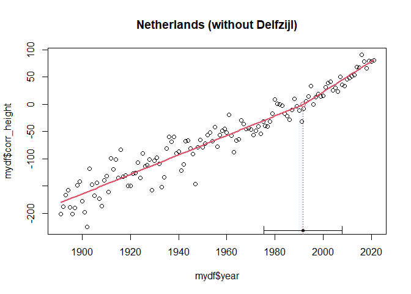
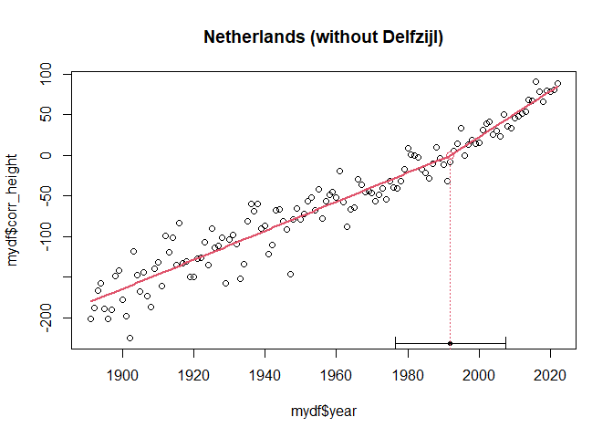
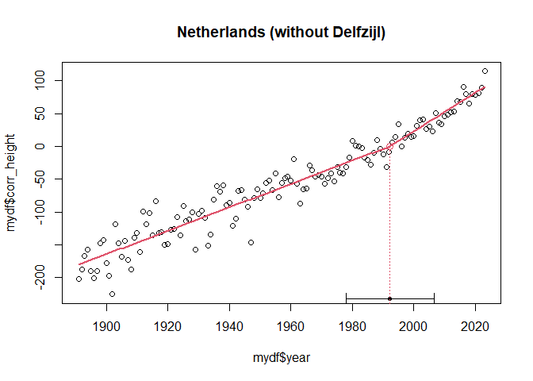
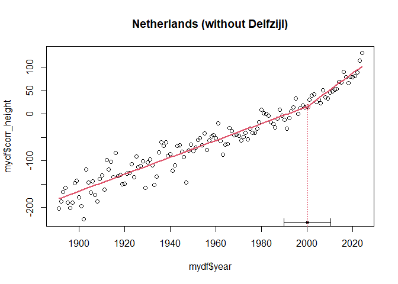
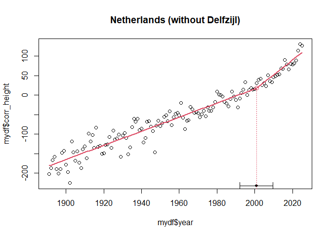

Untitled
================
Willem Stolte
2025-06-16

## Introduction

One of the models used in the Sea Level Monitor is a broken linear
model. In previous reports, the breakpoint was defined in the year 1993.
This was done for two reasons:

- Analyses showed that global and Dutch sea level in the beginning of
  the 1990’s was lower than expected. One of the explanations was a
  global temperature drop due to the Pinatubo eruption
- Earlier analysis showed a breakpoint in 1993 based on the measurements
  (Zeespiegelmonitor 2018)
- By choosing the year 1993, the trend of the part after the break could
  be easily compared to trends calculated from satellite observations,
  as they also start in this year. At the same time, the connection with
  earlier years is kept intact.

This notebook explores the most likely breakpoint year. A strong
deviation from 1993 would indicate that the breakpoint year may have to
change, or that the model is no longer valid.

## Read sea level data

Read predictions table, in order to use the estimates for nodal tide
(and storm surge) to correct the measured height.

``` r
df <- read_csv(, file = "../../results/analysis_output/predictions_latest.csv") %>%
filter(year >= 1890)
```

## Find breakpoints for broken linear regression in Sea Level time series

Breakpoint function that looks for breakpoints in the corrected (for
nodal cycle and surge anomaly) water level measurements:

``` r
slm_breakpoint <- function(
    df, 
    mystation = "Netherlands (without Delfzijl)",
    startyear = 1890, 
    endyear = 2025,
    n_bp, 
    printsummary = F
    ) {

  nr_of_breakpoints = n_bp
  
  mydf = df %>% 
    filter(
      station %in% mystation,
      year >= startyear,
      year <= endyear
    ) %>%
    mutate(corr_height = height - surge_anomaly - nodal_tide) %>%
    group_by(year) %>%
    summarize(corr_height = mean(corr_height))
  
  fit_lm = lm(corr_height ~ year, data = mydf )  
  
  fit_segmented = selgmented(
    fit_lm,
    seg.Z = ~year,
    Kmax = nr_of_breakpoints,
    type = "aic",
    bonferroni = TRUE,
    plot.ic = F
  )  # Two change points along x
  
 
  
  plot(mydf$year, mydf$corr_height, main = mystation)
  # lines(mydf$year, predict((fit_segmented)), add = T)
  
  plot(fit_segmented, add = T)
  # points(mydf)
  lines.segmented(fit_segmented)
  points.segmented(fit_segmented)
  
  if(printsummary){
    summary(fit_segmented)
  }
}
```

And apply this on time series from a few years back to now.

``` r
walk(
  c(2021, 2022, 2023, 2024, 2025),
  \(x) {
    cat("\nSea level breakpoint analysis for the year ", x, "\n\n")
    slm_breakpoint(df, 
                   # mystation = "Den Helder",
                   mystation = "Netherlands (without Delfzijl)",
                   startyear = 1890,
                   endyear = x,
                   n_bp = 4, 
                   printsummary = T
    )
  }  
)
```

    FALSE 
    FALSE Sea level breakpoint analysis for the year  2021 
    FALSE 
    FALSE No. of breakpoints: 2 .. 3 .. 4 .. 
    FALSE 
    FALSE AIC to detect no. of breakpoints:
    FALSE        0        1        2        3        4 
    FALSE 1170.563 1164.357 1164.594 1168.443 1172.214 
    FALSE 
    FALSE No. of selected breakpoints: 1

<!-- -->

    FALSE 
    FALSE Sea level breakpoint analysis for the year  2022 
    FALSE 
    FALSE No. of breakpoints: 2 .. 3 .. 4 .. 
    FALSE 
    FALSE AIC to detect no. of breakpoints:
    FALSE        0        1        2        3        4 
    FALSE 1179.671 1172.214 1172.392 1176.300 1179.477 
    FALSE 
    FALSE No. of selected breakpoints: 1

<!-- -->

    FALSE 
    FALSE Sea level breakpoint analysis for the year  2023 
    FALSE 
    FALSE No. of breakpoints: 2 .. 3 .. 4 .. 
    FALSE 
    FALSE AIC to detect no. of breakpoints:
    FALSE        0        1        2        3        4 
    FALSE 1192.245 1181.616 1181.690 1185.642 1189.064 
    FALSE 
    FALSE No. of selected breakpoints: 1

<!-- -->

    FALSE 
    FALSE Sea level breakpoint analysis for the year  2024 
    FALSE 
    FALSE No. of breakpoints: 2 .. 3 .. 4 .. 
    FALSE 
    FALSE AIC to detect no. of breakpoints:
    FALSE        0        1        2        3        4 
    FALSE 1207.525 1191.685 1192.674 1193.632 1197.629 
    FALSE 
    FALSE No. of selected breakpoints: 1

<!-- -->

    FALSE 
    FALSE Sea level breakpoint analysis for the year  2025 
    FALSE 
    FALSE No. of breakpoints: 2 .. 3 .. 4 .. 
    FALSE 
    FALSE AIC to detect no. of breakpoints:
    FALSE        0        1        2        3        4 
    FALSE 1221.117 1200.540 1201.644 1201.772 1205.769 
    FALSE 
    FALSE No. of selected breakpoints: 1

<!-- -->

What can be seen is that the optimal breakpoint was around 1993 untill
the last two measurements (years) were added. Because of the “cluster”
of high sea level at the end of the time series, the breakpoint is
pulled towards the end, making the final part of the regression
steepter.

For use in the Sea Level Monitor, where we want a rather conservative
method, we choose to still keep 1993 as a breakpoint year for the
analyses. Depending on future sea level measurements, this may turn out
to be more or less conservative.

## surge

Wind surge is determined with the Global Tide and Surge Model (GTSM).
The following part tests whether there is any breakpoint in the surge
data.

``` r
surge_breakpoint <- function(
    df, 
    mystation = "Netherlands (without Delfzijl)", 
    startyear = 1890, 
    n_bp, 
    printsummary = T
    ) {

  nr_of_breakpoints = 2
  
  mydf = df %>% 
    filter(
      station %in% mystation,
      year >= startyear
    ) #%>%

  fit_lm = lm(surge_anomaly ~ year, data = mydf )  # intercept-only model
  
  fit_segmented = selgmented(
    fit_lm, 
    seg.Z = ~year,
    Kmax = nr_of_breakpoints,
    type = "aic",
    bonferroni = TRUE,
    plot.ic = TRUE
  )  # Two change points along x
  
  # plot(mydf$year, mydf$surge_anomaly, main = mystation)
  # # lines(mydf$year, predict((fit_segmented)), add = T)
  # 
  # plot(fit_segmented, add = T)
  # # points(mydf)
  # lines.segmented(fit_segmented)
  # points.segmented(fit_segmented)
  
  if(printsummary){
    summary(fit_segmented)
  }
}
```

``` r
surge_breakpoint(df %>% filter(year >= 1950), 
               mystation = "Netherlands (without Delfzijl)",
               startyear = 1890,
               n_bp = 1, 
               printsummary = T
               )
```

    FALSE No. of breakpoints: 2 .. 
    FALSE 
    FALSE AIC to detect no. of breakpoints:
    FALSE        0        1        2 
    FALSE 2087.869 2091.653 2095.413 
    FALSE 
    FALSE No. of selected breakpoints:  0

    FALSE 
    FALSE Call:
    FALSE lm(formula = surge_anomaly ~ year, data = mydf)
    FALSE 
    FALSE Residuals:
    FALSE    Min     1Q Median     3Q    Max 
    FALSE -70.30 -16.95   0.67  19.22  52.78 
    FALSE 
    FALSE Coefficients:
    FALSE              Estimate Std. Error t value Pr(>|t|)
    FALSE (Intercept)  40.54880  140.16170   0.289    0.773
    FALSE year         -0.02040    0.07052  -0.289    0.773
    FALSE 
    FALSE Residual standard error: 23.36 on 226 degrees of freedom
    FALSE Multiple R-squared:  0.0003702,   Adjusted R-squared:  -0.004053 
    FALSE F-statistic: 0.0837 on 1 and 226 DF,  p-value: 0.7726

There are no breakpoints detected in the surge anomaly time series.

Only years from which surge data are available ( \>= 1950)
