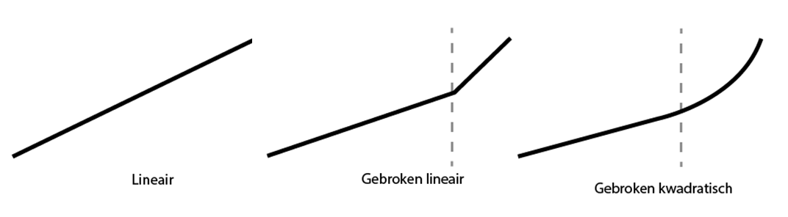
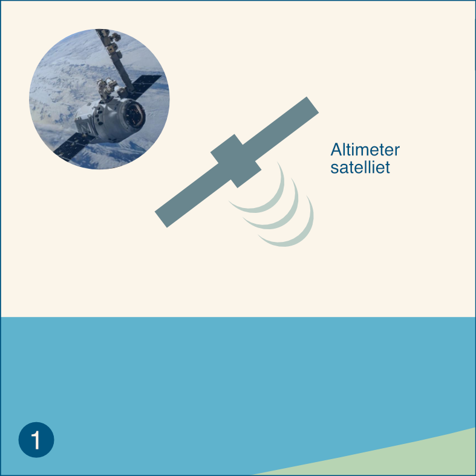
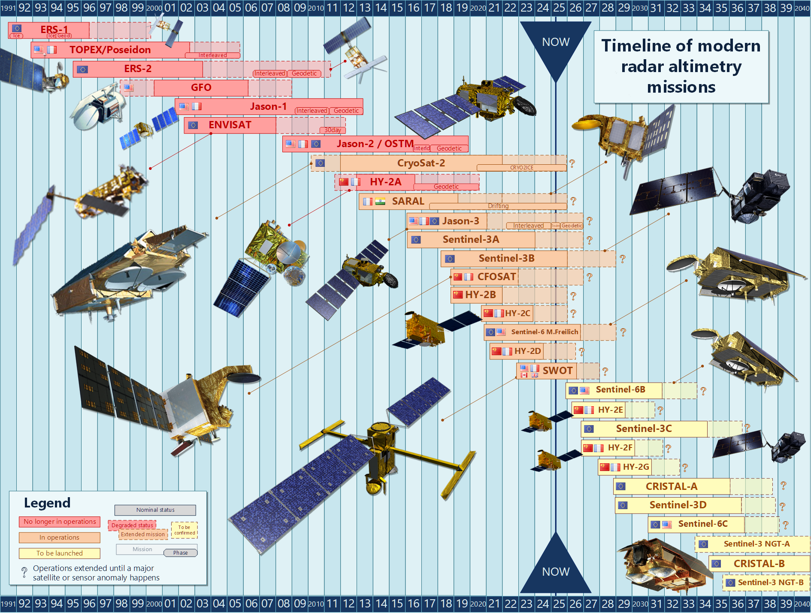

---
acronyms:
  include_unused: false
  insert_loa: false
  loa_title: ""
  fromfile:
  - acronyms.yml
---

# Methodiek {#sec-methodiek}

In hoofdstuk @sec-inleiding wordt uitgelegd dat er een 'huidige zeespiegel' nodig is, onder andere om de suppletiebehoefte te bepalen. Huidig is in de context van deze toepassing eigenlijk geen tijdspunt, maar een tijdspanne. Het gaat niet om de zeespiegel vandaag, maar om de zeespiegel en de daaruit afgeleide zeespiegelstijging van enkele jaren terug tot nu.

## Meetgegevens {#bronnen}

In de bijlage @sec-metingen wordt via een infographic uitgebreid uitgelegd hoe de metingen precies tot stand komen.

### Hoofdstations

In dit onderzoek gebruiken we gegevens voor de 6 hoofdgetijdestations Vlissingen, Hoek van Holland, IJmuiden, Den Helder, Harlingen en Delfzijl. Deze kuststations leveren sinds 1890, toen het \acr{NAP} overal was doorgevoerd, betrouwbare metingen. Gegevens worden betrokken uit de [\acr{PSMSL} database](https://psmsl.org/data/). Rijkswaterstaat draagt zorg voor de aanlevering van gegevens aan \acr{PSMSL}.

:::{#fig-station-map}

{width=60%}

Locatie van de zes hoofdstations

:::

Het is bekend dat sommige ingrepen invloed hebben op de metingen [bijvoorbeeld in @Becker2009]. Op dit moment ontbreekt de kennis om hier op een kwantitatieve manier voor te corrigeren. We nemen aan dat deze effecten beperkt doorwerken in het eindresultaat doordat wordt gerekend met het gemiddelde van de hoofdstations.

Sinds de vorige Zeespiegelmonitor is aangenomen dat de waarden bij Station Delfzijl onzeker zijn doordat de verticale positie de laatste 10-15 jaar niet correct is doorgevoerd [@Honingh2021]. Rijkswaterstaat heeft begin 2022 geconstateerd dat een inhaalslag nodig is voor de verticale correctie van de waterstandsmetingen bij Delfzijl. Deze correctie is bij het schrijven van dit rapport wel berekend maar nog niet via de geijkte manieren (WADAR, PSMSL) gepubliceerd. Daarom berekenen we de zeespiegel en -stijging op basis van het gemiddelde van alleen de 5 andere hoofdstations (Netherlands (without Delfzijl)).

### Recente correcties van de meetgegevens {#sec-metingen-en-recente-correcties}

Voor de Zeespiegelmonitor worden jaargemiddelden gebruikt die beschikbaar zijn in \acr{PSMSL}. Deze gegevens worden door \acr{RWS} jaarlijks berekend en aan \acr{PSMSL} aangeleverd. Voorafgaand aan de berekening van gemiddelden worden de meetgegevens gecontroleerd, en waar nodig aangevuld of gecorrigeerd. Dit staat uitgebreid beschreven in  [@Honingh2021].

Recent heeft een extra controle en correctie plaatsgevonden voor de getijdemetingen. Dit betreft 2 typen correcties:

1) herberekening van gemiddelden op basis van 10-minutenreeksen (dit werd tot nu toe gedaan op basis van uurgegevens)
1) Herberekening van NAP referentiewaarden voor station Delfzijl

De gecorrigeerde maand- en jaargemiddelden zijn op het moment van schrijven nog niet aangeleverd aan \acr{PSMSL}. De verwachting is dat het effect van herberekening van gemiddelden (1) zeer klein zal zijn. De aanpassing voor Delfzijl (2) zal er hopelijk voor zorgen dat dit station weer meegenomen kan worden in de reguliere analyse. 

## Bepalen van Zeespiegelstijging

### Afwegingen {#sec-afwegingen}

Bij het selecteren van de methode worden er diverse afwegingen gemaakt, waarbij we gebruik maken van onderstaande criteria. Dit hoofdstuk geeft een overzicht van de belangrijkste modelkeuzes en de bijbehorende onderbouwing. Uitgangspunt voor de afwegingen is het bepalen van een goede maat voor de huidige zeespiegelstijging ten behoeve van het suppletieprogramma en de suppletiebehoefte.

**Stabiliteit** - de gebruikte methodiek moet niet van jaar tot jaar te veel variëren.

**Spaarzaamheid** - parcimonie: principe dat de eenvoudigste van twee ongeveer even plausibele verklaringen voor hetzelfde fenomeen de voorkeur heeft

**Robuustheid** - trend moet niet te veel afhangen van modelkeuzes

**Voorspelkracht** - toepassing van model in het verleden moet een goede hindcast opleveren voor een voorspelhorizon die vergelijkbaar is met de lengte van de gewenste periode (10-15 jaar)

**Behoudend** - methode moet temporeel aansluiten oftewel over de gehele periode met metingen toepasbaar zijn zonder onderbreking of verspringing.

**Generaliseerbaarheid** - methode moet ook werken bij andere stations dan in Nederland

**Power** - als er een verandering is moet de methode dat snel detecteren

**Fysisch verklaarbaar** - de gekozen formulering moet verklaarbaar zijn vanuit fysisch oogpunt

### Methodiek

In dit onderzoek maken we gebruik van een \acr{GLM}, een gegeneralizeerde vorm van een lineair regressiemodel. Vooral omdat de variatie goed verklaard wordt [@Watson2016]. We gaan er sinds de vorige rapportage [@Stolte2022] vanuit dat de zeespiegel sneller aan het stijgen is dan in het verleden en mogelijk nog sneller gaat stijgen. Dit heeft implicaties voor de verwachte zeespiegel en zeespiegelstijging. Daarom maken we gebruik van schattingen van de versnelling, zie \@ref(versnelling-methods).

### Welke termen? {#sec-modelkeuze}

De methode in dit onderzoek bouwt verder op de aanpak zoals beschreven in @Baart2015. De variatie in de zeespiegel wordt in een aantal componenten uitgesplitst. Het uitsplitsen van de variatie van jaargemiddelde zeespiegel wordt gedaan met behulp van een \acr{GLM}. In deze sectie beschrijven we welke termen in dit model meegenomen worden en waarom.In eenvoudige vorm wordt de waterstand beschreven als de volgende vergelijking:

$$h_t = constante + trend + versnelling? + getij + wind + residu$$ {#eq-trend}

De versnelling is optioneel en kan op verschillende manieren worden ingevuld (zie sectie @sec-versnelling-methods. In @eq-gedetailleerd is de gedetailleerde wiskundige vergelijking van het regressiemodel voor de zeewaterstand opgenomen.

### Versnelling? {#sec-versnelling-methods}

In de vorige Zeespiegelmonitor is geconstateerd dat een versnellingsterm noodzakelijk is voor de correcte beschrijving van de gemiddelde zeespiegelstijging langs de Nederlandse kust. Om de versnelling van de zeespiegel te beschrijven zijn er in de literatuur verschillende varianten in omloop. Deze worden hieronder schematisch weergegeven en beschreven.

:::{#fig-modelvarianten}

{width=80%}

Verschillende modelvarianten om een al dan niet veranderende zeespiegelstijging te beschrijven.

:::

1.  Een *lineaire* aanpak gaat ervan uit dat de versnelling afwezig is. Deze methode wordt toegepast door NOAA voor [historische reeksen](https://tidesandcurrents.noaa.gov/sltrends/mslUSTrendsTable.html). Vanuit het spaarzaamheidsprincipe veronderstellen we dat dit model geldt (nulhypothese) tenzij het verworpen wordt.
3.  De *gebroken lineaire* methode gaat ervan uit dat de zeespiegelstijging abrupt versneld is. Een abrupte versnelling kan optreden als een groot gebied tegelijk boven het 0 punt komt te liggen. In de praktijk wordt het ook gebruikt om een aparte trend uit te rekenen voor het satelliettijdperk. Sinds 1993 (na de lancering van de [TOPEX/Poseidon](https://eospso.nasa.gov/missions/topexposeidon) satelliet) meten we de zeespiegel ook met satellieten. De satellietmetingen laten een hogere zeespiegelstijging zien dan de gemeten waterstanden in het getijstationtijdperk ('tide gauge era'). Hierbij wordt 1993 vaak genoemd als de start van de versnelde zeespiegel [bijvoorbeeld @Stocker2013]. Om goede vergelijkingen te maken is het daarom nodig om ook voor deze periode een trend te bepalen. In deze methode kan de trendparameter vanaf het jaar 1993 wijzigen. Op de significantie van de trendbreuk wordt statistisch getoetst. Dit gebroken trendmodel wordt weergegeven in vergelijking @eq-brokentrend.
4.  De *gebroken kwadratische* versnelling gaat er van uit dat de zeespiegel in de jaren 60 van de vorige eeuw is gaan versnellen als gevolg van de verhoogde uitstoot van broeikasgassen na de tweede wereldoorlog (@Slangen2016, @Dangendorf2019). Met een geavanceerd statische methode is dit ook gevonden door @Keizer2022. Voor toepassing hier wordt vóór 1960 een lineaire toename aangenomen. De versnelling vanaf 1960 wordt berekend op de manier die hierboven is beschreven bij de kwadratische versnelling. Dit gebroken trendmodel wordt weergegeven in vergelijking @eq-brokenquadratic.

Modellen die voorkomen in de literatuur, maar die we op dit moment niet overwegen. 

4.  Een *kwadratische versnelling*. Dit is de gebruikelijke [@Jevrejeva2014; @Church2011] en formele manier om de versnelling mee te nemen. De methode bevat naast een parameter voor de lineaire trend in de zeespiegelstijging een extra parameter voor de versnelling in de zeespiegelstijging (zie @eq-trend). Op de significantie van deze parameter wordt statistisch getoetst. Het nadeel van deze methode is dat het gevoelig is voor het startpunt van de tijdserie. Om die reden is deze methodiek niet meer gebruikt, maar is overgestapt op het gebroken kwadratische model (zie hieronder).
5.  Een andere methode is om een *discontinue lineaire* trend te berekenen. Door over aparte perioden trends uit te rekenen krijg je trends waarvan de intercepts niet aansluit op de vorige periode. Dit is de methode zoals gebruikt in het [IPCC rapport](https://www.ipcc.ch/report/ar6/wg1/chapter/chapter-9/). Hierbij worden trends over verschillende perioden apart uitgerekend.
6.  *Lokaal polynoom* is een methode met meer vrijheidsgraden en wat exploratiever van aard. De parameters worden gebaseerd op "expert judgement" en "trial en error" [@Cleveland1996]. Het voordeel van deze methode is dat deze de mogelijkheid open laat van een meer variërende trend over tijd. Het nadeel is dat deze methode door het grotere aantal vrijheidsgraden ook wat meer kan "wapperen", vooral aan het uiteinde. Dat wil zeggen dat de trend aan het eind van de reeks, met nieuwe data, snel van richtingscoefficient kan veranderen. Een methode die hier op lijkt is \acr{GAM}, waarbij een "smoothing term" wordt toegepast om een vloeiende lijn door de meetpunten te passen.

Het is dus belangrijk om het model te kiezen dat met de grootst mogelijke waarschijnlijkheid de huidige zeespiegelstijging beschrijft. Tegelijkertijd houden we vast aan de uitgangspunten in paragraaf @sec-afwegingen. De uiteindelijke modelkeuze (welk model is beter dan het simpelste, dus lineaire, model) vindt plaats op twee criteria. Er moet sprake zijn van een significante acceleratie of deceleratie en er moet sprake zijn van een beter model. Dat laatste wordt vastgesteld met behulp van het \acr{AIC}, waarbij een afweging wordt gemaakt tussen de complexiteit en de toegevoegde waarde. Het \acr{AIC} criterium is een afweging op basis van de statische eigenschappen van de verschillende modellen. Het doet geen uitspraak over de juistheid van onderliggende fysische processen.

### Windopzet {#sec-windopzet}

Voor details over de berekeningen van windopzet met het \acr{GTSM} verwijzen we naar @sec-gtsm-methodiek

In de Zeespiegelmonitor analyse wordt de correctie voor windopzet als volgt berekend:

- Voor elk station wordt jaargemiddeld windopzet berekend.
- Jaargemiddelde windopzet wordt getransformeerd tot jaarlijkse afwijking (opzetanomalie) van het langjarig gemiddelde.
- De opzetanomalie per jaar en station wordt afgetrokken van de zeespiegelhoogte om tot de voor windopzet gecorrigeerde zeespiegel te komen.

Voor het gemiddelde over Nederland worden de gecorrigeerde zeespiegelwaarden gemiddeld over de stations. De eerder genoemde @eq-trend wordt met deze methodiek:

$$h_t - windopzet = constante + trend + versnelling? + getij + residu$$ {#eq-trend2}

### Getij {#sec-getij}

Naast windopzet zorgt ook het getij, met name de nodale cyclus, voor een variatie in de zeespiegel over de jaren [@Woodworth2012, @Baart2012f]. Daarom wordt de variatie door de nodale cyclus meegenomen als gelineariseerde amplitude en fase, in de vorm van een u en v component. Het is ook mogelijk om het equilibrium getij [@Baart2012e] op te leggen of om het te berekenen met bijvoorbeeld \acr{GTSM}. Het equilibrium getij is het getij dat zou optreden zonder invloed van land of ondiepte op de propagatie van de getijgolf. In Nederland en op veel andere plaatsen is de amplitude en fase van het in de regressie meegenomen nodaal getij niet hetzelfde als het equilibrium getij. Er is lange tijd discussie geweest over welk getij het meest geschikt is om mee te rekenen in langjarige analyses (Woodworth vs Baart). Recent is aangetoond dat het waargenomen nodaal getij aan de Nederlandse kust verklaarbaar beïnvloed wordt door modulatie van de M2 getijgolf in de Noordzee [@Bult2024]. Dit brengt de twee denkbeelden dichter bij elkaar. Het lijkt er hierbij op dat de in de regressie geschatte nodale cyclus min of meer precies beantwoord aan het beeld van een gemoduleerd M2 getij. Hiermee vervalt voorlopig de behoefte om het nodaal getij op een andere, meer onafhankelijke manier mee te nemen in de analyse. 

### Gedetailleerde vergelijking

De gedetaileerde vergelijking wordt zodoende

$$
\begin{aligned}
h_t  &= \beta_{\text{constante}}\\
&\quad + \text{windopzetanomalie} \\ 
&\quad + \beta_{\text{trend}} t\\
&\quad + \text{versnelling?} \\
&\quad + \beta_{\text{nodal\_u}}
\cos\left(\frac{2\pi t}{18.613}\right)
+ \beta_{\text{nodal\_v}}
\sin\left(\frac{2\pi t}{18.613}\right) \\
&\quad + \varphi h(t-1) + \epsilon_t
\end{aligned}
$$ {#eq-gedetailleerd}

De term $\varphi h(t-1)$ is de autocorrelatieterm. Deze wordt toegevoegd om het effect van een hoge zeespiegel op de zeespiegel van het volgende jaar mee te nemen in de berekening van de onzekerheid. Zie @Baart2019 voor meer informatie hierover.

Voor de term $versnelling?$ kan in vergelijking @eq-gedetailleerd de volgende term ingevuld worden in het geval van gebroken lineaire trend:

$$\beta_{1993} (t-1993)(t>=1993)$$ {#eq-brokentrend}

Voor de term $versnelling?$ kan in vergelijking @eq-gedetailleerd de volgende term ingevuld worden in het geval van gebroken kwadratische trend:

  $$\beta_{1960} (t-1960)(t^2>=1960)$$ {#eq-brokenquadratic}

## Metingen van het zeeniveau met satellieten (altimetrie) {#sec-altimetrie}

Bij het meten van de waterhoogte worden satellieten op twee manieren ingezet. 

- Het meten van de hoogte van het wateroppervlak ten opzichte van het middelpunt van de aarde of een bepaalde geoïde  (\@ref(fig:hoogtemetingen a)).
- Het meten van de hoogte van het meetinstrument (direct of indirect) van een getijdemeetstation (\@ref(fig:hoogtemetingen b)).

:::{#fig-altimeter}

{width=60%}

Hoogtemeting met behulp van satellietaltimetrie

:::

: Hoogtemetingen in de kustzone. (a) Directe metingen van het zeeoppervlak met behulp van satellietaltimetrie.

### Beschikbare satellieten en metingen

:::{#fig-tijdlijn-satellieten}

{width=100%}

Tijdlijn van satellieten vanaf 1993 tot 2030 [@Aviso2022Timeline]

:::

In 1993 begonnen de eerste altimetrie satelieten met meten. De eerste satelliet was Topex/Poseidon, gevolgd door Jason-1, Jason-2, Jason-3 en de Sentinel-6A/B satellieten [@Aviso2022Timeline]. In het begin van de metingen was de resolutie van de satellietmetingen beperkt tot 1 keer per 10 dagen en de ruimtelijke resolutie was beperkt tot 10-20 km. In de loop der jaren is de resolutie verbeterd. 

De belangrijkste bron van satellietgegevens voor de zeespiegel is het gecombineerde product van meerdere satelieten. Om observaties van één missie voor de zeespiegelstand te gebruiken, zijn zowel de temporale als ruimtelijke resolutie te beperkt. Inmiddels is er vanaf 1993 tot heden een langere tijdreeks opgebouwd van het gecombineerde product. Het probleem van de beperkte kwaliteit bij de kust blijft echter bestaan. Nieuwe technieken, bijvoorbeeld het toevoegen van de SWOT (Surface Water Ocean Topography) satelliet hebben gezorgd voor een verkleining van de error factor buiten de kust, maar voor de toepassing van de zeespiegelmonitor is deze onzekerheid nog te hoog.

Daarnaast is voor een nauwkeurige vergelijking met de in-situ metingen van de getijdestations het nodig om de gemeten hoogtes ten opzichte van hetzelfde verticale referentievlak te bepalen. Satellietgegevens worden berekend ten opzichte van een gemiddeld niveau over een bepaalde periode (anomaliën), zonder informatie over het absolute referentieniveau. Op basis hiervan kunnen we alleen trends met elkaar vergelijken [@Stolte2022]. Daarom worden de gegevens meer ter verificatie gebruikt dan als primaire bron. We monitoren de wetenschappelijke ontwikkelingen op het gebied van satellietmetingen en de verwerking hiervan, om bij te houden of satellietdata ook een andere rol in de zeespiegelmonitor kan gaan spelen.

### Verwachting voor de toekomst en toepassing voor zeespiegelmonitor

Het voortzetten van de satelietmeetreeks en het verbeteren van kwaliteit nabij de kust zijn de belangrijkste punten om het gebruik van satelietgegevens in de zeespiegelmonitor te vergroten [@Aviso2022Timeline] [@Ballarotta2025]. In de toekomst zal de lancering van het Sentinel-3 Next Generation (S3NG-T) programma een belangrijke rol spelen in het verbeteren van de kwaliteit van de metingen in kustgebieden. Deze satellieten zullen de klassieke altimetrie combineren met een vergelijkbare sensor als SWOT, daarnaast is het doel om een 5-day revisit periode te realiseren en een ruimtelijke resolutie van 50 km te bereiken [@Egido2025]. Echter zijn deze ontwikkelingen nog in de startfase, met verschillende verwachtingen van lanceringsdatum (2030-2034) [@CEOSdatabase2026], tot die tijd is de voortzetting van de huidige satelietmeetreeks het belangrijkste punt.

## Zeespiegelbudgetten {#sec-budget-methode}

Aan de ene kant wordt de relatieve zeespiegel gemeten met getijdenmeters langs de Nederlandse kust. Aan de andere kant worden ook de fysische processen die zeespiegelverandering veroorzaken, zoals opwarming van de oceaantemperatuur en het smelten van gletsjers en ijskappen, gemeten met in-situ- en satellietmetingen. We gebruiken aardmodellen van zwaartekracht, rotatie en elastische vervorming van het land om het smelten van landijs te koppelen aan veranderingen in de relatieve zeespiegel langs de kust. Hierdoor kunnen we controleren of de som van de fysische mechanismen die invloed hebben op zeespiegelverandering in lijn ligt met de zeespiegelwaarnemingen. In de afgelopen 10 jaar is grote vooruitgang geboekt om de balans (@frederikse_closing_2016 en @camargo_regionalizing_2023) te verfijnen, tot het punt dat deze methode nu een uitgebreid inzicht kan bieden in de redenen voor zeespiegelverandering langs de Nederlandse kust (@le_bars_connecting_2025).

Eerdere zeespiegelmonitor rapporten bevatten al een bespreking van de oorzaken van zeespiegelstijging, maar het is voor het eerst dat er een volledige budget wordt getoond op interannuele tot multidecadale tijdschalen. Het budget die wij presenteren is ontwikkeld door het KNMI om de KNMI’23-zeespiegelscenario's te berekenen (@le_bars_constraining_2025, @le_bars_connecting_2025). Het biedt een budget voor de gemiddelde zeespiegel van zes getijdenstations langs de kust (Vlissingen, Hoek van Holland, IJmuiden, Den Helder, Harlingen, Delfzijl). We merken drie verschillen op met de oorspronkelijk gepubliceerde resultaten (@van_dorland_knmi_2023). Ten eerste begint de balans nu in 1960 in plaats van in 1993. Het jaar 1993 is nuttig omdat het vergelijking met satellietaltimetriegegevens mogelijk maakt, maar het gebruik van het jaar 1960 levert een langere tijdreeks op waarmee veranderingen op de lange termijn kunnen worden geanalyseerd. Ten tweede is de bijdrage van ijskappen na 2018 uitgebreid met behulp van de satellietmissies GRACE en GRACE-FO, in plaats van een lineaire extrapolatie van de oorspronkelijke tijdreeks van @Frederikse2020. Ten derde is de balans bijgewerkt tot en met 2025, terwijl de oorspronkelijke liep tot en met 2021.

::: {.content-visible when-format="html"}

## Lijst met gebruikte afkortingen

\printacronyms

:::
