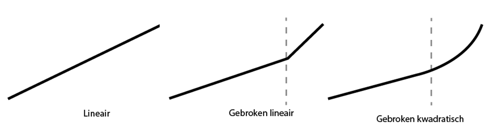
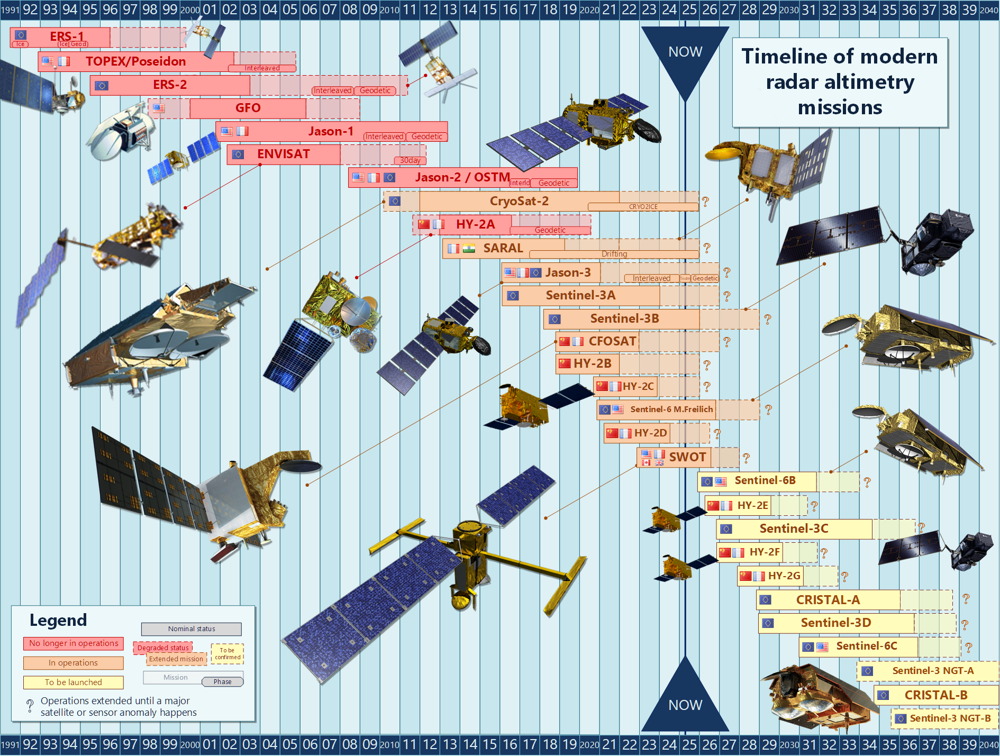

---
acronyms:
  include_unused: false
  insert_loa: false
  loa_title: ""
  fromfile:
  - acronyms.yml
---

# Methodiek {#sec-methodiek}

In @sec-inleiding wordt uitgelegd dat inzicht in de 'huidige zeespiegel' nodig is, onder andere om de suppletiebehoefte te bepalen. Huidig is in de context van deze toepassing eigenlijk geen tijdspunt, maar een tijdspanne. Het gaat niet alleen om de zeespiegel vandaag, maar om de relatieve zeespiegelstijging over de afgelopen periode.

## Meetgegevens {#bronnen}

In de @sec-metingen wordt via een infographic uitgebreid uitgelegd hoe de metingen precies tot stand komen.

### Hoofdstations

De Zeespiegelmonitor gebruikt we gegevens van de 6 hoofdgetijdestations Vlissingen, Hoek van Holland, IJmuiden, Den Helder, Harlingen en Delfzijl. Deze kuststations leveren sinds 1890, toen het \acr{NAP} overal was doorgevoerd, voldoende betrouwbare metingen. Rijkswaterstaat draagt zorg voor de aanlevering van deze gegevens aan de \acr{PSMSL} [database](https://psmsl.org/data/).

:::{#fig-station-map}

{width=60%}

Locatie van de zes hoofdstations

:::

Het is bekend dat sommige grote ingrepen zoals de Afsluitdijk en Deltawerken invloed hebben op de metingen [zie bijvoorbeeld @Becker2009]. Op dit moment ontbreekt de kennis om hier op een kwantitatieve manier voor te corrigeren. We nemen aan dat dit beperkt doorwerkt in het eindresultaat omdat wordt gerekend met het gemiddelde van de hoofdstations.

Sinds de vorige Zeespiegelmonitor is aangenomen dat de waarden bij Station Delfzijl te onzeker zijn doordat de verticale positie de laatste 10-15 jaar niet correct is doorgevoerd [@Honingh2021]. Rijkswaterstaat heeft begin 2022 geconstateerd dat een inhaalslag nodig is voor de verticale correctie van de waterstandsmetingen bij Delfzijl. Deze correctie is bij het schrijven van dit rapport wel berekend maar nog niet via de geijkte manieren (WADAR, PSMSL) gepubliceerd. Daarom is de zeespiegel en -stijging op basis van het gemiddelde van alleen de 5 andere hoofdstations berekend.

### Recente correcties van de meetgegevens {#sec-metingen-en-recente-correcties}

De Zeespiegelmonitor gebruikt jaargemiddelde zeespiegelgetallen die beschikbaar zijn in \acr{PSMSL}. Deze gegevens worden door \acr{RWS} jaarlijks aan \acr{PSMSL} geleverd. Voorafgaand aan de berekening van gemiddelden worden de meetgegevens gecontroleerd, en waar nodig aangevuld of gecorrigeerd. Dit staat uitgebreid beschreven in  [@Honingh2021].

Recent heeft een extra controle en correctie plaatsgevonden voor de getijdemetingen. Dit betreft:

1) herberekening van gemiddelden op basis van 10-minutenreeksen (dit werd tot nu toe gedaan op basis van uurgegevens)
1) Herberekening van NAP referentiewaarden voor station Delfzijl

De gecorrigeerde maand- en jaargemiddelden zijn op het moment van schrijven nog niet aangeleverd aan \acr{PSMSL}. De verwachting is dat het effect van herberekening van gemiddelden (1) zeer klein zal zijn. De aanpassing voor Delfzijl (2) zal er hopelijk voor zorgen dat dit station weer meegenomen kan worden in de reguliere analyse. 

## Bepalen van Zeespiegelstijging

Het berekenen van de huidige zeespiegel en zeespiegelstijging vraagt een aantal stappen. De methodiek hiervoor is een statistisch benadering met als doel de invloed van windopzet en getij op de langjarige trend zo veel mogelijk te verwijderen. Belangrijke keuzes zijn hieronder toegelicht.

### Afwegingen {#sec-afwegingen}

Dit hoofdstuk geeft een overzicht van de belangrijkste modelkeuzes en de bijbehorende onderbouwing. De criteria voor de afwegingen staan hieronder. Het belangrijkste uitgangspunt is het gebruik in het bepalen van de suppletiebehoefte.

**Stabiliteit** - de gebruikte methodiek moet niet te veel van jaar tot jaar variëren;

**Spaarzaamheid** - de eenvoudigste van twee ongeveer even plausibele verklaringen voor hetzelfde fenomeen heeft de voorkeur (parcimonie);

**Robuustheid** - de trend moet niet te veel afhangen van modelkeuzes;

**Voorspelkracht** - de toepassing van het model in het verleden moet een goede hindcast opleveren voor een voorspelhorizon die vergelijkbaar is met de lengte van de gewenste periode (10-15 jaar);

**Behoudend** - de methode moet temporeel aansluiten oftewel over de gehele periode met metingen toepasbaar zijn zonder onderbreking of verspringing;

**Generaliseerbaarheid** - de methode moet ook werken bij andere stations dan in Nederland;

**Power** - de methode moet, als er een verandering is, dat snel detecteren;

**Fysisch verklaarbaar** - de gekozen formulering moet verklaarbaar zijn vanuit fysisch oogpunt.

### Methode

Dit onderzoek gebruikt een \acr{GLM}, een gegeneralizeerde vorm van een lineair regressiemodel. Dit kan de variatie goed verklaren [@Watson2016] en houdt er rekening mee dat de zeespiegelstijging over de tijd kan veranderen, wat gebeurt als de zeespiegelwereldwijd versneld stijgt.

### Meegenomen termen {#sec-modelkeuze}

De methode bouwt verder op de aanpak zoals beschreven in @Baart2015. De variatie in de zeespiegel wordt in een aantal componenten uitgesplitst. Het uitsplitsen van de variatie van jaargemiddelde zeespiegel wordt gedaan met behulp van een \acr{GLM}. In deze sectie beschrijven we welke termen in dit model meegenomen worden en waarom.In eenvoudige vorm wordt de waterstand ($h_t$) beschreven als de volgende vergelijking:

$$
\begin{aligned}
h_t &= constante\\ 
&\quad + trend\\ 
&\quad + versnelling\\ 
&\quad + getij\\ 
&\quad + windopzet\\ 
&\quad + residu
\end{aligned}
$$ {#eq-trend}

De versnellingsterm ($versnelling$) kan verschillende vormen aannemen (inclusief nul) en wordt later ingevuld (zie sectie @sec-versnelling-methods. In @eq-gedetailleerd is de gedetailleerde wiskundige vergelijking van het regressiemodel voor de zeewaterstand opgenomen.

### Modelvarianten {#sec-versnelling-methods}

In de vorige Zeespiegelmonitor is geconstateerd dat een versnellingsterm noodzakelijk is voor de correcte beschrijving van de gemiddelde zeespiegelstijging langs de Nederlandse kust. Om de stijging en eventuele versnelling van de zeespiegel te beschrijven zijn er in de literatuur verschillende varianten in omloop. Deze worden hieronder schematisch weergegeven en beschreven, in dienst van het zinvol interpreteren van de gegevens, gegeven eerdergenoemde afwegingen (@sec-afwegingen). Uitsluitsel geven over processen die de zeespiegelstijging beïnvloeden is geen doel. 

:::{#fig-modelvarianten}

{width=80%}

Verschillende modelvarianten om een al dan niet veranderende zeespiegelstijging te beschrijven.

:::

1.  Een *lineaire* aanpak gaat ervan uit dat er geen versnelling is. Deze methode wordt toegepast door NOAA voor [historische reeksen](https://tidesandcurrents.noaa.gov/sltrends/mslUSTrendsTable.html). Het spaarzaamheidsprincipe maakt dit de nulhypothese, totadat ze verworpen wordt.
3.  De *gebroken lineaire* methode gaat ervan uit dat de metingen van de zeespiegel binnen korte tijd een afbuiging vertonen naar een hogere zeespiegelstijging. Zo'n versnelling kan optreden als een belangrijke factor binnen korte tijd blijvend gaat bijdragen aan de zeespiegelstijging, zoals het afsmelten van gletsjers door hogere lucht- of zeetemperaturen. Ook als het mechanisme onduidelijk is, kan het zijn dat dit model de gegevens het beste beschrijft. 
In de praktijk wordt deze variant ook gebruikt om een aparte trend uit te rekenen voor het satelliettijdperk. Sinds 1993 (na de lancering van de [TOPEX/Poseidon](https://eospso.nasa.gov/missions/topexposeidon) satelliet) wordt de zeespiegel ook met satellieten gemeten. De satellietmetingen laten een hogere zeespiegelstijging zien dan de gemeten waterstanden in het getijstationtijdperk ('tide gauge era'). Hierbij wordt 1993 vaak genoemd als de start van de versnelde zeespiegel [bijvoorbeeld @Stocker2013]. Om goede vergelijkingen te maken is het nodig om ook voor deze periode een trend te bepalen. In de gebroken lineaire methode kan de trendparameter vanaf het jaar 1993 wijzigen. Op de significantie van de trendbreuk wordt statistisch getoetst. Dit gebroken trendmodel wordt weergegeven in vergelijking @eq-brokentrend. Vanuit statistisch oogpunt is 1993 lang het optimale breekpunt geweest. Sinds de metingen van 2024 is het dat niet meer (zie ook [dit rekendocument](https://github.com/Deltares-research/sealevelmonitor/blob/reporting26_final/analysis/sealevelmonitor/breakpoints_analyse.md)). Vanwege behoudendheid van de methode blijft 1993 vooralsnog het breekpunt. 
4.  De *gebroken kwadratische* versnelling gaat er van uit dat de zeespiegel in de jaren 60 van de vorige eeuw ging versnellen door verhoogde uitstoot van broeikasgassen na de tweede wereldoorlog (@Slangen2016, @Dangendorf2019). Met een geavanceerd statische methode is dit ook gevonden door @Keizer2022. De Zeespiegelmonitor neemt vóór 1960 een lineaire toename aan. De versnelling vanaf 1960 wordt berekend als een extra (bovenop het lineaire deel) kwadratische toename van de zeespiegel in de tijd (dus een constante toename van de snelheid. Dit gebroken trendmodel wordt weergegeven in vergelijking @eq-brokenquadratic.

Andere modellen uit de literatuur, nu niet overwogen voor de Zeespiegelmonitor, zijn:

4.  Een *kwadratische versnelling* (vanaf het begin van de metingen). Dit is de gebruikelijke [@Jevrejeva2014; @Church2011] en formele manier om de versnelling mee te nemen. De methode bevat naast een parameter voor de lineaire trend in de zeespiegelstijging een extra parameter voor de versnelling in de zeespiegelstijging (zie @eq-trend). Op de significantie van deze parameter wordt statistisch getoetst. Het nadeel van deze methode is dat het gevoelig is voor het startpunt van de tijdserie. Om die reden is deze methodiek niet meer gebruikt, maar is overgestapt op het gebroken kwadratische model (zie hieronder).
5.  Een *discontinue lineaire* trend volgt bij berekening over aparte perioden waarvan de intercepts niet aansluit op de vorige periode. Dit is gebruikt in het [IPCC rapport](https://www.ipcc.ch/report/ar6/wg1/chapter/chapter-9/). Hierbij worden trends over verschillende perioden apart uitgerekend.
6.  *Lokaal polynoom* is een methode met meer vrijheidsgraden en wat exploratiever van aard. De parameters worden gebaseerd op "expert judgement" en "trial en error" [@Cleveland1996]. Het voordeel van deze methode is dat deze de mogelijkheid open laat van een meer variërende trend over tijd. Het nadeel is dat deze methode door het grotere aantal vrijheidsgraden kan "wapperen", vooral aan het uiteinde. Dat wil zeggen dat de trend aan het eind van de reeks, met nieuwe data, snel van richtingscoefficient kan veranderen. Een methode die hier op lijkt is \acr{GAM}, waarbij een "smoothing term" wordt toegepast om een vloeiende lijn door de meetpunten te passen.

De opgave is om met de grootst mogelijke waarschijnlijkheid de huidige zeespiegelstijging correct te beschrijven en tegelijkertijd vast te houden aan de uitgangspunten in @sec-afwegingen. De uiteindelijke modelkeuze (welk model is beter dan het simpelste, dus lineaire, model) vindt plaats op twee criteria. Er moet sprake zijn van een significante acceleratie of deceleratie en er moet sprake zijn van een beter model. Dat laatste wordt vastgesteld met behulp van het \acr{AIC}. Dit maakt een afweging tussen de complexiteit en de toegevoegde waarde, op basis van de statistische eigenschappen van de verschillende modellen. Het doet geen uitspraak over de juistheid van onderliggende fysische processen.

### Windopzet {#sec-windopzet}

De windopzet (storm surge) beïnvloedt de stand van de zeespiegel. Om die bijdrage te kwantificeren, is de gemiddelde jaarlijkse windopzet berekend met de door Deltares geproduceerde \acr{GTSM} dataset met \acr{ERA5} forcing (van het \acr{ECMWF}). Deze bevat uurlijkse mondiale waterstanden en windopzet tijdreeksen voor de periode vanaf 1950 tot heden. De dataset is berekend met een dieptegemiddeld hydrodynamisch model dat getijden, windopzet en hun niet-lineaire interacties in de wereldoceaan simuleert, aangestuurd door de \acr{ERA5} atmosferische heranalyse (\acr{GTSM}). De windopzet wordt bepaald als het verschil tussen een gecombineerde windopzet-getijdensimulatie en een simulatie met uitsluitend astronomisch getij en is als afzonderlijke variabele beschikbaar in de dataset. Meer informatie is beschikbaar in de documentatie van de [GTSM-ERA5-dataset](https://doi.org/10.24381/cds.a6d42d60) en in [@Muis2023], [@Aleksandrova2026].

Voor details over de berekeningen van windopzet met het \acr{GTSM} verwijzen we naar @sec-gtsm-methodiek

In de Zeespiegelmonitor analyse wordt de correctie voor windopzet als volgt berekend:

- De jaargemiddelde windopzet wordt voor elk station berekend;
- De jaargemiddelde windopzet wordt getransformeerd tot een jaarlijkse afwijking (opzetanomalie) van het langjarig gemiddelde;
- De opzetanomalie per jaar en per station wordt daana afgetrokken van de zeespiegelhoogte om tot de voor windopzet gecorrigeerde zeespiegel te komen. Deze laatste waarde wordt gebruikt voor het statistische model.

Voor het gemiddelde over Nederland worden de gecorrigeerde zeespiegelwaarden gemiddeld over de stations. De eerder genoemde @eq-trend wordt met deze methodiek:

$$h_t - windopzet = constante + trend + versnelling + getij + residu$$ {#eq-trend2}

Waarbij $h_t - windopzet$ dan de voor windopzet gecorrigeerde zeespiegel is. 

### Getij {#sec-getij}

Naast windopzet zorgt ook het getij, met name de nodale cyclus, voor een variatie in de zeespiegel over de jaren [@Woodworth2012, @Baart2012f]. Dit "nodaal getij" vertoont een wereldwijde "slingering" in waterhoogte van enkele centimeters met een periode van ongeveer 18.6 jaar, veroorzaakt door de schommeling van het vlak waarin de maan rond de aarde draait ten opzichte van de aardse evenaar. Daarom wordt de variatie door de nodale cyclus meegenomen als gelineariseerde amplitude en fase, in de vorm van een u en v component. 

Er zijn ook andere manieren om het effect van het langjarig getij mee te nemen. Bijvoorbeeld door het equilibrium getij [@Baart2012e] op te leggen of om het te berekenen met bijvoorbeeld \acr{GTSM}. Het equilibrium getij is het getij dat zou optreden zonder invloed van land of ondiepte op de propagatie van de getijgolf. In Nederland en op veel andere plaatsen is de amplitude en fase van het in de regressie meegenomen nodaal getij niet hetzelfde als het equilibrium getij. Er is lange tijd discussie geweest over welk getij het meest geschikt is om mee te rekenen in langjarige analyses (@Woodworth2012 vs @Baart2012e). Recent is aangetoond dat het waargenomen nodaal getij aan de Nederlandse kust verklaarbaar beïnvloed wordt door modulatie van de M2 getijgolf in de Noordzee [@Bult2024]. Dit brengt de twee denkbeelden dichter bij elkaar. Het lijkt er op dat de in de regressie geschatte nodale cyclus vrij nauwkeurig beantwoordt aan het beeld van een gemoduleerd M2 getij. Hiermee vervalt voorlopig de behoefte om het nodaal getij op een andere, meer onafhankelijke manier mee te nemen in de analyse. 

### Volledige vergelijking

De volledige vergelijking wordt zodoende

$$
\begin{aligned}
h_t  &= \beta_{\text{constante}}\\
&\quad + \text{windopzetanomalie} \\ 
&\quad + \beta_{\text{trend}} t\\
&\quad + \text{versnelling} \\
&\quad + \beta_{\text{nodal\_u}}
\cos\left(\frac{2\pi t}{18.613}\right)
+ \beta_{\text{nodal\_v}}
\sin\left(\frac{2\pi t}{18.613}\right) \\
&\quad + \varphi h(t-1) + \epsilon_t
\end{aligned}
$$ {#eq-gedetailleerd}

Waarbij $beta_{\text{constante}}$ de zeespiegel is bij het referentiejaar (we kiezen hiervoor 1970), en $beta_{\text{trend}}$ het lineaire deel van de trend. 

De term $\varphi h(t-1)$ is de autocorrelatieterm. Deze wordt toegevoegd om het effect van een hoge zeespiegel op de zeespiegel van het volgende jaar mee te nemen in de berekening van de onzekerheid. Zie @Baart2019 voor meer informatie hierover.

Voor de term $versnelling$ kan in vergelijking @eq-gedetailleerd het volgende ingevuld worden bij een gebroken lineaire trend:

$$\beta_{1993} (t-1993)(t>=1993)$$ {#eq-brokentrend}

Voor de term $versnelling$ kan in vergelijking @eq-gedetailleerd de volgende term ingevuld worden bij een gebroken kwadratische trend:

  $$\beta_{1960} (t-1960)^2(t>=1960)$$ {#eq-brokenquadratic}

In het geval van een lineair model (zonder versnelling) wordt de term $versnelling$ weggelaten.

## Metingen van het zeeniveau met satellieten (altimetrie) {#sec-altimetrie}

Bij het meten van de waterhoogte worden satellieten op twee manieren ingezet. 

- Het meten van de hoogte van het wateroppervlak ten opzichte van het middelpunt van de aarde of een bepaalde geoïde  (@fig-waarmingen-combined linker paneel).
- Het meten van de hoogte van het meetinstrument (direct of indirect) van een getijdemeetstation (@fig-waarmingen-combined rechter paneel.

Dit hoofdstuk bespreekt de eerste variant: het direct meten van de waterspiegel.

### Beschikbare satellieten en metingen

:::{#fig-tijdlijn-satellieten}

{width=100%}

Tijdlijn van satellieten vanaf 1993 tot 2030 [@Aviso2022Timeline]

:::

In 1993 begonnen de eerste altimetriesatelieten met meten. De eerste satelliet was Topex/Poseidon, gevolgd door Jason-1, Jason-2, Jason-3 en de Sentinel-6A/B satellieten [@Aviso2022Timeline]. In het begin van de metingen was de resolutie van de satellietmetingen beperkt tot 1 keer per 10 dagen en de ruimtelijke resolutie was beperkt tot 10-20 km. In de loop der jaren is de resolutie verbeterd. 

Het belangrijkste gebruik van satellietgegevens voor de zeespiegel loopt via het gecombineerde resultaat van meerdere satelieten. De observaties van één missie zijn voor de zeespiegelstand te beperkt in zowel tijd als ruimte. Vanaf 1993 tot heden is een lange tijdreeks opgebouwd van het gecombineerde resultaat. Het probleem van de beperkte kwaliteit bij de kust blijft echter bestaan. Nieuwe technieken, bijvoorbeeld het toevoegen van de \acr{SWOT} satelliet hebben gezorgd voor een verkleining van de error factor, maar voor de toepassing van de zeespiegelmonitor is deze onzekerheid nog te hoog.

Daarnaast is het voor een nauwkeurige vergelijking met de in-situ metingen van de getijdestations nodig om de gemeten hoogtes ten opzichte van hetzelfde verticale referentievlak te bepalen. Satellietgegevens worden berekend ten opzichte van een gemiddeld niveau over een bepaalde periode (anomaliën), zonder informatie over het absolute referentieniveau. Hiermee zijn alleen trends met elkaar te vergelijken [@Stolte2022]. Dit rapport gebruikt daarom niet de trend uit satellietgegevens, maar vergelijkt de bepaalde zeespiegelstijging met deze trends. Daarnaast vindt monitoring plaats van de wetenschappelijke ontwikkelingen op het gebied van satellietmetingen en de verwerking hiervan. Hiermee wordt bijgehouden of satellietdata ook een andere rol in de zeespiegelmonitor kunnen gaan spelen.

### Verwachting voor de toekomst en toepassing voor zeespiegelmonitor

Het voortzetten van de satelietmeetreeks en het verbeteren van kwaliteit nabij de kust zijn de belangrijkste punten om het gebruik van satelietgegevens in de zeespiegelmonitor te vergroten [@Aviso2022Timeline] [@Ballarotta2025]. In de toekomst gaat het \acr{S3NG-T} programma een belangrijke rol spelen in het verbeteren van de kwaliteit van de metingen in kustgebieden. Deze satellieten zullen de klassieke altimetrie combineren met een vergelijkbare sensor als \acr{SWOT}. Daarnaast is het doel een 5-day revisit periode te realiseren en een ruimtelijke resolutie van 50 km te bereiken [@Egido2025]. Deze ontwikkelingen zijn nog in de startfase, met verschillende verwachtingen van lanceringsdatum (2030-2034) [@CEOSdatabase2026].

## Zeespiegelbudgetten {#sec-budget-methode}

Aan de ene kant wordt de relatieve zeespiegel gemeten met getijdenmeters langs de Nederlandse kust. Aan de andere kant worden ook de fysische processen die zeespiegelverandering veroorzaken, zoals opwarming van het oceaanwater en het smelten van gletsjers en ijskappen, gemeten met in-situ- en satellietmetingen. Er wordt gebruik gemaakt van aardmodellen van zwaartekracht, rotatie en elastische vervorming van het land om het smelten van landijs te koppelen aan veranderingen in de relatieve zeespiegel langs de kust. Zo kan gecontroleerd worden of de som van de fysische mechanismen die invloed hebben op zeespiegelverandering in lijn ligt met de zeespiegelwaarnemingen. In de afgelopen 10 jaar is grote vooruitgang geboekt om de balans (@frederikse_closing_2016 en @camargo_regionalizing_2023) te verfijnen, tot het punt dat deze methode nu een uitgebreid inzicht kan bieden in de redenen voor zeespiegelverandering langs de Nederlandse kust (@le_bars_connecting_2025).

Eerdere zeespiegelmonitor rapporten bevatten al een bespreking van de oorzaken van zeespiegelstijging, maar het is voor het eerst dat er een volledige budget wordt getoond op interannuele tot multidecadale tijdschalen. Het hier gepresenteerde budget is ontwikkeld door het \acr{KNMI} om de KNMI’23-zeespiegelscenario's te berekenen (@le_bars_constraining_2025, @le_bars_connecting_2025). Het biedt een budget voor de gemiddelde zeespiegel van zes getijdenstations langs de kust (Vlissingen, Hoek van Holland, IJmuiden, Den Helder, Harlingen, Delfzijl). We merken drie verschillen op met de oorspronkelijk gepubliceerde resultaten (@van_dorland_knmi_2023). Ten eerste begint de balans nu in 1960 in plaats van in 1993. Het jaar 1993 is nuttig omdat het vergelijking met satellietaltimetriegegevens mogelijk maakt, maar het gebruik van het jaar 1960 levert een langere tijdreeks op waarmee veranderingen op de lange termijn kunnen worden geanalyseerd. Ten tweede is de bijdrage van ijskappen na 2018 uitgebreid met behulp van de satellietmissies \acr{GRACE} en \acr{GRACE-FO}, in plaats van een lineaire extrapolatie van de oorspronkelijke tijdreeks van @Frederikse2020. Ten derde is de balans bijgewerkt tot en met 2025, terwijl de oorspronkelijke liep tot en met 2021. De resultaten hiervan zijn te zien in @sec-budget.

::: {.content-visible when-format="html"}

## Lijst met gebruikte afkortingen

\printacronyms

:::
