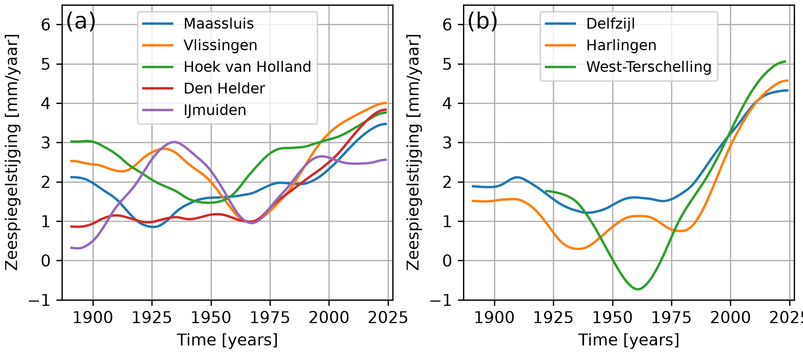
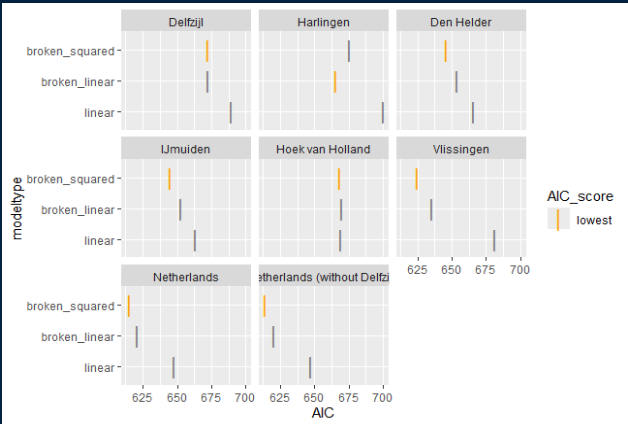
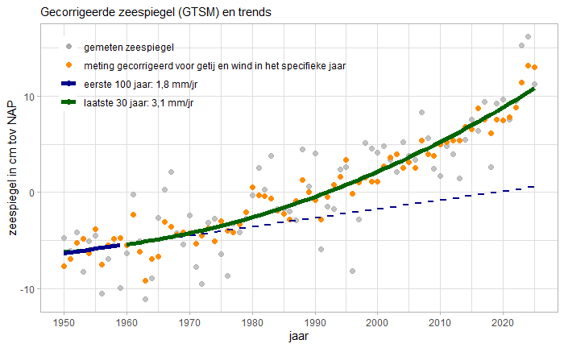

---
acronyms:
  include_unused: false
  insert_loa: false
  loa_title: ""
  fromfile:
  - acronyms.yml
---

# Discussie {#sec-discussie}

## Sluiten de uitkomsten aan bij andere analyses?

De resultaten van de zeespiegelmonitor worden hier vergeleken met de uitkomsten bij het gebruik van andere methodieken, zoals gerapporteerd door @Steffelbauer2022 en @Keizer2022 en PBL (in hun Compendium van de Leefomgeving). Ook wordt vergeleken met mondiale data.

### Huidige snelheid

Gemiddeld over de stations vond @Steffelbauer2022 een relatieve zeespiegelstijging van 2.7 ± 0.4 mm/jaar voor de periode na 1993. @Keizer2022 komen voor de periode 2000-2019 tot een relatieve zeespiegelstijging van 3.0 ± 0.5 mm/jaar. De huidige stijging in de zeespiegelmonitor (3.2±0.3 mm/jaar) is dus consistent met deze studies. 

De Nederlandse waarde ligt duidelijk lager dan de mondiaal gemiddelde absolute zeespiegelstijging (gemiddeld 4,75 mm/jaar in 2012–2025 volgens de \acr{WMO} en 4,4 mm/jaar als actuele langetermijntrend volgende de \acr{NASA}). In Nederland zou de relatieve zeespiegelstijging theoretisch echter hoger moeten zijn dan de globaal berekende absolute zeespiegelstijging, omdat in Nederland bodemdaling bijdraagt aan de relatieve stijging. De verschillen worden veroorzaakt door correcties in het mondiale getal die niet aan de kust gemeten wordt en doordat Nederland op een gunstige plek ligt wat betreft de bijdrage van Groenlands massaverlies aan de zeespiegelstijging (9cm). Andere effecten, zoals veranderingen in dichtheid, zijn hier buiten beschouwing gelaten.

### Versnelling

De gemiddelde snelheid van stijging was in de afgelopen decennia duidelijke hoger dan daarvoor. Toepassen van het gebroken lineaire model (de variant die op basis van de criteria nu het best scoort) toont dat die verandering vanaf ca. 1993 zichtbaar is in de metingen. Toepassen van het gebroken kwadratisch model (de variant die bijna net zo goed scoort als het lineaire model) toont een verandering die vanaf de jaren zestig op gang is gekomen. Een model met constante stijging sinds het begin van de metingen, wat met de data tot en met 2018 nog plausibel werd geacht, voldoet niet meer. 

Een versnelde zeespiegelstijging langs de Nederlandse kust is, met andere methodieken, ook aangetoond door @Steffelbauer2022 en @Keizer2022, zie kader. Het optreden van een versnelling komt overeen met het wereldwijde beeld bij de oceanen, zoals gemeten met satellieten. De conclusie dat de zeespiegel nu sneller stijgt dan in de 20e eeuw gemiddeld is dan ook zeer robuust. 

De data-analyse van de Zeespiegelmonitor maakt het niet mogelijk een uitspraak te doen over òf en in welke mate de versnelling zich voortzet. Het is uiteraard aannemelijk, kijkend naar de achterliggende processen, dat het sneller stijgen niet op één moment in de tijd gebeurde. Onderzoek naar de oorzaken van versnelling, tevens leidend tot uitspraken of de versnelling steeds sterker wordt, wordt in samenwerking met het KNMI gedaan (@sec-budget).

> **Vergelijking met anderen**

> @Steffelbauer2022 onderzocht met een soortgelijke methodiek als de Zeespiegelmonitor of er een significant gezamelijk knikpunt was in de tijdreeks van waterhoogte van de Nederlandse hoofdstations tot 2019. Er is een grotere subset van stations gebruikt (Maassluis en Terschelling zijn ook meegenomen) inclusief Delfzijl. Ook is het knikpunt bepaald aan de afzonderlijke stations (maar wel gezamenlijk), en niet aan het gemiddelde zoals in de Zeespiegelmonitor. Geconstateerd werd dat er een gezamenlijk knikpunt was in 1993. Deze constatering vinden we nu ook in de Zeespiegelmonitor. Gemiddeld over de stations werd door @Steffelbauer2022 een zeespiegelstijging gevonden van 2.7 ± 0.4 mm/jaar voor de periode na 1993. 

> @Keizer2022 onderzocht de trend in zeespiegelstijging over een lange termijn met een geavanceerd statistische methode. Voor correctie door windopzet is de \acr{20CR} heranalyse gebruikt. Na een correctie van de zeespiegel voor de lange termijn windveranderingen is de zeespiegelstijging en het verschil daarin over tijd geschat met behulp van \acr{GAM}. Er is ook rekening gehouden met seizoensvariatie in windopzet. De conclusie uit dit artikel is dat de zeespiegelstijging in de periode 2000-2019 (3.0\[2.4 - 3.5\] mm/jaar) significant hoger is dan in de periode 1940-1959 (1.5\[1.1 - 1.8\] mm/jaar).

> Het \acr{PBL} heeft in zijn [Compendium voor de Leefomgeving](https://www.clo.nl/indicatoren) een grafiek opgenomen over de zeespiegel(stijging) in Nederland. Hiervoor worden dezelfde basisgegevens gebruikt als de Zeespiegelmonitor. De laatste update is van oktober 2026. In het Compendium worden gegevens gemodelleerd met \acr{IRW} (@Visser2015). 

## Gebruik van de resultaten

**Periode van vooruit kijken: maximaal 15 jaar**

In @sec-inleiding is uiteengezet dat het \acr{ENW} in 2015 in haar advies suggereerde dat de methode inzetbaar is om ‘officiële’ waarden voor het niveau van de zeespiegel (wellicht regionaal verschillend) in de nabije toekomst (circa dertig jaar) aan te geven. Vanaf 2018 is ervoor gekozen het begrip ‘nabije toekomst’ in het kader van de zeespiegelmonitor te beperken tot ‘niet langer dan 15 jaar vooruit kijken’, gegeven de onzekerheden in de toekomstscenario’s. Dit geldt nog steeds. Voor projecties voorbij 2040 is de ZSM niet voldoende geschikt. 

**Omgaan met onzekerheid bij 15 jaar vooruit kijken**

In @sec-methodiek is uiteengezet dat de afgesproken methodiek er toe leidt dat de ontwikkeling van de zeespiegel via een gebroken lineair model met knikpunt in 1993 wordt weergegeven. Het verschil met de weergave via ‘gebroken kwadratisch’ met een startpunt in 1960 (vanaf dat moment versnellen als gevolg van de verhoogde uitstoot van broeikasgassen na de tweede wereldoorlog) is echter klein. Het verschil tussen de modellen is hieronder gekwantificeerd door voor beide trendlijnen te tonen wat de waarden zijn in 2040 (15 jaar na de data van de ZSM, die lopen tm 2025). Duidelijk is dat er geen significant verschil is tussen gebruik van beide methodieken tot en met 1940. Deltares beveelt aan dit inzicht te gebruiken cf. de risico’s in de systemen die onderwerp zijn van het beleid.
Voor de kustsuppleties lijkt het voldoende uit te gaan van de onderkant van de onzekerheidsband (volg de lineaire lijn), aangezien dit een volledig adaptieve maatregel is, die in de praktijk erop neerkomt dat opgetreden tekorten aan sediment worden opgevuld. 
Voor het ontwerp van waterkeringen en kunstwerken geeft de onzekerheidsband extra informatie. In gevallen waar het complexer en/of kostbaarder is de kunstwerken aan te passen aan een sneller gestegen zeespiegel lijkt het logischer aan de bovenzijde van de onzekerheidsband te zitten tot 2040. Meestal zullen projecties / scenario’s voorbij 2040 hierbij ook worden betrokken. Dit zal per geval anders uitpakken en dit valt overduidelijk buiten de scope van de \acr{ZSM}.

Bij het bepalen van de risico’s van grondstoffenwinning en bodemdaling onder de Waddenzee lijkt de onzekerheid over de snelheid van zeespiegelstijging tot 2040 klein, wanneer deze wordt vergeleken met de onzekerheid over het gedrag van elk bekken van de Waddenzee, meer precies het meegroeivermogen. Vanwege de mogelijkheden om in te grijpen, is de winning een maatregel die in principe adaptief is. Dit suggereert dat de onzekerheidsband net zo benaderd kan worden als bij de kustsuppleties, maar hierover zijn gedurende de ontwikkeling van de zeespiegelmonitor geen uitspraken gedaan. Dit betekent dat dit verder buiten de scope van de \acr{ZSM} ligt.

**Zijn de resultaten bruikbaar voor keuzes tussen scenario’s (na 2040)?**

De kennis die in dit rapport wordt gepresenteerd helpt bij het kiezen over gebruik van projecties voor de zeespiegel. Voor Nederland maakt het KNMI deze projecties [^1]. De jaarlijkse zeespiegelstand en de trend daarin die de ZSM geeft geven geen aanwijzing welk scenario van zeespiegelstijging na 2040 meer of minder waarschijnlijk is [^2]. 

[^1]: De studie naar de verschillende bijdragen aan de stijging van de zeespiegel, uitgevoerd door het KNMI en in samenvatting opgenomen in dit rapport (zie @sec-budget) geeft hiervoor wel kennis. 

[^2]: Belangrijke feiten zijn dat de scenario’s van zeespiegelstijging tot 2050 weinig verschillen, dat er mondiaal al een duidelijk waarneembare opwarming van het klimaat is, maar deze met vertraging de snelheid van de zeespiegelstijging beinvloedt. Tevens is dit een niet-lineair proces, waarin het gedrag van Antarctica bij een stijgende temperatuur van de aarde de belangrijkste onzekerheid is.

## Bronnen van onzekerheden in de resultaten

### Te verklaren verschillen tussen hoofdstations

Er zijn verschillen tussen de berekende zeespiegelstijging voor de hoofdstations . De grootste verschillen doen zich voor in de periode vóór 1993. In die periode vertonen Harlingen, en in mindere mate ook Den Helder en Delfzijl lagere stijging dan de stations aan de rest van de Nederlandse kust (Vlissingen, Hoek van Holland en IJmuiden (@sec-ruimtelijke-variatie). Over het algemeen vertonen de stations een zeer gelijksoortige huidige zeespiegelstijging. Dat geeft vertrouwen in de metingen en de methodiek om de huidige zeespiegelstijging vast te stellen. Ook het feit dat de resultaten overeenkomen met resultaten van andere partijen met verschillende methodische aanpak, geeft veel vertrouwen. De op dit moment bekende oorzaken van resterende variatie in de data worden hieronder genoemd.

### Veranderingen in de Westelijke Waddenzee

Er zijn sterke aanwijzingen dat de lagere stijging bij Harlingen en Den Helder voor zeer belangrijk deel samenhangt met de aanpassing van de westelijke Waddenzee aan de afsluiting van de Zuiderzee in 1932. De afsluiting heeft gezorgd voor een enorme verkleining van het bekken. Hierdoor veranderde het getij plotsklaps. De aanpassing van de bodemligging hierop heeft lang geduurd. Tijdens die bodemaanpassing wordt ook de gemiddelde waterstand beïnvloed, wat gevolgen heeft voor de waarnemingen van de zeespiegel. Verder is de zoetwaterverdeling in de westelijke Waddenzee hierdoor veranderd. Bovendien vertonen de veranderingen ook onderlinge afhankelijkheid. Veranderingen in spuidebieten van het IJsselmeer hebben nog meer bijgedragen aan veranderingen in de zoutverspreiding. Er zijn dus meerdere processen die het signaal in de zeespiegelstijging bij stations in de buurt van de westelijke Waddenzee verstoorden.

Recente studies suggereren dat tussen 1990 en 2000 een punt werd bereikt dat de reactie voor meer dan 90% was afgerond. Tevens is te zien dat de zeespiegelstijging sinds het begin van de jaren 1990 weer min of meer gelijk opgaat met de andere stations langs de Nederlandse kust. Voor meer informatie wordt verwezen naar @sec-zeespiegel-wadden.

### Loskoppeling van NAP-vlak voor Delfzijl

De bodemdaling door gaswinning zorgt bij Delfzijl voor onzekerheden. Het laatste decennium is dit station losgekoppeld van het \acr{NAP} nulvlak vanwege de te snelle verandering in hoogte. Rijkswaterstaat \acr{CIV} is bezig om voor Delfzijl de gemeten waterhoogtes te herzien, waarbij niet langer \acr{NAP} gebruikt wordt als verticale referentie, maar de geoïde. Hiermee zullen de trends voor Delfzijl geïnterpreteerd moeten worden als absolute zeespiegelstijging. De verwachting is dat de herziening in de komende jaren komt. Mogelijk wordt in een volgende monitor Delfzijl weer toegevoegd.

### Versnelde daling van de M-bout bij IJmuiden {#sec-ijmuiden}

Zoals vermeld in Paragraaf 5.9 is de recente veranderingssnelheid bij IJmuiden lager dan bij alle andere stations. Dit zou te wijten kunnen zijn aan een fout in de meting van het peilstation (M-bout) ten opzichte van de dichtstbijzijnde nulpaal (Fig. 13 in @Honingh2021). De daling van de M-bout laat 14 mm bodemdaling zien tussen 2003 en 2004, vergeleken met een gemiddelde bodemdalingssnelheid van 1,3 mm/jaar in de daaropvolgende jaren. Deze mogelijke meetfout zou leiden tot een reductie van de trend over 1993–2025 met ongeveer 0,4 mm/jaar, wat zou verklaren waarom IJmuiden een uitbijter is. Het statistische GAM-model beschreven in @keizer_acceleration_2023 biedt hier extra inzicht voor, omdat het naar de continue evolutie van de snelheid van de zeespiegel in de tijd kijkt, zie de resultaten voor 8 stations langs de kust in @fig-gam-diff. In paneel (a) staan de stations aan de Noordzeekust en in paneel (b) de stations in de Waddenzee. 

{#fig-gam-diff width=80%}
 
@fig-gam-diff biedt ook een illustratie van de data bij de in de vorige secties besproken onzekerheden bij de stations bij de Waddenzee en Delfzijl in het bijzonder. De zeespiegelstijging in Delfzijl lijkt in de jaren 50 en 60 het snelst en nu het langzaamst.

### Niet-verklaarde kortdurende variatie bij individuele stations 

Er zijn “schommelingen” zichtbaar bij individuele stations. Deze zijn soms te herleiden naar grote ingrepen (Deltawerken, Afsluitdijk). Het is aannemelijk dat er meer variatie is te koppelen aan grote ingrepen in het verleden, denk aan uitbreidingen van havens of sluizen, verdiepingen, zoetwaterverdeling. Dit wordt in de komende jaren verder uitgezocht.

### Niet-verklaarde afwijkingen bij de nulpaal

De nulpalen die gekoppeld zijn aan de hoofdgetijdestations zijn de verticale referenties die sturend zijn voor de afstelling van de meetinstrumenten (zie paragraaf en infographics). De hoogtes van ondergrondse merken die samen het NAP netwerk vormen zijn gepubliceerd vanaf 1970-1980, afhankelijk van locatie.  Deze hoogtes zijn bepaald in verschillende projecten, ten opzichte van het regionale referentienetwerk. Alleen in de Nauwkeurigheidswaterpassing (NWP) worden deze waarden weer gerelateerd aan de nationale referenties op de Veluwe. Na de laatste NWP zijn de hoogtes daarom ook herberekend. 

Wat opvalt is dat het verloop van de hoogtes in de tijd niet helemaal constant is. Vooral de stations Harlingen en Den Helder vertonen een verschil waarbij er vóór pakweg 1990 een duidelijk snellere daling is van de nulpaal t.o.v. de regionale referenties dan daarna. Dit valt samen met de sterke knik in relatieve zeespiegelstijging bij die stations. Aangezien deze metingen gebruikt worden om de meetinstrumenten af te stellen is het niet uit te sluiten dat dit een bijdrage heeft geleverd aan een veranderende zeespiegelstijging in die periode. Zie ook bijlage @sec-zeespiegel-wadden.

## Doelmatigheid methodiek en mogelijke verbeteringen {#sec-doelmatigheid}

### Nu alleen de hoofdstations

Er is gekozen om de stand van de zeespiegel langs de Nederlandse kust alleen te baseren op de hoofdstations. Deze hebben een lange tijdreeks. Ze geven de relatieve zeespiegel voor onze kust beter weer dan satellietgegevens. Deze laatste hebben een grotere ruimtelijke dekking, maar zijn niet gedetailleerd genoeg in de kustzone (zie @sec-altimetrie). De wetenschappelijke ontwikkelingen op het gebied van satellietmetingen en de verwerking ervan worden gevolgd om vast te stellen of satellietdata een extra rol in de zeespiegelmonitor kunnen gaan spelen.

### Rekening houden met nodaal getij

Het nodale getij geeft variatie in de stand van de zeespiegel. Dit is uitgelegd in Hoofdstuk 4. De lange periode van deze terugkerende variatie (ruim 18 jaar) maakt het van belang te weten waar in deze cyclus een jaar ligt. 

Een onafhankelijke schatting van het nodaal getij is mogelijk door middel van berekening van het zogenaamde equilibrium getij. Echter, het geobserveerde getij aan de Nederlandse kust blijkt daarvan af te wijken. De oorzaak ervan ligt in fysische processen die de doorwerking van het nodale getij op het contentinale plat bepalen (zie @sec-getij voor meer details). Hierom wordt het nodaal getij meegenomen als term in de regressie, om zo de variatie in zeespiegelhoogte door het getij beter te verklaren. Dit is in lijn met recent onderzoek hieraan (@Bult2024).

### Windopzetcorrectie vanaf 1950

Het effect van wind of storm is een belangrijke bron van variatie voor de jaarlijkse zeespiegel aan de Nederlandse kust [@Baart2014a; @Gerkema2017]. Sinds de rapportage in 2022 gebruiken we resultaten van het \acr{GTSM} om voor het effect van wind op de gemiddelde waterstand te corrigeren. Dit maakt het mogelijk om (in tegenstelling tot het alternatief van wind meenemen in de regressieanalyse) het effect van wind op de zeespiegel geheel onafhankelijk te schatten. Het \acr{GTSM} model was in 2022 beschikbaar voor de periode van 1979 tot nu (een serie van 43 jaar), maar voor de huidige rapportage is het model uitgebreid tot de jaren 1950 tot nu (75 jaar). Dit heeft niet tot wezenlijk andere resultaten of conclusies geleid.

Het feit dat er pas vanaf 1950 gecorrigeerd kan worden voor de jaarlijks variërende windopzet met \acr{GTSM} verbetert in principe het zeespiegelsignaal, maar zorgt ook voor een inhomogene variantie, waarmee nu niet rekening wordt gehouden. Uitbreiden van de windopzet naar de jaren vóór 1950 is nu niet mogelijk, want er zijn geen klimaatheranalyses waarmee \acr{GTSM} aangestuurd kan worden voor die jaren. Als dit in de toekomst alsnog kan zal dit overwogen worden, aangezien het de analyse statistisch robuuster maakt. Anderzijds is niet te verwachten het de uitkomst wat betreft de huidige zeespiegelstijging veel zal veranderen.

### Als alternatief de analyse uitvoeren vanaf 1950?

Een andere aanpak om het probleem van verschillen in variantie over de tijd te vermijden is om alleen metingen vanaf 1950 meenemen in de analyse. Een tweede reden om de tijdserie in te korten is dat oudere metingen onzekerder zijn dan nieuwere. Oorzaken daarvan liggen in de frequentie van meten en de grotere onzekerheid in de absolute verticale referentie van de zeespiegelmetingen vóór de invoering van nulpalen (1958).

:::{#fig-kortere-tijdserie-AIC}

{width=60%}

AIC Analyse van zeespiegeltijdserie met een verkorte tijdserie (vanaf 1950) met de methodiek van de Zeespiegelmonitor. Door het weglaten van veel meetdata verschuift het voorkeursmodel van gebroken lineair naar gebroken kwadratisch.

:::

Door de tijdserie in te korten wordt echter mogelijk waardevolle informatie niet gebruikt. Ook kan het toelaten van een knikpunt onzekerder resultaten opleveren als deze dichter bij het begin van de tijdserie komt te liggen, zoals het knikpunt bij 1960 voor het gebroken kwadratische model. 

Het verkorten van de tijdserie zou kunnen betekenen dat er een ander voorkeursmodel als uitkomst is (@fig-kortere-tijdserie-AIC en @fig-kortere-tijdserie-kwadratisch). Dat zal de schatting van de stijging van de zeespiegel veranderen en daarmee ook de vooruitblik tot en met 2040. De verschillen tussen de best scorende modellen zijn echter voor 2040 (zie…) klein

!!!!!! Placeholder referentie naar figuur met vooruitblik en verschillende modellen

:::{#fig-kortere-tijdserie-kwadratisch}

{width=60%}

Analyse van zeespiegeltijdserie met een verkorte tijdserie (vanaf 1950) met de methodiek van de Zeespiegelmonitor. Door het weglaten van veel meetdata verschuift het voorkeursmodel van gebroken lineair naar gebroken kwadratisch.

:::

### Meer modellen toevoegen {#sec-meer-modellen}

Op dit moment wordt een \acr{LM} of \acr{GLM} methodiek gebruikt om de verschillende modellen te fitten. Op termijn zal de relatief beperkte set van modellen waarop wordt getest (lineair, gebroken lineair, en gebroken kwadratisch) onvoldoende kunnen zijn om optredende veranderingen weer te geven. De komende jaren wordt hier in meer detail naar gekeken. Hieronder volgt een korte uitkijk naar hoe de methodiek zich verder zou kunnen ontwikkelen.

In andere studies wordt ook wel een \acr{GAM} (@Keizer2022), \acr{LOESS}, of \acr{IRW} (@Visser2015)) gebruikt. Het belangrijkste verschil is dat een GLM een vooraf gespecificeerde parametrische relatie tussen voorspellers en respons veronderstelt, terwijl een GAM, wanneer een spline functie wordt toegevoegd, deze relatief flexibel en niet-parametrisch uit de data schat. Een GAM heeft hierdoor meer potentie om de meetgegevens beter te beschrijven, maar die toename komt niet door een betere duiding van natuurkundige principes, maar door een hogere graad van vrijheid. Een ander nadeel bij flexibele modellen als GAM is dat de onzekerheid toeneemt naar de uiteinden van de tijdserie. 

Een eerste vergelijking van een GAM en GLM model met dezelfde methodiek en dataset laat zien dat er op het oog weinig verschillen zijn in de beschrijving van de gemiddelde zeespiegel langs de Nederlandse kust. De zeespiegelstijging over de jaren is bij het gebroken lineaire model abrupt in 1993, en verloopt geleidelijker bij het GAM model (@fig-gam-glm-zeespiegel). 
 
:::{#fig-gam-glm-zeespiegel}

{width=80%}

Vergelijking GAM en "broken linear" model voor de Nederlandse zeespiegelmetingen.

:::

:::{#fig-gam-glm-zss}

{width=80%}

Vergelijking van de snelheid van zeespiegelstijging zoals geschat met het GAM model en het "broken linear" model inclusief het betrouwbaarheidsinterval.

:::

Bij toepassing op individuele stations, zijn de verschillen groter. Het GAM volgt de variatie van individuele stations beter dan de GLM variant (@fig-gam-glm-zeespiegel-stations). Het GLM presteert beter voor de gemiddelde zeespiegel in Nederland. Deze analyse is ook te vinden in een online [rekendocument](https://github.com/Deltares-research/sealevelmonitor/blob/main/analysis/sealevelmonitor/gam-knmi-analyse.md).

:::{#fig-gam-glm-zeespiegel-stations}

{width=80%}

Vergelijking van de snelheid van zeespiegelstijging zoals geschat met het GAM model en het "broken linear" model inclusief het betrouwbaarheidsinterval voor de zes hoofdstations.

:::

### spare parts

Volgens de criteria die we hanteren voor modelkeuze (\acr{AIC}) is, net als bij de voorgaande rapportage, een keuze gemaakt voor het gebroken lineaire model met een knikpunt in 1993 (zie dit [rekendocument](https://github.com/Deltares-research/sealevelmonitor/blob/main/analysis/sealevelmonitor/sealevelanalysis.md)). Dit is het meest geschikte model voor schatting van de huidige zeespiegel (op grond van onze criteria), en de zeespiegelstijging over de afgelopen decennia. De methode is geschikt om over relatief korte tijd een verandering van zeespiegelstijging te detecteren. Gegeven het feit dat we een knik veronderstellen is dit een beter model dan het lineaire. Ook is er op grond van de residuen geen reden om het model af te wijzen. De gebruikte methodiek zegt echter niet veel over de oorzaak van deze verandering.

We zien deze keer wel dat de twee verschillende modellen met een versnellingsterm (gebroken lineair en gebroken kwadratisch) maar weinig verschillen in termen van \acr{AIC}. Het gebroken kwadratische model zal beter gaan presteren in het geval dat de zeespiegel zou blijven versnellen. Ondanks dat de modellen voor de afgelopen dicht bij elkaar liggen, is het verschil tussen de modellen, wanneer deze geextrapoleerd worden naar de komende jaren, veel groter. Dat zou een abrupte verandering geven van de verwachte (geëxtrapoleerde) zeespiegel. De komende jaren zal bekeken worden of het nodig is om hierop in te spelen door de methodiek eventueel aan te passen (@sec-uitkijk-methodiek). 

Voor kustonderhoud via zandsuppletie is de huidige methode geschikt. Zandsuppletie is een reactief proces, bedoeld om het volume zand dat nodig is om het kustfundament mee te laten groeien met de zeespiegel aan te vullen. Hiervoor is een zo betrouwbaar mogelijke schatting van de zeespiegelstijging over de afgelopen jaren nodig. De methode die gebruikt wordt voor het presenteren van de resultaten in hoofdstuk \@ref(resultaten) voldoet daaraan.

De zeespiegelmonitor is niet bedoeld om de verwachte zeespiegelstand langere tijd vooruit (bijvoorbeeld in 2050 of 2100) te bepalen. Tegelijkertijd zien we dat zeespiegelscenario's niet bedoeld zijn om op korte termijn de zeespiegel te voorspellen. Voor de planning van zandsuppletie op middellange termijn (10-15 jaar vooruit) is het nodig om een zo nauwkeurig mogelijke schatting te maken van de zeespiegelstijging over die periode. Hiervoor is binnen de zeespiegelmonitor geen methodiek vastgelegd. Totdat een betere methode beschikbaar is, kiezen we een periode van tot 15 jaar vooruit, als de periode waarvoor we het gebruik van de huidige zeespiegel en -stijging zoals beschreven in het voorkeursmodel aanraden.

Een huidige zeespiegelstand op zichzelf is niet geschikt voor beoordelingen van veiligheid. Daarvoor is de verwachte maximale zeespiegel nodig (getij + absolute zeespiegel + bodemdaling + hoogwater + golven) ten opzichte van de hoogte van de keringen. Het kan wel als component gebruikt worden.

::: {.content-visible when-format="html"}

## Lijst met gebruikte afkortingen

\printacronyms

:::
