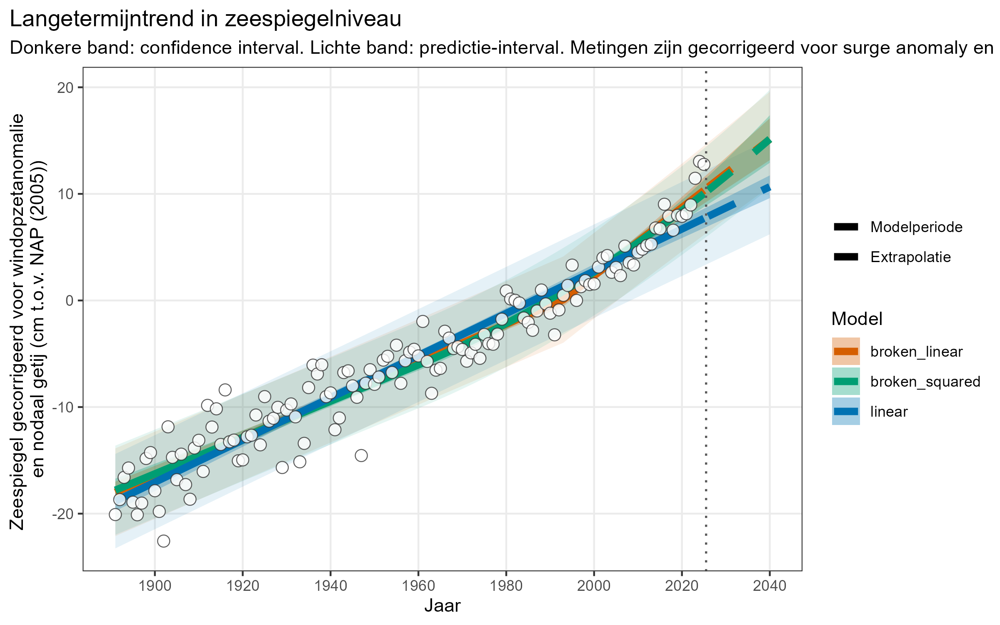
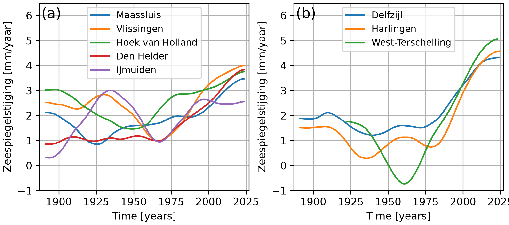
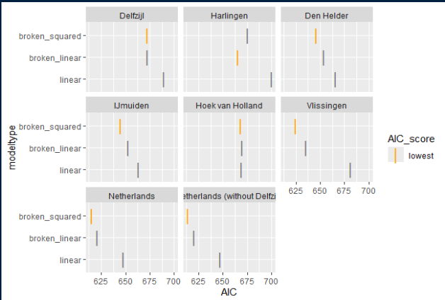
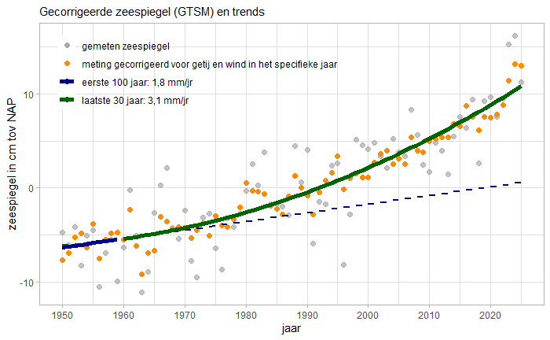
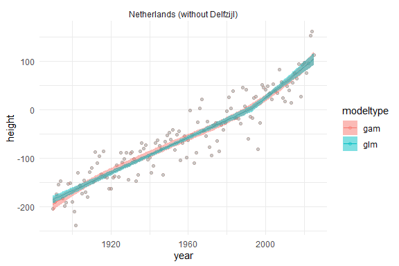
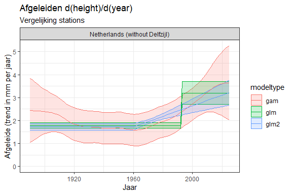
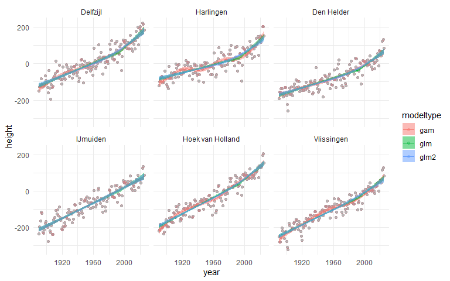

---
acronyms:
  include_unused: false
  insert_loa: false
  loa_title: ""
  fromfile:
  - acronyms.yml
---

# Discussie {#sec-discussie}

Dit hoofdstuk behandelt de belangrijkste discussiepunten aangaande de gerapporteerde waarden door de Zeespiegelmonitor. In de eerste twee delen wordt vergeleken met andere studies die meetdata van de zeespiegel analyseerden. Daarna wordt ingegaan op de verschillen binnen de studie van de Zeespiegelmonitor zelf en verbeteringen die er in de toekomst mogelijk zijn voor de methodiek.

## Vergelijking Nederlandse resultaten met mondiale metingen

De Nederlandse waarde ligt duidelijk lager dan de mondiaal gemiddelde absolute zeespiegelstijging (gemiddeld 4,75 mm/jaar in 2012–2025 volgens de \acr{WMO} en 4,4 mm/jaar als actuele langetermijntrend volgende de \acr{NASA}). )). Voor Nederland zou een hogere relatieve zeespiegelstijging verwacht kunnen worden omdat hier bodemdaling bijdraagt aan de relatieve stijging. Er zijn echter andere factoren die de hoofdrol spelen. Ten eerste zijn er verschillen door correcties in het mondiale getal die niet aan de kust gemeten wordt en ten tweede ligt Nederland op een gunstige plek wat betreft de bijdrage van Groenlands massaverlies aan de zeespiegelstijging (zie ook @sec-budget). Andere effecten, zoals veranderingen in dichtheid, zijn kleiner en worden hier niet besproken.

## Vergelijking met andere studies over de Nederlandse kust.

### Met welke studies is vergeleken?

@Steffelbauer2022 onderzocht met een soortgelijke methodiek als de Zeespiegelmonitor of er een significant gezamelijk knikpunt was in de tijdreeks van waterhoogte van de Nederlandse hoofdstations tot 2019. Er is een grotere subset van stations gebruikt (Maassluis en Terschelling zijn ook meegenomen) inclusief Delfzijl. Ook is het knikpunt bepaald aan de afzonderlijke stations en niet aan het gemiddelde zoals in de Zeespiegelmonitor. Geconstateerd werd dat er een gezamenlijk knikpunt was in 1993. Deze constatering vinden we nu ook in de Zeespiegelmonitor. Gemiddeld over de stations werd door @Steffelbauer2022 een zeespiegelstijging gevonden van 2,7 ± 0,4 mm/jaar voor de periode na 1993.

@Keizer2022 onderzocht de trend in zeespiegelstijging over een lange termijn met een geavanceerd statistische methode. Voor correctie door windopzet is de \acr{20CR} heranalyse gebruikt. Na een correctie van de zeespiegel voor de lange termijn windveranderingen is de zeespiegelstijging en het verschil daarin over tijd geschat met behulp van \acr{GAM.} Er is ook rekening gehouden met seizoensvariatie in windopzet. De conclusie uit dit artikel is dat de zeespiegelstijging in de periode 2000-2019 (3,0[2,4 - 3,5] mm/jaar) significant hoger is dan in de periode 1940-1959 (1,5[1,1 - 1,8] mm/jaar).

### Huidige snelheid

Gemiddeld over de stations vond @Steffelbauer2022 een relatieve zeespiegelstijging van 2.7 ± 0.4 mm/jaar voor de periode na 1993. @Keizer2022 komen voor de periode 2000-2019 tot een relatieve zeespiegelstijging van 3.0 ± 0.5 mm/jaar. De huidige stijging in de zeespiegelmonitor (3.2±0.3 mm/jaar) is consistent met deze studies. 

### Versnelling

De Zeespiegelmonitor toont dat de gemiddelde snelheid van stijging in de afgelopen decennia duidelijk hoger was dan daarvoor (@sec-huidige). Het gebroken lineaire model is de variant die op basis van de criteria nu het best scoort en daaruit volgt een verandering vanaf ca. 1993. Het gebroken kwadratisch model scoort bijna net zo goed scoort als het gebroken lineaire model en toont een verandering die vanaf de jaren zestig op gang is gekomen

Een versnelde zeespiegelstijging langs de Nederlandse kust is, met andere methodieken, ook aangetoond door @Steffelbauer2022 en @Keizer2022. Het optreden van een versnelling komt overeen met het wereldwijde beeld bij de oceanen, zoals gemeten met satellieten. De conclusie dat de zeespiegel nu sneller stijgt dan in de 20e eeuw gemiddeld is dan ook zeer robuust.

De data-analyse van de Zeespiegelmonitor maakt het niet mogelijk een uitspraak te doen over òf en in welke mate de versnelling zich voortzet. Het is uiteraard aannemelijk, kijkend naar de achterliggende processen, dat het sneller stijgen niet op één moment in de tijd gebeurde. Onderzoek naar de oorzaken van versnelling, tevens leidend tot uitspraken of de versnelling steeds sterker wordt, wordt door het KNMI gedaan (@sec-budget).

### Is de gerapporteerde trend en versnelling fysisch verklaarbaar?

> @Willem: als je klaar bent met de twee andere hoofdstukken dit schrijven, om te voorkomen dat we dubbelingen hebben. Lijkt me wel handig deze paragraaf te schrijven gezien commentaren. -> er zijn dingen gebeurd rond 1993 die de plek van de breuk op dat moment rechtvaardigen, maar fysisch anders uiteraard. Evenzo zegt de literatuur zaken over 1960 bij kwadratisch. We zouden ook nog kunnen verwijzen, net als in eerste hoofdstuk, naar wat in de ZSM 2018 hier al over staat (heel veel oorzaken, dus sws niet via een normale wiskundige relatie.

### Gebruik van de resultaten

In @sec-inleiding is uiteengezet dat de Zeespiegelmonitor inzetbaar is om ‘officiële’ waarden voor het niveau van de zeespiegel (wellicht regionaal verschillend) voor 15 jaar vooruit aan te geven. Deze periode geldt nog steeds en voor projecties voorbij 2040 is de Zeespiegelmonitor niet voldoende geschikt.

In @sec-methodiek is vervolgens uiteengezet dat de afgesproken methodiek er toe leidt dat de ontwikkeling van de zeespiegel via een gebroken lineair model met knikpunt in 1993 wordt weergegeven. Het verschil met de weergave via ‘gebroken kwadratisch’ met een startpunt in 1960 (hier begint het versnellen cf. de literatuur, vanwege de verhoogde uitstoot van broeikasgassen na de tweede wereldoorlog) is echter klein. Het verschil tussen de modellen is hieronder gekwantificeerd door voor beide trendlijnen te tonen wat de waarden zijn in 2040 (15 jaar na de data van de Zeespiegelmonitor , die lopen tm 2025). 

:::{#fig-zsm-model-vergelijking}

{width=80%}

Modelfit en extrapolatie tot 2040 met het gebroken lineaire model en het gebroken kwadratische model voor 'Netherlands (without Delfzijl)'. 

:::
 
Duidelijk is dat er nauwelijks verschil is tussen gebruik van gebroken lineair en gebroken kwadratisch tot en met 2040. Uitgaande van deze twee modellen is de onzekerheid over de toekomstige zeespiegelstijging op die tijdschaal dus beperkt. Kijkend naar de beleids- en beheerscontext waarin de trend in de zeespiegel gebruikt wordt concludeert Deltares het volgende. 

Voor de kustsuppleties is het voldoende uit te gaan van de gerapporteerde trend en verwachte stand van de zeespiegel in 2040. Kustlijnzorg  is immers een volledig adaptieve maatregel, die erop neerkomt dat opgetreden tekorten aan sediment worden opgevuld. 

Voor het bepalen van de risico’s van grondstoffenwinning en bodemdaling onder de Waddenzee is er ook relatief weinig onzekerheid over de snelheid en verwachte stand van de zeespiegel tot 2040.  Dit geldt zeker gegeven de veel grotere onzekerheid over het gedrag van elk bekken van de Waddenzee, meer precies het meegroeivermogen. Dit dossier ligt verder buiten de scope van de ZSM.

Voor waterkeringen en kunstwerken is het resultaat van de Zeespiegelmonitor niet leidend, maar geeft het wel extra informatie voor het afleiden van de hydraulische belastingen. Projecties / scenario’s voorbij 2040 zijn bijna altijd belangrijker bij het ontwerp. 

De zeespiegelstand en de trend daarin die de Zeespiegelmonitor rapporteert geven geen aanwijzing welk scenario van zeespiegelstijging na 2040, die het KNMI  voor Nederland maakt [^1], meer of minder waarschijnlijk is [^2]. De kennis die dit rapport presenteert (@@sec-budget)) kan wel helpen bij het gebruik van de scenario’s. 

[^1]: De studie naar de verschillende bijdragen aan de stijging van de zeespiegel, uitgevoerd door het KNMI en in samenvatting opgenomen in dit rapport (zie @sec-budget) geeft hiervoor wel kennis. 

[^2]: Belangrijke feiten zijn dat de scenario’s van zeespiegelstijging tot 2050 weinig verschillen, dat er mondiaal al een duidelijk waarneembare opwarming van het klimaat is, maar deze met vertraging de snelheid van de zeespiegelstijging beinvloedt. Tevens is dit een niet-lineair proces, waarin het gedrag van Antarctica bij een stijgende temperatuur van de aarde de belangrijkste onzekerheid is.

## Onzekerheden veroorzaakt door modelkeuze

De Zeespiegelmonitor hanteert een beperkte set modellen om de zeespiegel te beschrijven. Ten grondslag hiervan liggen de afwegingen gemaakt in @sec-afwegingen. Stabiliteit, spaarzaamheid en behoudendheid zijn belangrijke afwegingen om een relatief conservatieve schatting te maken voor de huidige zeespiegelstijging. De keuze om naar een conservatieve waarde te streven wordt verklaard door het doel van de Zeespiegelmonitor en het adaptieve karakter van het beoogde gebruik (zie ook sec-methodiek-en-toepassing). De zeespiegelmonitor produceert daardoor een zeespiegelstijging die naar verwachting niet snel te hoog uitvalt.

Over het algemeen zijn er bij alle gebruikte modellen mogelijkheden om de flexibiliteit aan te passen. Het gebroken lineaire model is vrij star (niet flexibel), wat deels veroorzaakt wordt doordat we het jaar waarin het breekpunt optreedt niet aanpassen. Een keuze om dat wel te doen maakt het model flexibeler, en leidt tot een hogere zeespiegelstijging over de laatste jaren (zie dit [rekendocument](https://github.com/Deltares-research/sealevelmonitor/blob/reporting26_final/analysis/sealevelmonitor/breakpoints_analyse.md)). Doordat de metingen van de laatste drie jaar boven de trend liggen, wordt het breekpunt "opzij getrokken". De vraag is of hiervoor het model aangepast moet worden. Aangezien het vaker gebeurt dat metingen meerdere jaren achter elkaar boven of onder de trend vallen, besluiten we hier om het model niet aan te passen. Er is eenvoudig niet genoeg informatie om op dit moment te kiezen voor het één of het ander, waardoor we terugvallen op het behoudendheidsprincipe. 

De onzekerheid die met deze keuze geassocieert is wordt geillustreerd doordat een andere keuze (bijvoorbeeld het \acr{GAM} model dat \acr{KNMI} hanteert) een ander zeespiegelstijgingsgetal oplevert (namelijk ... +/- ... cm NAP(2005)). Een ander Het is moeilijk om deze onzekerheid precies in te schatten. Voor elke situatie en doel zal de gebruiker zich moeten afvragen of er een conservatiever dan wel beweeglijker model geschikt is. 

## Onzekerheden door verschillen in metingen tussen hoofdstations

### Algemeen

Er zijn verschillen tussen de berekende zeespiegelstijging voor de hoofdstations. De grootste verschillen doen zich voor in de periode vóór 1993. In die periode vertonen Harlingen, en in mindere mate ook Den Helder en Delfzijl lagere stijging dan de stations aan de rest van de Nederlandse kust (Vlissingen, Hoek van Holland en IJmuiden (@sec-ruimtelijke-variatie). Over het algemeen vertonen de stations een zeer gelijksoortige huidige zeespiegelstijging. Dat geeft vertrouwen in de metingen en de methodiek om de huidige zeespiegelstijging vast te stellen. Ook het feit dat de resultaten overeenkomen met resultaten van andere partijen met verschillende methodische aanpak, geeft veel vertrouwen. De op dit moment bekende oorzaken van resterende variatie in de data worden in de volgende paragrafen verhandeld.

### Veranderingen in de Westelijke Waddenzee

Er zijn sterke aanwijzingen dat de lagere stijging bij Harlingen en Den Helder voor zeer belangrijk deel samenhangt met de aanpassing van de westelijke Waddenzee aan de afsluiting van de Zuiderzee in 1932. De afsluiting heeft gezorgd voor een enorme verkleining van het bekken. Hierdoor veranderde het getij binnen enkele jaren. De aanpassing van de bodemligging hierop heeft lang geduurd en is nog bezit. Tijdens die bodemaanpassing wordt ook de gemiddelde waterstand beïnvloed, wat gevolgen heeft voor de waarnemingen van de zeespiegel. Verder is de zoetwaterverdeling in de westelijke Waddenzee hierdoor veranderd. Bovendien vertonen de veranderingen ook onderlinge afhankelijkheid. Veranderingen in spuidebieten van het IJsselmeer hebben nog meer bijgedragen aan veranderingen in de zoutverspreiding. Er zijn dus meerdere processen die het signaal in de zeespiegelstijging bij stations in de buurt van de westelijke Waddenzee verstoorden.

Recente studies suggereren dat tussen 1990 en 2000 een punt werd bereikt dat de reactie voor meer dan 90% was afgerond. Tevens is te zien dat de zeespiegelstijging sinds het begin van de jaren 1990 weer min of meer gelijk opgaat met de andere stations langs de Nederlandse kust. Voor meer informatie wordt verwezen naar @sec-zeespiegel-wadden.

### Loskoppeling van NAP-vlak voor Delfzijl

De bodemdaling door gaswinning zorgt bij Delfzijl voor onzekerheden. Het laatste decennium is dit station losgekoppeld van het \acr{NAP} nulvlak vanwege de te snelle verandering in hoogte. Rijkswaterstaat \acr{CIV} is bezig om voor Delfzijl de gemeten waterhoogtes te herzien, waarbij niet langer \acr{NAP} gebruikt wordt als verticale referentie, maar de geoïde. Hiermee zullen de trends voor Delfzijl geïnterpreteerd moeten worden als absolute zeespiegelstijging. De verwachting is dat de herziening in de komende jaren komt. Mogelijk wordt in een volgende monitor Delfzijl weer toegevoegd.

### Versnelde daling van de M-bout bij IJmuiden {#sec-ijmuiden}

Zoals vermeld in @sec-ruimtelijke-variatie is de recente veranderingssnelheid bij IJmuiden lager dan bij alle andere stations. Dit zou te wijten kunnen zijn aan een fout in de meting van het peilstation (M-bout) ten opzichte van de dichtstbijzijnde nulpaal (Fig. 13 in @Honingh2021). De daling van de M-bout laat 14 mm bodemdaling zien tussen 2003 en 2004, vergeleken met een gemiddelde bodemdalingssnelheid van 1,3 mm/jaar in de daaropvolgende jaren. Deze mogelijke meetfout zou leiden tot een reductie van de trend over 1993–2025 met ongeveer 0,4 mm/jaar, wat zou verklaren waarom IJmuiden een uitbijter is. Het statistische GAM-model beschreven in @keizer_acceleration_2023 biedt hier extra inzicht voor, omdat het naar de continue evolutie van de snelheid van de zeespiegel in de tijd kijkt, zie de resultaten voor 8 stations langs de kust in @fig-gam-diff. In paneel (a) staan de stations aan de Noordzeekust en in paneel (b) de stations in de Waddenzee. 

{#fig-gam-diff width=80%}
 
@fig-gam-diff biedt ook een illustratie van de data bij de in de vorige secties besproken onzekerheden bij de stations bij de Waddenzee en Delfzijl in het bijzonder. De zeespiegelstijging in Delfzijl lijkt in de jaren 50 en 60 het snelst en nu het langzaamst.

### Niet-verklaarde kortdurende variatie bij individuele stations 

Er zijn “schommelingen” zichtbaar bij individuele stations. Deze zijn soms te herleiden naar grote ingrepen (Deltawerken, Afsluitdijk). Het is aannemelijk dat er meer variatie is te koppelen aan grote ingrepen in het verleden, denk aan uitbreidingen van havens of sluizen, verdiepingen, zoetwaterverdeling. Dit wordt in de komende jaren verder uitgezocht.

### Niet-verklaarde afwijkingen bij de nulpaal

De nulpalen die gekoppeld zijn aan de hoofdgetijdestations zijn de verticale referenties die sturend zijn voor de afstelling van de meetinstrumenten (zie paragraaf en infographics). De hoogtes van ondergrondse merken die samen het NAP netwerk vormen zijn gepubliceerd vanaf 1970-1980, afhankelijk van locatie.  Deze hoogtes zijn bepaald in verschillende projecten, ten opzichte van het regionale referentienetwerk. Alleen in de Nauwkeurigheidswaterpassing (NWP) worden deze waarden weer gerelateerd aan de nationale referenties op de Veluwe. Na de laatste NWP zijn de hoogtes daarom ook herberekend. 

Wat opvalt is dat het verloop van de hoogtes in de tijd niet helemaal constant is. Vooral de stations Harlingen en Den Helder vertonen een verschil waarbij er vóór pakweg 1990 een duidelijk snellere daling is van de nulpaal t.o.v. de regionale referenties dan daarna. Dit valt samen met de sterke knik in relatieve zeespiegelstijging bij die stations. Aangezien deze metingen gebruikt worden om de meetinstrumenten af te stellen is het niet uit te sluiten dat dit een bijdrage heeft geleverd aan een veranderende zeespiegelstijging in die periode. Zie ook bijlage @sec-zeespiegel-wadden.

### Onzekerheid zeespiegelbudgetten

De bepaling van de budgetten methode kent haar beperkingen. Wanneer de methode wordt toegepast op individuele getijdenstations, neemt de overeenkomst tussen de waarnemingen en de som van de bijdragende factoren af. Dit is waarschijnlijk te wijten aan lokale fysische processen zoals veranderingen in getijden, rivierafvoer en kustbescherming. Bovendien presenteren we alleen de veranderingen sinds 1960, omdat veranderingen van vóór 1960 niet kunnen goed kunnen worden berekend voor de hier gepresenteerde fysische processen. Dit zou het gevolg kunnen zijn van een gebrek aan waarnemingen van de oceaantemperatuur en het zoutgehalte, of van een afname in de kwaliteit van de metingen van getijdenstations. Hoewel Delfzijl in andere secties niet is opgenomen in de gemiddelde zeespiegel langs de kust, is het hier wel inbegrepen, in lijn met de oorspronkelijke KNMI-studies. Het weglaten van Delfzijl uit het gemiddelde heeft echter geen invloed op de belangrijkste conclusies die in deze sectie worden getrokken.

## Discussie over methodiek en mogelijke verbeteringen erop {#sec-doelmatigheid}

### Beperking tot de hoofdstations

Er is gekozen om de stand van de zeespiegel langs de Nederlandse kust alleen te baseren op de hoofdstations. Deze hebben een lange tijdreeks. Ze geven de relatieve zeespiegel voor onze kust beter weer dan satellietgegevens. Deze laatste hebben een grotere ruimtelijke dekking, maar zijn niet gedetailleerd genoeg in de kustzone (zie @sec-altimetrie). De wetenschappelijke ontwikkelingen op het gebied van satellietmetingen en de verwerking ervan worden gevolgd om vast te stellen of satellietdata een extra rol in de zeespiegelmonitor kunnen gaan spelen.

### Windopzetcorrectie gebeurt pas vanaf 1950

Het effect van wind of storm is een belangrijke bron van variatie voor de jaarlijkse zeespiegel aan de Nederlandse kust [@Baart2014a; @Gerkema2017]. Sinds de rapportage in 2022 gebruiken we resultaten van het \acr{GTSM} om voor het effect van wind op de gemiddelde waterstand te corrigeren. Dit maakt het mogelijk om (in tegenstelling tot het alternatief van wind meenemen in de regressieanalyse) het effect van wind op de zeespiegel geheel onafhankelijk te schatten. Het \acr{GTSM} model was in 2022 beschikbaar voor de periode van 1979 tot nu (een serie van 43 jaar), maar voor de huidige rapportage is het model uitgebreid tot de jaren 1950 tot nu (75 jaar). Dit heeft niet tot wezenlijk andere resultaten of conclusies geleid.

Het feit dat er pas vanaf 1950 gecorrigeerd kan worden voor de jaarlijks variërende windopzet met \acr{GTSM} verbetert in principe het zeespiegelsignaal, maar zorgt ook voor een inhomogene variantie, waarmee nu niet rekening wordt gehouden. Waar dit toe leidt is te zien in @fig-zsm-model-vergelijking. Alle metingen die buiten het predictie-interval liggen (het is een 95% predictie-interval, dus ongeveer 7 metingen liggen daar buiten) zijn gemeten vóór 1950. Wanneer de windcorrectie over de hele meetserie kan worden toegepast (of de meetserie wordt ingekort zodat deze in 1950 begint) dan wordt het predictie-interval kleiner, en de schatting van de huidige zeespiegelstijging in principe nauwkeuriger. Dit veronderstelt uiteraard dat het onderliggende model correct is. 

Uitbreiden van de windopzet naar de jaren vóór 1950 is nu niet mogelijk, want er zijn geen klimaatheranalyses waarmee \acr{GTSM} aangestuurd kan worden voor die jaren. Als dit in de toekomst alsnog kan zal dit overwogen worden, aangezien het de analyse statistisch robuuster maakt. Anderzijds is niet te verwachten het de uitkomst wat betreft de huidige zeespiegelstijging veel zal veranderen.

### Analyseperiode beperken tot 1950 vanwege betrouwbaarheid data?

In de vorige paragraaf is het probleem van inhomogene variantie genoemd. Deze is ook te vermijden door alleen metingen vanaf 1950 mee te nemen in de analyse. Een tweede reden om de tijdserie in te korten kan zijn dat oudere metingen onzekerder zijn dan nieuwere. Dt komt door de frequentie van meten en de grotere onzekerheid in de absolute verticale referentie van de zeespiegelmetingen vóór de invoering van nulpalen (1958).

:::{#fig-kortere-tijdserie-AIC}

{width=60%}

AIC Analyse van zeespiegeltijdserie met een verkorte tijdserie (vanaf 1950) met de methodiek van de Zeespiegelmonitor. Door het weglaten van veel meetdata verschuift het voorkeursmodel van gebroken lineair naar gebroken kwadratisch.

:::

Met inkorten van de tijdserie wordt informatie niet gebruikt, wat een bezwaar kan zijn. Een ander bezwaar is dat een knikpunt onzekerder resultaten geeft als deze dicht bij het begin van de tijdserie komt te liggen. Dit geldt voor het knikpunt bij 1960 voor het gebroken kwadratische model.

Het verkorten van de tijdserie kan ertoe leiden dat een ander voorkeursmodel als uitkomst is (@fig-kortere-tijdserie-AIC en @fig-kortere-tijdserie-kwadratisch). Dat zal de schatting van de stijging van de zeespiegel veranderen. Hiervoor (@fig-zsm-model-vergelijking) is echter uiteengezet  dat voor een vooruitblik tot en met 2040 de verschillen klein zijn

:::{#fig-kortere-tijdserie-kwadratisch}

{width=60%}

Analyse van zeespiegeltijdserie met een verkorte tijdserie (vanaf 1950) met de methodiek van de Zeespiegelmonitor. Door het weglaten van veel meetdata verschuift het voorkeursmodel van gebroken lineair naar gebroken kwadratisch.

:::

### Meer modellen toevoegen in de methodiek? {#sec-meer-modellen}

Op dit moment wordt een \acr{GLM} methodiek gebruikt om de verschillende modellen te fitten. Op termijn zal de relatief beperkte set van modellen waarop wordt getest (lineair, gebroken lineair, en gebroken kwadratisch) onvoldoende kunnen zijn om optredende veranderingen weer te geven. De komende jaren wordt hier in meer detail naar gekeken. Hieronder volgt een korte uitkijk naar hoe de methodiek zich verder zou kunnen ontwikkelen.

In andere studies wordt ook wel een \acr{GAM} (@Keizer2022), \acr{LOESS}, of \acr{IRW} (@Visser2015)) gebruikt. Het belangrijkste verschil is dat een GLM een vooraf gespecificeerde parametrische relatie tussen voorspellers en respons veronderstelt, terwijl een GAM, wanneer een spline (flexibele vorm van curve-fitting) functie wordt toegevoegd, deze relatief flexibel en niet-parametrisch uit de data schat. Een GAM heeft hierdoor meer potentie om de meetgegevens beter te beschrijven, maar die toename komt niet door een betere duiding van natuurkundige principes, maar door een hogere graad van vrijheid. Een ander nadeel bij flexibele modellen als GAM is dat de onzekerheid toeneemt naar de uiteinden van de tijdserie. 

Een eerste vergelijking van een GAM en GLM model met dezelfde methodiek en dataset laat zien dat er op het oog weinig verschillen zijn in de beschrijving van de gemiddelde zeespiegel langs de Nederlandse kust. De zeespiegelstijging over de jaren is bij het gebroken lineaire model abrupt in 1993, en verloopt geleidelijker bij het GAM model (@fig-gam-glm-zeespiegel). 
 
:::{#fig-gam-glm-zeespiegel}

{width=80%}

Vergelijking GAM en "broken linear" model voor de Nederlandse zeespiegelmetingen.

:::

:::{#fig-gam-glm-zss}

{width=80%}

Vergelijking van de snelheid van zeespiegelstijging zoals geschat met het GAM model en het "broken linear" model inclusief het betrouwbaarheidsinterval.

:::

Bij toepassing op individuele stations, zijn de verschillen groter. Het GAM volgt de variatie van individuele stations beter dan de GLM variant (@fig-gam-glm-zeespiegel-stations). Het GLM presteert beter voor de gemiddelde zeespiegel in Nederland. Deze analyse is ook te vinden in een online [rekendocument](https://github.com/Deltares-research/sealevelmonitor/blob/main/analysis/sealevelmonitor/gam-knmi-analyse.md).

:::{#fig-gam-glm-zeespiegel-stations}

{width=80%}

Vergelijking van de snelheid van zeespiegelstijging zoals geschat met het GAM model en het "broken linear" model inclusief het betrouwbaarheidsinterval voor de zes hoofdstations.

:::

::: {.content-visible when-format="html"}

## Lijst met gebruikte afkortingen

\printacronyms

:::
