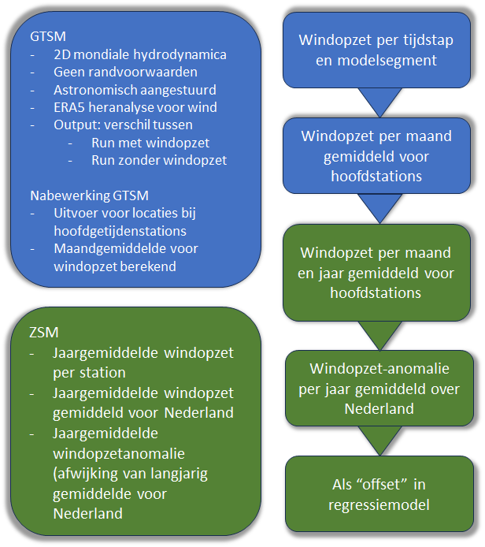
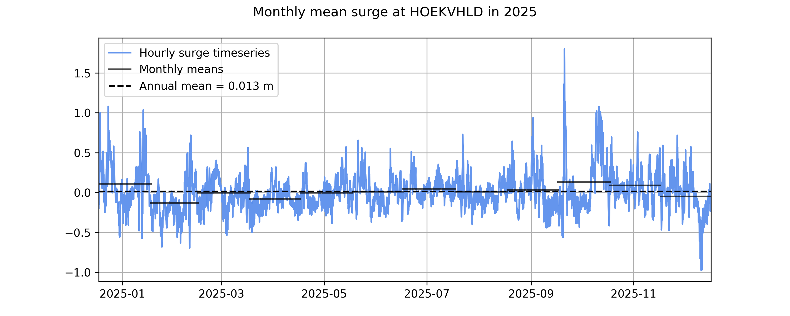
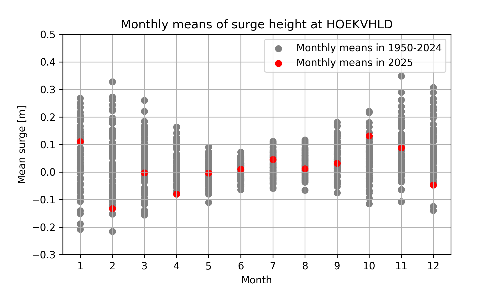
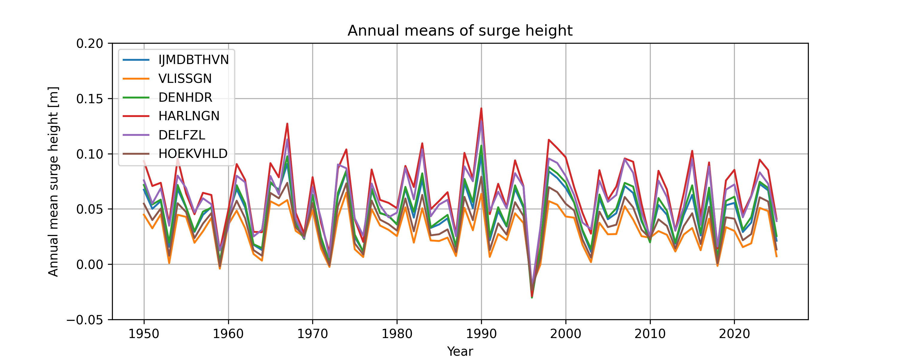
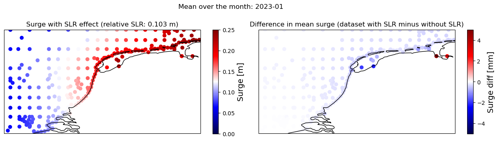

---
acronyms:
  include_unused: false
  insert_loa: false
  loa_title: ""
  fromfile:
  - acronyms.yml
---

# Het gebruik van het Global Tide and Surge Model (GTSM) in de Zeespiegelmonitor en verdere ontwikkeling. {#sec-gtsm-methodiek}

Een van de factoren die de zeespiegel beïnvloeden is de windopzet (storm surge). Om de bijdrage hiervan te kwantificeren, is de gemiddelde jaarlijkse windopzet berekend op basis van de Door Deltares geproduceerde \acr{GTSM} dataset met \acr{ERA5} forcing (van het \acr{ECMWF}). Deze bevat uurlijkse mondiale waterstanden en windopzet tijdreeksen voor de periode vanaf 1950 tot heden. De dataset is berekend met (\acr{GTSM}), een dieptegemiddeld hydrodynamisch model dat getijden, windopzet en hun niet-lineaire interacties in de wereldoceaan simuleert, aangestuurd door de \acr{ERA5} atmosferische heranalyse. De windopzet wordt bepaald als het verschil tussen een gecombineerde windopzet-getijdensimulatie en een simulatie met uitsluitend astronomisch getij en is als afzonderlijke variabele beschikbaar in de dataset. Meer informatie is beschikbaar in de documentatie van de [GTSM-ERA5-dataset](https://doi.org/10.24381/cds.a6d42d60) en in [@Muis2023], [@Aleksandrova2026].

:::{#fig-gtsm-workflow}

{width=80%}

Flowdiagram voor gebruik van GTSM windopzet in de Zeespiegelmonitor.

:::

Modelresultaten voor windopzet uit \acr{GTSM} runs worden geselecteerd per hoofdstation. Deze worden daarna gemiddeld per maand voor elk hoofdstation en opgeslagen voor later gebruik in de Zeespiegelmonitor (zie dit [rekendocument](https://github.com/Deltares-research/sealevelmonitor/blob/develop_reporting26_aleksandrova/analysis/gtsm/get_monthly_means_surge.ipynb)). In de onderstaande figuur zijn, ter illustratie voor Hoek van Holland, de uurlijkse tijdreeks van de windopzet in 2025 en de daaruit afgeleide maand- en jaargemiddelden weergegeven.

:::{#fig-windopzet-tijdreeks}

{width=80%}

Windopzet tijdreeks en maandgemiddelde windopzet voor 2025 voor Hoek van Holland

:::

De maandgemiddelden vertonen interjaarlijkse variaties, maar zijn in het algemeen hoger gedurende het winterseizoen. De onderstaande figuur toont de spreiding van de maandgemiddelden van de windopzet voor Hoek van Holland voor de periode 1950–2025.

:::{#fig-windopzet-maandgemiddelden}

{width=80%}

Maandgemiddelde windopzet voor alle jaren over de periode 1950 - 2025 voor Hoek van Holland.

:::

De gemiddelde jaarlijkse windopzet varieert tussen locaties en individuele meetstations, afhankelijk van de weersomstandigheden in een bepaald jaar en de blootstelling van de getijdestationlocatie aan wind- en storminvloeden. De onderstaande figuur toont de tijdreeks van de jaarlijkse gemiddelde windopzet voor de hoofdstations.

:::{#fig-surge-all-stations}

{width=80%}

Jaargemiddelde windopzet voor 1950-2025 voor alle stations

:::

## Invloed van zeespiegelstijging

De huidige versie van GTSM die gebruikt wordt voor berekening van windopzet voor de Zeespiegelmonitor wordt aangestuurd door een waterpeil inclusief een stijging. De zeespiegelstijging die is toegepast is afgeleid van SLR-projecties in \acr{AR5} van \acr{IPCC}. Deze wijken waarschijnlijk af van de daadwerkelijk waargenomen zeespiegelstijging. De bijdrage van zeespiegelstijging wordt bij de berekening van de windopzet grotendeels opgeheven doordat de windopzet wordt gedefinieerd als het verschil tussen de totale waterstand (getij en windopzet) en een simulatie met uitsluitend getij. Wel kan zeespiegelstijging een geringe indirecte invloed hebben op de berekende windopzet, doordat veranderingen in de waterdiepte de hydrodynamische processen beïnvloeden. Het is daarom belangrijk om te weten of de gebruikte stijging invloed heeft op de berekende windopzet aan de Nederlandse kust. Dit is gecontroleerd door de GTSM-ERA5 modelopstelling voor 2023 te draaien, zodat modelresultaten zowel met als zonder \acr{SLR} (totaal waterpeil en alleen getijdenruns) worden getoond. Deze resultaten zijn vergeleken (zoals te zien in dit [rekendocument](https://github.com/VU-IVM/gtsm3-era5-nrt/blob/main/02_analysis_and_validation/p06_compare_SLR_effect_surge_mean.ipynb). Uit deze resultaten kan worden geconcludeerd:

- SLR in 2023, die in onze modelruns is opgenomen, is \~0.1 m te opzichte van het referentie periode 1986-2005.
- Dit niveau van SLR heeft geen significant effect op de gemiddelde windopzet. Het verschil dat het model veroorzaakt is verwaarloosbaar (minder dan 1 mm).
- Op enkele locaties diep in de Waddenzee is er enig verschil in windopzet tussen de twee runs, maar dit zijn locaties in relatief afgesloten gebieden in ondiep water. Het verschil blijft beperkt tot enkele millimeters.

:::{#fig-windopzet-zss}

{width=80%}

Gemiddelde windopzet op de zeespiegel voor 2023 inclusief zeespiegelstijging zoals gedefinieerd in GTSM (linker figuur) en het verschil in windopzet tussen modelruns met en zonder zeespiegelstijging (rechter figuur).

:::

Hieruit concluderen we dat de windopzet uit \acr{GTSM} inclusief zeespiegelstijging, die we op dit moment gebruiken voor de Zeespiegelmonitor, niet wordt beïnvloed door de gebruikte zeespiegelprojectie.

::: {.content-visible when-format="html"}

## Lijst met gebruikte afkortingen

\printacronyms

:::